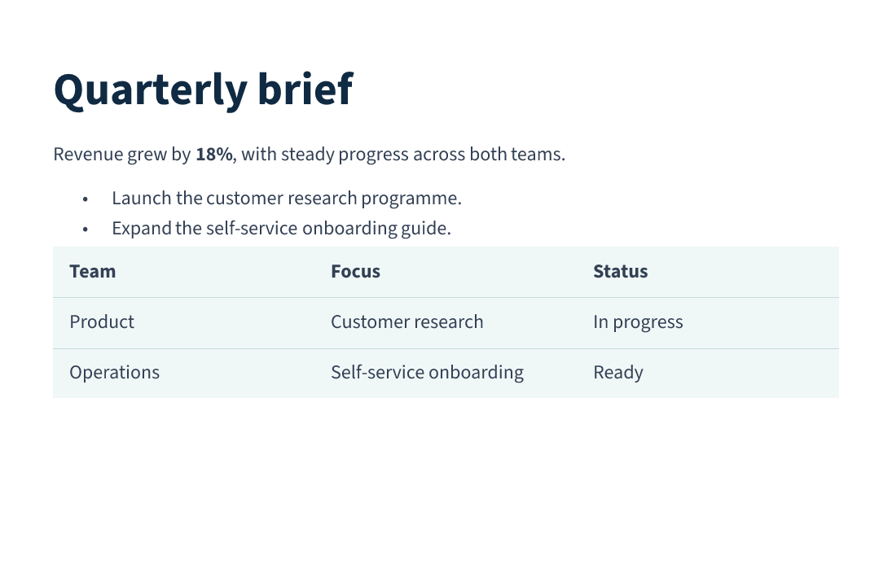
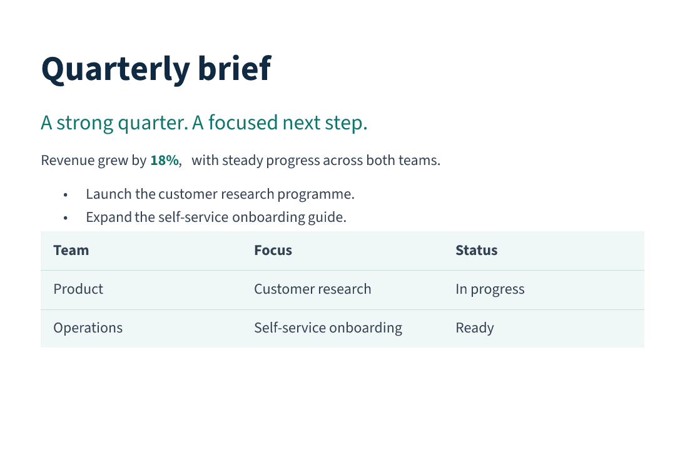
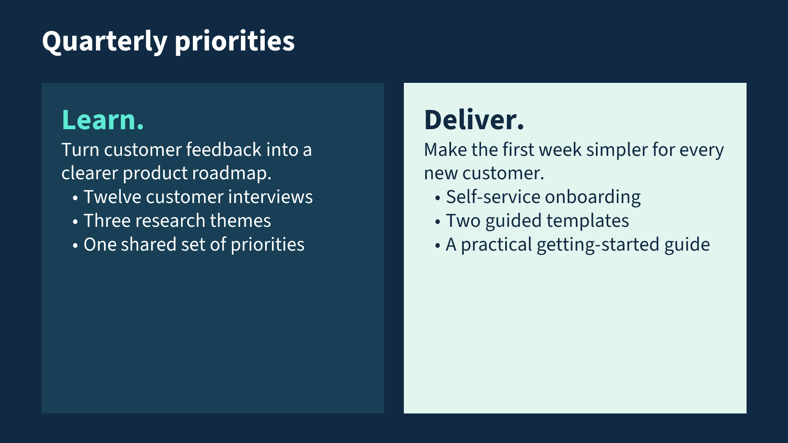
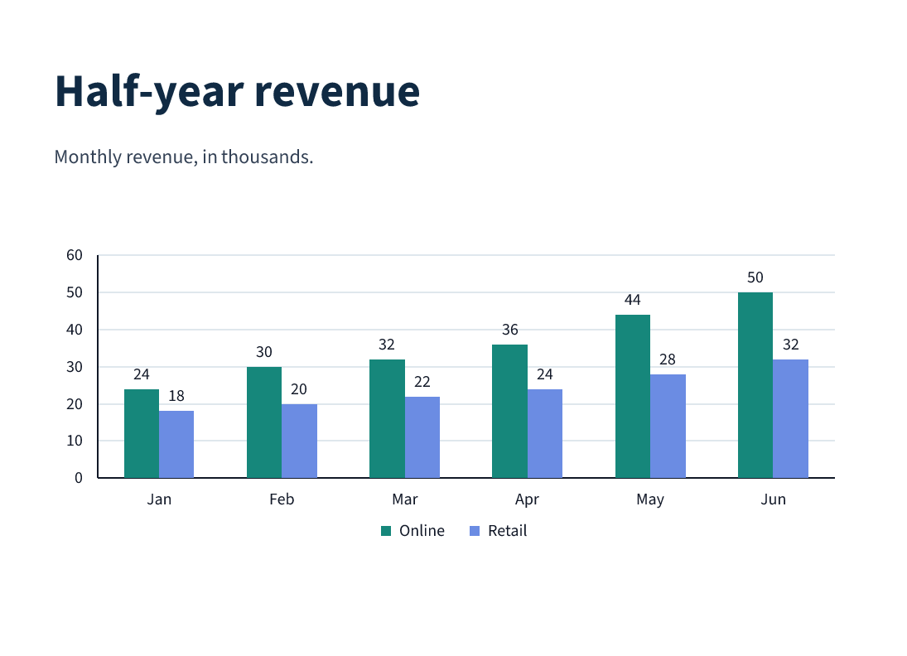
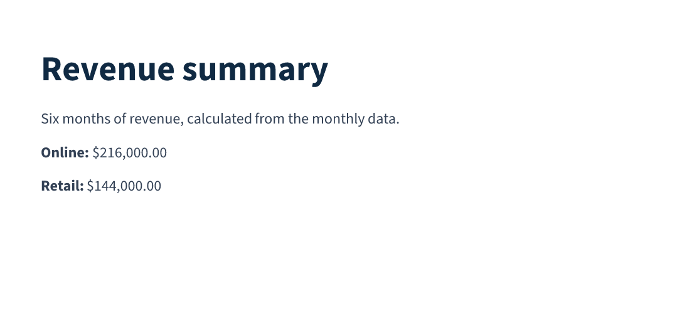

# Mote

**Microsoft Office Typesetting Engine**

**Mote works with pure Markdown.** Turn existing `.md` files into editable Word
documents and PowerPoint presentations, or render them directly to PDF and PNG.
Apply defaults to improve typography and layout while keeping the Markdown
content unchanged. Add directives wherever you need more control.

Written in Rust and inspired by Typst, Mote's goal is to make programmable
document authoring straightforward for people and language models.

## Start with pure Markdown

Headings, emphasis, lists and tables work without any Mote directives:

```markdown
# Quarterly brief

Revenue grew by **18%**, with steady progress across both teams.

- Launch the customer research programme.
- Expand the self-service onboarding guide.

| Team | Focus | Status |
| :--- | :--- | :--- |
| Product | Customer research | In progress |
| Operations | Self-service onboarding | Ready |
```

[Markdown source](examples/readme/plain.md) ·
[Word download](docs/examples/readme/plain.docx) ·
[PowerPoint download](docs/examples/readme/plain.pptx) ·
[Native preview](docs/images/readme/plain-1.png)

The same source produces both editable formats. PowerPoint uses automatic slide
layout; native PDF/PNG can select document or presentation layout.

## Apply defaults without rewriting the content

Keep the Markdown above intact and supply a separate defaults file before it.
Styles set the base typography, while `#set` supplies properties for subsequent
elements, including those created by Markdown. `pt(...)` and `inch(...)` express
lengths. `Normal` is the default paragraph style; `Heading1` styles level-one
headings, and `extends` inherits another style.

```mote
#style "Normal" (run = {font = "Source Sans 3", size = pt(12), color = "#334155"})
#style "Heading1" extends "Normal" (
  run = {size = pt(28), bold = true, color = "#102a43"},
  paragraph = {spacing = {before = pt(0), after = pt(12)}}
)
#set paragraph(spacing = {after = pt(10)})
#set table(
  width = inch(6.7),
  cell = {margin = {vertical = pt(7), horizontal = pt(10)}, fill = "#f0f7f7"},
  borders = {all = {style = "none"}, inside_h = {width = pt(0.5), color = "#c4dcdb"}}
)
```

This excerpt sets typography, paragraph spacing and table appearance. The full
[defaults file](examples/readme/defaults.mote) also declares the font files and a
compact page size. To apply it, concatenate it with the original Markdown at
render time; the original file remains unchanged. No special defaults CLI option
is required.



[Defaults source](examples/readme/defaults.mote) ·
[Unchanged Markdown](examples/readme/plain.md) ·
[Word download](docs/examples/readme/defaults.docx) ·
[PowerPoint download](docs/examples/readme/defaults.pptx)

## Layer in directives where they help

Directives use `#name(arguments)[content]`. Named arguments set properties, and
the bracketed body supplies content. A quoted name applies a named style. Here,
only the introduction needs extra formatting; the heading, list and table remain
Markdown. The source imports the defaults from the previous example.

```mote
#style "Lead" extends "Normal" (run = {size = pt(17), color = "#0f766e"})

# Quarterly brief

#paragraph "Lead"[A strong quarter. A focused next step.]
#paragraph[
  Revenue grew by #span(bold = true, color = "#0f766e")[18%],
  with steady progress across both teams.
]

- Launch the customer research programme.
- Expand the self-service onboarding guide.

| Team | Focus | Status |
| :--- | :--- | :--- |
| Product | Customer research | In progress |
| Operations | Self-service onboarding | Ready |
```



[Complete source](examples/readme/directives.mote) ·
[Word download](docs/examples/readme/directives.docx) ·
[PowerPoint download](docs/examples/readme/directives.pptx)

## Compose a presentation

`presentation` sets the canvas and theme. A `slide` can use a named layout, with
`box(slot = ...)` supplying each named region. This example uses the built-in
`two_column` layout. Boxes can also have explicit positions, and custom layouts
can inherit existing layouts.

```mote
#presentation(
  size = "wide", background = "#102a43",
  theme = {
    fonts = {heading = "Source Sans 3", body = "Source Sans 3"},
    colors = {text = "#ffffff"}
  }
)
#slide(
  layout = "two_column",
  notes = "Review the research and delivery plans with each team."
)[
  #box(slot = "title")[#heading(level = 1)[Quarterly priorities]]
  #box(slot = "left", fill = "#183f55",
       margin = {top = pt(24), right = pt(24), bottom = pt(24), left = pt(24)},
       text = {size = pt(24), color = "#ffffff"})[
    #paragraph[#span(size = pt(36), bold = true, color = "#5eead4")[Learn.]]
    Turn customer feedback into a clearer product roadmap.

    - Twelve customer interviews
    - Three research themes
    - One shared set of priorities
  ]
  #box(slot = "right", fill = "#e3f5ef",
       margin = {top = pt(24), right = pt(24), bottom = pt(24), left = pt(24)},
       text = {size = pt(24), color = "#102a43"})[
    #paragraph[#span(size = pt(36), bold = true)[Deliver.]]
    Make the first week simpler for every new customer.

    - Self-service onboarding
    - Two guided templates
    - A practical getting-started guide
  ]
]
```



[Complete slide source](examples/readme/presentation.mote) ·
[PowerPoint download](docs/examples/readme/presentation.pptx) ·
[Word companion](docs/examples/readme/presentation.docx)

The Word companion presents the same content in document flow, using its
[own source](examples/readme/presentation-document.mote). Positioned slide boxes
belong to presentation layout.

## Build a chart from JSON

`json(...)` loads data relative to the source file, and `let` gives it a name.
This works with ordinary static evaluation. For example,
[revenue.json](examples/readme/revenue.json) contains monthly values in thousands:

```json
{
  "categories": ["Jan", "Feb", "Mar", "Apr", "May", "Jun"],
  "series": [
    {"name": "Online", "values": [24, 30, 32, 36, 44, 50]},
    {"name": "Retail", "values": [18, 20, 22, 24, 28, 32]}
  ]
}
```

Pass that data to a chart alongside its size, colors and labels:

```mote
#let(revenue = json("revenue.json"))

# Half-year revenue

Monthly revenue, in thousands.

#chart(
  kind = "column", data = revenue,
  width = inch(6.7), height = inch(3.1),
  colors = {"#16877b", "#6b8ce3"}, legend = "bottom",
  data_labels = {value = true, position = "outside_end"},
  gridlines = {major = true, color = "#dfe7ed"}
)
```



[Complete chart source](examples/readme/chart.mote) ·
[Word download](docs/examples/readme/chart.docx) ·
[PowerPoint download](docs/examples/readme/chart.pptx)

Both Office downloads contain an editable chart and its embedded workbook.
Supported kinds include column, bar, line, area, pie and doughnut charts, with
stacked variants, axes, legends and data labels.

## Add Lua when you need computation

Lua is optional and enabled explicitly with `--lua`. A `#function ... end`
definition contains Lua statements and returns a value or document content.
Here, a function sums each channel's monthly values and converts thousands to
dollars. Mote's `#for` repeats a paragraph for each channel, while
`format_money(...)` formats the calculated amount.

```mote
#let(revenue = json("revenue.json"))
#function channel_total(values)
  local total = 0
  for index, amount in ipairs(values) do
    total = total + amount
  end
  return total * 1000
end

# Revenue summary

Six months of revenue, calculated from the monthly data.

#for channel in revenue.series {
  #paragraph[#strong[#channel.name:] #format_money(channel_total(channel.values))]
}
```



[Complete source](examples/readme/lua.mote) ·
[Word download](docs/examples/readme/lua.docx) ·
[PowerPoint download](docs/examples/readme/lua.pptx)

## Capabilities at a glance

| Area | Coverage |
| --- | --- |
| Typography | Inline formatting, named styles and inheritance, scoped defaults, declared fonts, lists, links and code. |
| Document layout | Page sizes, margins, sections, equal-width columns, pagination, headers and footers, page numbers, footnotes and endnotes. |
| Tables and media | Merged cells, repeated headers, fills and borders; image sizing, cropping and transforms; figures and captions. |
| Drawings and slides | Editable shapes, connectors and charts; automatic and positioned slide layout, themes, backgrounds, named layouts and speaker notes. |
| Structure and data | References, bookmarks, editable equations, comments, checkboxes and metadata; bindings, conditions, loops, imports, JSON, CSV and opt-in Lua. |

DOCX and PPTX retain editable content. PDF and PNG use Mote's own layout and
painters. JSON output exposes evaluated content for inspection. Support varies
by output format; see the [rendering coverage](docs/rendering-coverage.md).

## Run the examples

With Rust and Cargo installed, build from the repository root:

```sh
cargo build --release
mkdir -p target/readme
target/release/mote --format docx -o target/readme/brief.docx examples/readme/plain.md
target/release/mote --format pptx -o target/readme/brief.pptx examples/readme/plain.md
target/release/mote --lua --format pdf -o target/readme/summary.pdf examples/readme/lua.mote
```

Use `--format png --dpi 144 -o PREFIX` for numbered page images. An explicit
`#presentation(...)` selects slide layout for native PDF/PNG; use
`--layout presentation` for a bare Markdown deck.

[All downloads and previews](docs/examples/readme/README.md) are checked in under
`docs`. The [example guide](examples/readme/README.md) explains the separate
defaults, format-specific presentation setup and regeneration command.

## Status and documentation

Mote is under active development, with support tracked per attribute and output
format. Native mathematical typesetting and complex-script shaping are not yet
implemented; equations use a source-text fallback in PDF/PNG. These previews
are native Mote output. Microsoft Word and PowerPoint visual review remains
pending.

- [Language specification](docs/specification/README.md): syntax and semantics, introduced progressively.
- [Rendering coverage](docs/rendering-coverage.md): behavior and limitations by output format.
- [Directive checklists](docs/checklists/README.md): supported attributes and remaining inventories.
- [Implementation overview](docs/implementation.md): architecture and validation.
- [Format references](docs/reference/README.md): retained OOXML and related specifications.
