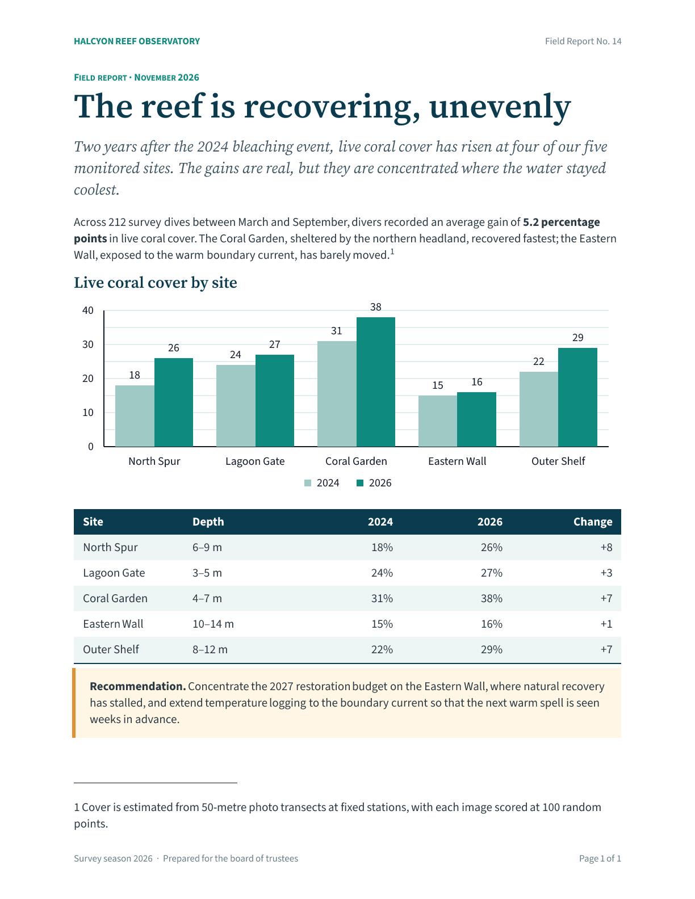
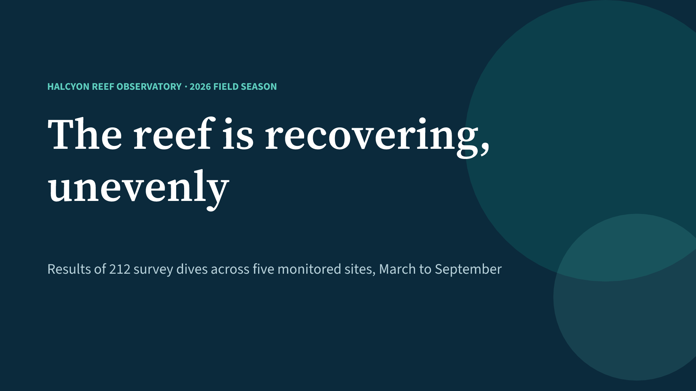
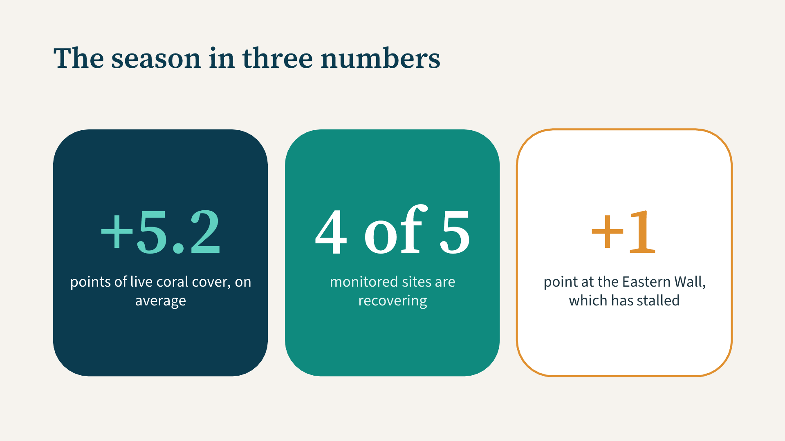
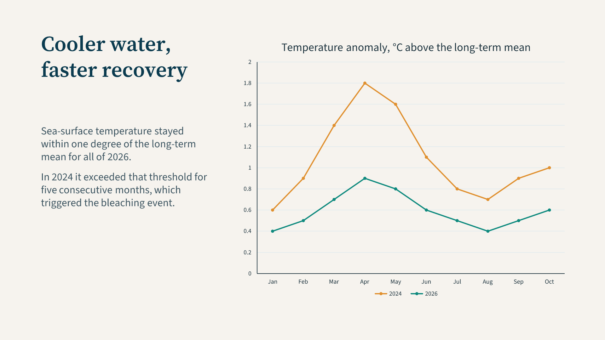
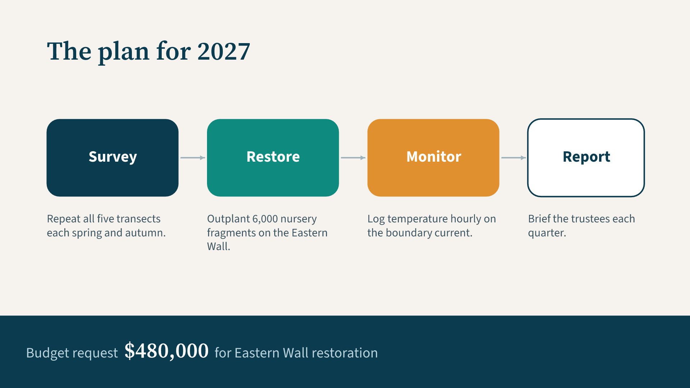
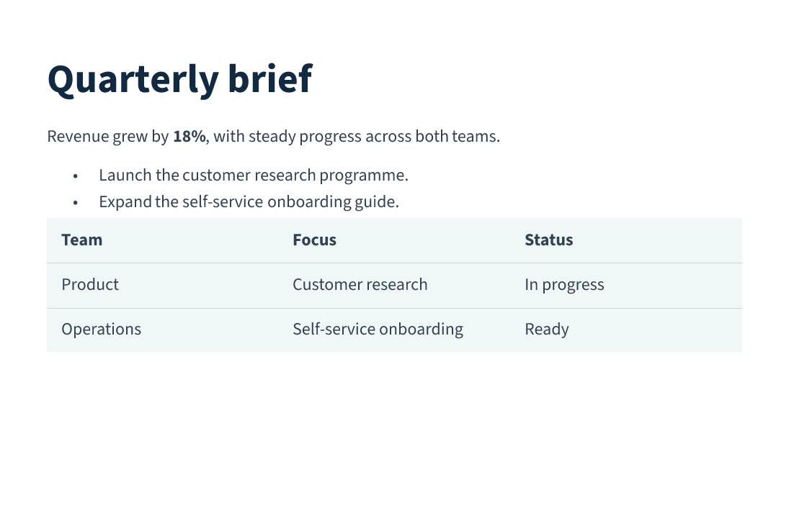
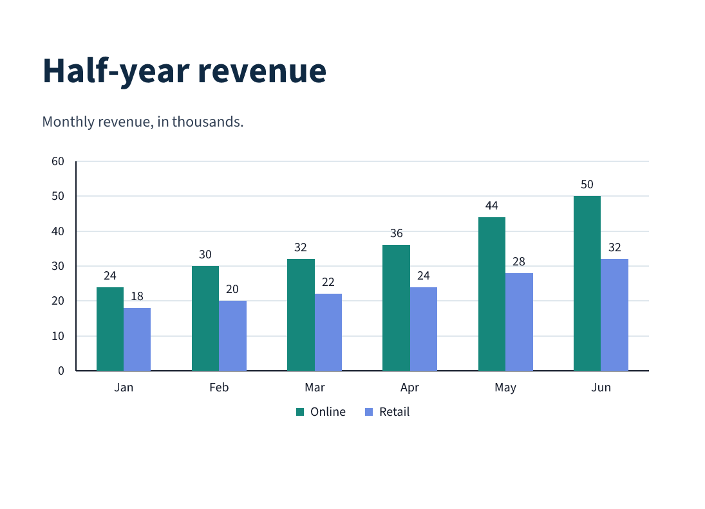

# Mote

**Microsoft Office Typesetting Engine**

Mote turns Markdown, and a small typesetting language built upon it, into
editable Word documents, editable PowerPoint presentations, and native PDF and
PNG pages. A single plain-text source serves every format. The engine is written
in Rust and draws its inspiration from Typst; its purpose is to make the
authoring of office documents tractable for language models and agents, as well
as for people.

## Why Mote

An agent asked for a report or a slide deck has, at present, two unsatisfactory
courses open to it. The first is to drive a general-purpose Office library,
writing a long procedural program whose result the agent cannot see. The second
is to produce a PDF or an image, which appears finished but cannot be edited by
the person who receives it. In either case the agent reviews its work blind, or
only after a round trip through Microsoft Office.

Mote addresses both generation and review.

- **A source that models already write.** The input is ordinary Markdown,
  extended where necessary by directives for styles, page layout, tables,
  slides, charts and equations. A few dozen lines of source take the place of a
  program, and the same lines yield DOCX, PPTX and PDF.
- **Output that remains editable.** The Office packages contain native
  structures rather than pictures of them: named styles, numbered lists, slide
  masters and themes, speaker notes, editable equations, and charts with their
  embedded workbooks. The recipient may continue the work in Word or PowerPoint.
- **Review without Office.** Mote lays out and paints PDF and PNG pages with
  its own engine. An agent may therefore render the pages it has just written,
  examine them, and correct the source within a single loop.
- **Precise feedback.** A diagnostic names its file, line and column. An
  invalid source produces no partial output. A construct that an output format
  cannot represent is reported at its source location rather than silently
  dropped. The JSON output exposes the evaluated document for inspection.
- **Computation under control.** Bindings, loops, imports, JSON and CSV data
  are part of the language. Lua is available for further computation, but only
  when enabled explicitly, and then within a time budget.

The implementation comprises some 41,000 lines of Rust and nearly 500 tests. A
catalogue of 94 rendering cases, 63 for documents and 31 for presentations,
exercises the native output. The language is described in 36 specification
chapters, and the support for each of 64 directives is inventoried against the
OOXML standards.

## Two finished examples

The report and the deck below share a subject, a fictional reef survey, but
neither is a conversion of the other. The Word report is
[88 lines of source](readme/examples/report.mote); the PowerPoint deck is
[121 lines](readme/examples/deck.mote). Both read their figures from the same
[JSON file](readme/examples/survey.json).

**A field report for Word.** A title block, a lead paragraph, a chart built from
JSON, a styled data table, a callout, a footnote, and running headers and footers.



[Report source](readme/examples/report.mote) ·
[Word download](readme/downloads/report.docx) ·
[PDF download](readme/downloads/report.pdf)

**A board deck for PowerPoint.** Four slides with a theme, positioned text,
editable shapes and connectors, a line chart, and speaker notes on every slide.

<p>




</p>

[Deck source](readme/examples/deck.mote) ·
[PowerPoint download](readme/downloads/deck.pptx) ·
[PDF download](readme/downloads/deck.pdf)

The sections that follow introduce the language step by step, from plain
Markdown to these finished pieces.

## Start with pure Markdown

Headings, emphasis, lists and tables require no Mote directives:

```markdown
# Quarterly brief

Revenue grew by **18%**, with steady progress across both teams.

- Launch the customer research programme.
- Expand the self-service onboarding guide.

| Team | Focus | Status |
| :--- | :--- | :--- |
| Product | Customer research | In progress |
| Operations | Self-service onboarding | Ready |
```

[Markdown source](readme/examples/plain.md) ·
[Word download](readme/downloads/plain.docx) ·
[PowerPoint download](readme/downloads/plain.pptx) ·
[Document preview](readme/images/plain-1.png) ·
[Slide preview](readme/images/plain-slides-1.png)

The same source produces both editable formats. The PowerPoint output uses
automatic slide layout; the native PDF and PNG output may use either document
or presentation layout.

## Apply defaults without rewriting the content

The Markdown above stays intact; a separate defaults file precedes it. A style
sets the base typography, and `#set` supplies properties to the elements that
follow, including those created by Markdown. The helpers `pt(...)` and
`inch(...)` express lengths. `Normal` is the default paragraph style, `Heading1`
styles level-one headings, and `extends` inherits from another style.

```mote
#style "Normal" (run = {font = "Source Sans 3", size = pt(12), color = "#334155"})
#style "Heading1" extends "Normal" (
  run = {size = pt(28), bold = true, color = "#102a43"},
  paragraph = {spacing = {before = pt(0), after = pt(12)}}
)
#set paragraph(spacing = {after = pt(10)})
#set table(
  width = inch(6.7),
  cell = {margin = {vertical = pt(7), horizontal = pt(10)}, fill = "#f0f7f7"},
  borders = {all = {style = "none"}, inside_h = {width = pt(0.5), color = "#c4dcdb"}}
)
```

The excerpt sets the typography, paragraph spacing and table appearance. The
full [defaults file](readme/examples/defaults.mote) also declares the font files
and a compact page size. The defaults are applied by concatenating them with the
original Markdown at render time; the original file is left unchanged, and no
special command-line option is required.



[Defaults source](readme/examples/defaults.mote) ·
[Unchanged Markdown](readme/examples/plain.md) ·
[Word download](readme/downloads/defaults.docx)

## Add directives where they help

A directive takes the form `#name(arguments)[content]`. The named arguments set
properties, and the bracketed body supplies content. A quoted name applies a
named style. In the example below only the introduction needs further
formatting; the heading, list and table remain Markdown. The source imports the
defaults from the previous example.

```mote
#style "Lead" extends "Normal" (run = {size = pt(17), color = "#0f766e"})

# Quarterly brief

#paragraph "Lead"[A strong quarter. A focused next step.]
#paragraph[
  Revenue grew by #span(bold = true, color = "#0f766e")[18%],
  with steady progress across both teams.
]

- Launch the customer research programme.
- Expand the self-service onboarding guide.

| Team | Focus | Status |
| :--- | :--- | :--- |
| Product | Customer research | In progress |
| Operations | Self-service onboarding | Ready |
```


[Complete source](readme/examples/directives.mote) ·
[Word download](readme/downloads/directives.docx)

A span repeated with the same attributes is better served by a character style,
declared with `type = "character"` and applied by name. The report above sets
its running header this way:

```mote
#style "Running" (type = "character", run = {size = pt(8.5), color = "#6b7f88"})
#style "Brand" extends "Running" (type = "character", run = {bold = true, color = "#0f8a7e"})

#header[#paragraph(tabs = {right = inch(6.7)})[#span "Brand"[HALCYON REEF OBSERVATORY]#tab()#span "Running"[Field Report No. 14]]]
```

The Word package receives both as native character styles, so a later edit to
the style in Word changes every span that uses it. The right-aligned tab stop
places the report number against the right margin.

## Compose a presentation

The `presentation` directive sets the canvas and the theme. A slide contains
either loose content, which Mote arranges in automatic frames, or positioned
objects: a `box` holds text, a `shape` draws an editable shape that may hold text
of its own, and a `line` draws a connector. Each object takes a `position` on the
slide, and the `notes` argument supplies the speaker notes. The second slide of
the deck above reads as follows, with `flush` bound earlier to a table of zero
margins:

```mote
#presentation(
  size = "wide", background = "#f6f3ee",
  theme = {
    fonts = {heading = "Source Serif 4", body = "Source Sans 3"},
    colors = {text = "#1f3540", accent1 = "#0f8a7e", accent2 = "#e0902f"}
  }
)

#slide(notes = "Three numbers to remember. Pause on the third: one site has not recovered at all.")[
  #box(position = {x = inch(0.9), y = inch(0.7), width = inch(11.5), height = inch(1.1)}, margin = flush,
       text = {font = "Source Serif 4", size = pt(36), bold = true, color = "#0b3b4f"})[
    The season in three numbers
  ]
  #shape(kind = "round_rect", fill = "#0b3b4f",
         position = {x = inch(0.9), y = inch(2.2), width = inch(3.65), height = inch(4.2)})[
    #paragraph[#span(font = "Source Serif 4", size = pt(80), bold = true, color = "#5fd0c0")[+5.2]]
    #paragraph[#span(size = pt(19), color = "#ffffff")[points of live coral cover, on average]]
  ]
  #shape(kind = "round_rect", fill = "#0f8a7e",
         position = {x = inch(4.84), y = inch(2.2), width = inch(3.65), height = inch(4.2)})[
    #paragraph[#span(font = "Source Serif 4", size = pt(80), bold = true, color = "#ffffff")[4 of 5]]
    #paragraph[#span(size = pt(19), color = "#e6f5f3")[monitored sites are recovering]]
  ]
  #shape(kind = "round_rect", fill = "#ffffff", border = {style = "single", color = "#e0902f", width = pt(2.5)},
         position = {x = inch(8.78), y = inch(2.2), width = inch(3.65), height = inch(4.2)})[
    #paragraph[#span(font = "Source Serif 4", size = pt(80), bold = true, color = "#e0902f")[+1]]
    #paragraph[#span(size = pt(19), color = "#1f3540")[point at the Eastern Wall, which has stalled]]
  ]
]
```


A slide may also use a named layout, such as the built-in `two_column`, in which
each `box(slot = ...)` fills one named region; a custom layout may inherit from
an existing one.

[Complete deck source](readme/examples/deck.mote) ·
[PowerPoint download](readme/downloads/deck.pptx)

## Build a chart from JSON

The `json(...)` helper loads data relative to the source file, and `let` gives
the data a name. Static evaluation suffices; no scripting is required. The file
[revenue.json](readme/examples/revenue.json) contains monthly values in
thousands:

```json
{
  "categories": ["Jan", "Feb", "Mar", "Apr", "May", "Jun"],
  "series": [
    {"name": "Online", "values": [24, 30, 32, 36, 44, 50]},
    {"name": "Retail", "values": [18, 20, 22, 24, 28, 32]}
  ]
}
```

The chart receives the data together with its size, colors and labels:

```mote
#let(revenue = json("revenue.json"))

# Half-year revenue

Monthly revenue, in thousands.

#chart(
  kind = "column", data = revenue,
  width = inch(6.7), height = inch(3.1),
  colors = {"#16877b", "#6b8ce3"}, legend = "bottom",
  data_labels = {value = true, position = "outside_end"},
  gridlines = {major = true, color = "#dfe7ed"}
)
```



[Complete chart source](readme/examples/chart.mote) ·
[Word download](readme/downloads/chart.docx)

The Word download contains an editable chart and its embedded workbook. The
supported kinds are column, bar, line, area, pie and doughnut charts, with
stacked variants, axes, legends and data labels.

## Add Lua when computation is needed

Lua is optional and must be enabled with `--lua`. A `#function ... end`
definition contains Lua statements and returns a value or document content. In
the example, a function sums the monthly values of each channel and converts
thousands to dollars. The Mote `#for` loop repeats a paragraph for each channel,
and `format_money(...)` formats the result.

```mote
#let(revenue = json("revenue.json"))
#function channel_total(values)
  local total = 0
  for index, amount in ipairs(values) do
    total = total + amount
  end
  return total * 1000
end

# Revenue summary

Six months of revenue, calculated from the monthly data.

#for channel in revenue.series {
  #paragraph[#strong[#channel.name:] #format_money(channel_total(channel.values))]
}
```


[Complete source](readme/examples/lua.mote) ·
[Word download](readme/downloads/lua.docx)

## Capabilities at a glance

| Area | Coverage |
| --- | --- |
| Typography | Inline formatting, named styles and inheritance, scoped defaults, declared fonts, lists, links and code. |
| Document layout | Page sizes, margins, sections, equal-width columns, pagination, headers and footers, page numbers, footnotes and endnotes. |
| Tables and media | Merged cells, repeated headers, fills and borders; image sizing, cropping and transforms; figures and captions. |
| Drawings and slides | Editable shapes, connectors and charts; automatic and positioned slide layout, themes, backgrounds, named layouts and speaker notes. |
| Structure and data | References, bookmarks, editable equations, comments, checkboxes and metadata; bindings, conditions, loops, imports, JSON, CSV and opt-in Lua. |

The DOCX and PPTX output retains editable content. The PDF and PNG output uses
Mote's own layout and painters. The JSON output exposes the evaluated content
for inspection. The support differs by output format; the
[rendering coverage](docs/rendering-coverage.md) gives the details.

## Run the examples

With Rust and Cargo installed, build from the repository root:

```sh
cargo build --release
mkdir -p target/readme
target/release/mote --format docx -o target/readme/brief.docx readme/examples/plain.md
target/release/mote --format pptx -o target/readme/brief.pptx readme/examples/plain.md
target/release/mote --lua --format pdf -o target/readme/summary.pdf readme/examples/lua.mote
```

The option `--format png --dpi 144 -o PREFIX` writes numbered page images. An
explicit `#presentation(...)` selects slide layout for the native PDF and PNG
output; `--layout presentation` does the same for a bare Markdown deck.

The [downloads and previews](readme/downloads/README.md) are checked in
under `readme/`. The [example guide](readme/examples/README.md) explains the
separate defaults, the format-specific presentation setup and the regeneration
command.

## Review the output

The command `cargo review` renders the whole rendering catalogue without opening
an Office application. Each case yields its source, its editable package, a
native PDF and a PNG for each page; `cargo review --case NAME` refreshes a
single case. The [rendering case guide](tests/cases/README.md) describes the
catalogue and its diagnostics.

The same facilities serve an agent reviewing its own work. A warning or error
appears on standard error as `file:line:column: warning:` or
`file:line:column: error:`, and an error leaves no partial output. The PNG pages
show what the agent has produced, and the JSON output shows how the source was
understood.

A package that renders natively may still be rejected in part by Office: Word
omits a chart whose markup violates its schema without reporting an error. The
command `cargo xtask validate PACKAGE...` therefore checks every
XML part of the editable output, including embedded workbooks, against the
ECMA-376 schemas retained in the repository. All 94 catalogue cases validate.

## Status and documentation

Mote is under active development, and its support is tracked for each attribute
and output format. Native mathematical typesetting and complex-script shaping
are not yet implemented; equations fall back to their source text in PDF and
PNG. The previews above are native Mote output. A visual review in Microsoft
Word and PowerPoint remains outstanding.

- [Language specification](docs/specification/README.md): the syntax and semantics, introduced progressively.
- [Rendering coverage](docs/rendering-coverage.md): the behaviour and limitations of each output format.
- [Directive checklists](docs/checklists/README.md): the supported attributes and the remaining inventories.
- [Implementation overview](docs/implementation.md): the architecture and its validation.
- [Format references](docs/reference/README.md): the retained OOXML and related specifications.
