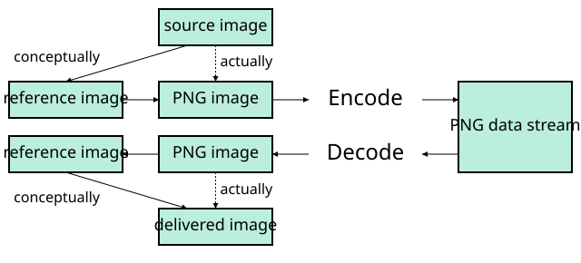
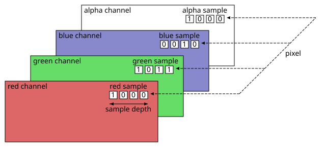

# 4. Concepts

Source: [Portable Network Graphics (PNG) Specification](https://www.w3.org/TR/2025/REC-png-3-20250624/) · 3rd edition, W3C Recommendation 2025-06-24.

[Document index](../README.md) · [Topic guide](../../../../README.md) · [Publisher](https://www.w3.org/TR/2025/REC-png-3-20250624/).

HTML normalized to Markdown. Complex tables and mathematical markup retain HTML; illustrations are stored locally.

[Previous](002-2-scope.md) · [Next](004-4-3-color-spaces.md)

    A decoder calculates the CRC for the received data and checks by comparing it to the CRC calculated by
    the encoder and appended to the data. A mismatch indicates that the data or the CRC were corrupted in transit.

Cathode Ray Tube

CRT
:   vacuum tube containing one or more electron guns, which emit electron beams that are manipulated to display images on a
    phosphorescent screen.

Electro-Optical Transfer Function

EOTF

:   The [transfer function](002-2-scope.md#dfn-transfer-function) between the electrical or digital domain and light energy. It defines the amount of light emitted by a display for a given input signal.

Least Significant Byte

LSB

:   Least significant byte of a multi-[byte](002-2-scope.md#dfn-byte) value.

Most Significant Byte

MSB

:   Most significant byte of a multi-[byte](002-2-scope.md#dfn-byte) value.

Opto-Electrical Transfer Function

OETF

:   The [transfer function](002-2-scope.md#dfn-transfer-function) between light energy and the electrical or digital domain. It defines the amount of light in a scene required to produce a given output signal.

## 4. Concepts

### 4.1 Static and Animated images

All PNG images contain a single static image.

Some PNG images — called Animated PNG (APNG) — also
contain a frame-based animation sequence, the animated image. The first frame of this may be — but need not be —
the [static image](003-4-concepts.md#dfn-static-image). Non-animation-capable displays (such as printers) will display the [static image](003-4-concepts.md#dfn-static-image) rather than
the animation sequence.

The [static image](003-4-concepts.md#dfn-static-image), and each individual frame of an [animated image](003-4-concepts.md#dfn-animated-image), corresponds to a *reference image*
and is stored as a *PNG image*.

### 4.2 Images

This specification specifies the PNG datastream, and places some requirements on PNG encoders, which generate PNG
datastreams, PNG decoders, which interpret PNG datastreams, and [PNG editors](002-2-scope.md#dfn-png-editor), which transform one PNG datastream into
another. It does not specify the interface between an application and either a PNG encoder, decoder, or editor. The precise
form in which an image is presented to an encoder or delivered by a decoder is not specified. Four kinds of image are
distinguished.

Source image
:   The *source image* is the image presented to a PNG encoder.

Reference image

:   The [reference image](003-4-concepts.md#3referenceImage), which only exists conceptually, is a rectangular array of rectangular pixels, all having
    the same width and height, and all containing the same number of unsigned integer samples, either three (red, green, blue)
    or four (red, green, blue, alpha). The array of all samples of a particular kind (red, green, blue, or alpha) is called a
    channel. Each channel has a sample depth in the range 1 to 16, which is the number of bits used by every sample in the
    channel. Different channels may have different sample depths. The red, green, and blue samples determine the intensities of
    the red, green, and blue components of the pixel's color; if they are all zero, the pixel is black, and if they all have
    their maximum values (2sampledepth-1), the pixel is white. The alpha sample determines a pixel's degree of
    opacity, where zero means fully transparent and the maximum value means fully opaque. In a three-channel reference image
    all pixels are fully opaque. (It is also possible for a four-channel reference image to have all pixels fully opaque; the
    difference is that the latter has a specific alpha sample depth, whereas the former does not.) Each horizontal row of
    pixels is called a scanline. Pixels are ordered from left to right within each scanline, and scanlines are ordered from top
    to bottom. Every reference image can be represented exactly by a [PNG datastream](008-4-10-error-handling.md#3PNGdatastream) and every [PNG datastream](008-4-10-error-handling.md#3PNGdatastream) can be converted into a reference image. A PNG encoder may transform the source image directly into a PNG image, but conceptually it first transforms the
    source image into a reference image, then transforms the reference image into a PNG image. Depending on the type of source
    image, the transformation from the source image to a reference image may require the loss of information. That
    transformation is beyond the scope of this International Standard. The reference image, however, can always be recovered
    exactly from a PNG datastream.

PNG image

:   The *PNG image* is obtained from the reference image by a series of transformations: [alpha separation](004-4-3-color-spaces.md#3alphaSeparation),
    [indexing](004-4-3-color-spaces.md#3indexing), [RGB merging](004-4-3-color-spaces.md#3RGBmerging), [alpha compaction](004-4-3-color-spaces.md#3alphaCompaction), and [sample depth scaling](004-4-3-color-spaces.md#3sampleDepthScaling). Five types of PNG image are defined
    (see [6.1 Color types and values](010-5-7-defining-chunks.md#6Colour-values)). (If the PNG encoder actually transforms the source image directly into the PNG image,
    and the source image format is already similar to the PNG image format, the encoder may be able to avoid doing some of
    these transformations.) Although not all sample depths in the range 1 to 16 bits are explicitly supported in the PNG image,
    the number of significant bits in each channel of the reference image may be recorded. All channels in the PNG image have
    the same sample depth. A PNG encoder generates a PNG datastream from the PNG image. A PNG decoder takes the PNG datastream
    and recreates the PNG image.

Delivered image

:   The [delivered image](003-4-concepts.md#3deliveredImage) is constructed from the PNG image obtained by decoding a PNG datastream. No specific format
    is specified for the [delivered image](003-4-concepts.md#3deliveredImage). A viewer presents an image to the user as close to the appearance of the
    original source image as it can achieve.

The relationships between the four kinds of image are illustrated in [Figure 1](003-4-concepts.md#image-relationship "Relationships between source, reference, PNG, and display images").

[Figure 1](003-4-concepts.md#image-relationship) 
Relationships between source, reference, PNG, and display images

The relationships between samples, channels, pixels, and sample depth are illustrated in [Figure 2](003-4-concepts.md#sample-pixel-channel-relationship "Relationships between sample, sample depth, pixel, and channel").

[Figure 2](003-4-concepts.md#sample-pixel-channel-relationship) 
Relationships between sample, sample depth, pixel, and channel

