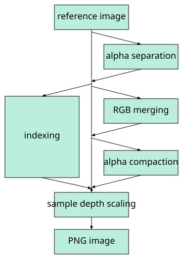
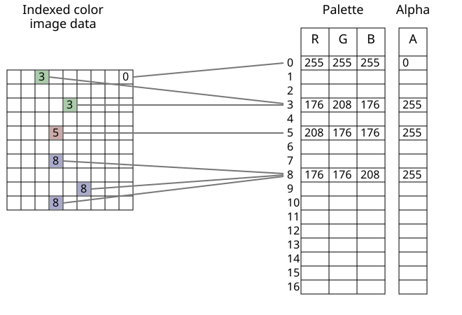
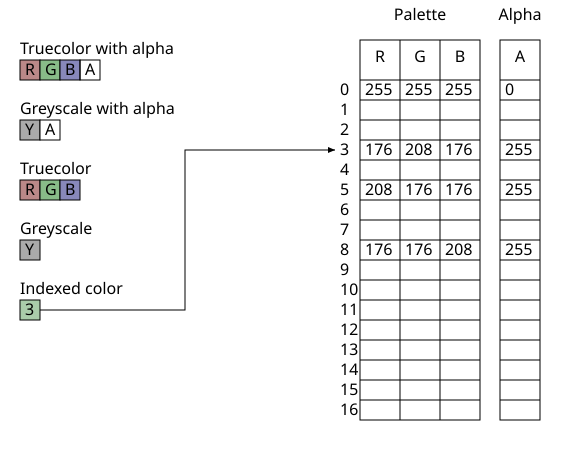

# 4.3 Color spaces

Source: [Portable Network Graphics (PNG) Specification](https://www.w3.org/TR/2025/REC-png-3-20250624/) · 3rd edition, W3C Recommendation 2025-06-24.

[Document index](../README.md) · [Topic guide](../../../../README.md) · [Publisher](https://www.w3.org/TR/2025/REC-png-3-20250624/).

HTML normalized to Markdown. Complex tables and mathematical markup retain HTML; illustrations are stored locally.

[Previous](003-4-concepts.md) · [Next](005-4-5-png-image.md)

<a id="4Concepts.ColourSpaces"></a>

<a id="x4-3-color-spaces"></a>

### 4.3 Color spaces

The RGB color space in which color samples are situated may be specified in one of four ways:

1. by CICP image format signaling metadata;
2. by an ICC profile;
3. by specifying explicitly that the color space is sRGB when the samples conform to this color space;

<a id="ref-for-dfn-gamma-value-1"></a>

<a id="ref-for-dfn-white-point-1"></a>

4. by specifying a [gamma value](002-2-scope.md#dfn-gamma-value) and the 1931 CIE *x,y* chromaticities of the red, green, and blue primaries
   used in the image and the reference [white point](002-2-scope.md#dfn-white-point).

<a id="ref-for-dfn-gamma-2"></a>

For high-end applications the first two methods provides the most flexibility and control. The third method enables one
particular, but extremely common, color space to be indicated. The fourth method, which was standardized before ICC profiles
were widely adopted, enables the exact chromaticities of the RGB data to be specified, along with the [gamma](002-2-scope.md#dfn-gamma) correction
to be applied (see [C. Gamma and chromaticity](035-c-gamma-and-chromaticity.md#C-GammaAppendix)). However, color-aware applications will prefer one of the first three
methods, while color-unaware applications will typically ignore all four methods.

[Table 1](004-4-3-color-spaces.md#color-chunk-precendence "Color Chunk Priority") is a list of chunk types that provide color space information,
each with an associated Priority number. If a single image contains more than one of these chunk types,
the chunk with the lowest Priority number should take precedence and any higher-numbered chunk types should be ignored.

<a id="color-chunk-precendence"></a>

[Table 1](004-4-3-color-spaces.md#color-chunk-precendence) 
Color Chunk Priority

| Chunk Type | Priority |
| --- | --- |
| [cICP](016-11-3-2-5-srgb-standard-rgb-color-space.md#cICP-chunk) | 1 |
| [iCCP](015-11-3-ancillary-chunks.md#11iCCP) | 2 |
| [sRGB](016-11-3-2-5-srgb-standard-rgb-color-space.md#11sRGB) | 3 |
| [cHRM](015-11-3-ancillary-chunks.md#11cHRM) and [gAMA](015-11-3-ancillary-chunks.md#11gAMA) | 4 |

<a id="ref-for-dfn-gamma-3"></a>

[Gamma](002-2-scope.md#dfn-gamma) correction is not applied to the alpha channel, if present. Alpha samples are always full-range and represent
a linear fraction of full opacity.

Mastering metadata may also be provided.

<a id="4Concepts.PNGImageTransformation"></a>

<a id="x4-4-reference-image-to-png-image-transformation"></a>

### 4.4 Reference image to PNG image transformation

<a id="4Concepts.Introduction"></a>

<a id="introduction-1"></a>

### Introduction

A number of transformations are applied to the reference image to create the PNG image to be encoded (see [Figure 3](004-4-3-color-spaces.md#reference-to-png-transformation "Reference image to PNG image transformation")). The transformations are applied in the following sequence, where square brackets
mean the transformation is optional:


```
[alpha separation]
indexing or ( [RGB merging] [alpha compaction] )
sample depth scaling
```


<a id="ref-for-3alphaSeparation-2"></a>

<a id="ref-for-3alphaCompaction-2"></a>

<a id="ref-for-3indexing-2"></a>

When every pixel is either fully transparent or fully opaque, the [alpha separation](004-4-3-color-spaces.md#3alphaSeparation), [alpha compaction](004-4-3-color-spaces.md#3alphaCompaction), and
[indexing](004-4-3-color-spaces.md#3indexing) transformations can cause the recovered reference image to have an alpha sample depth different from the
original reference image, or to have no alpha channel. This has no effect on the degree of opacity of any pixel. The two
reference images are considered equivalent, and the transformations are considered lossless. Encoders that nevertheless
wish to preserve the alpha sample depth may elect not to perform transformations that would alter the alpha sample
depth.

<a id="reference-to-png-transformation"></a>

<a id="figure43"></a>




[Figure 3](004-4-3-color-spaces.md#reference-to-png-transformation) 
Reference image to PNG image transformation

<a id="4Concepts.Implied-alpha"></a>

<a id="x4-4-1-alpha-separation"></a>

<a id="3alphaSeparation"></a>

#### 4.4.1  Alpha separation

If all alpha samples in a reference image have the maximum value, then the alpha channel may be omitted, resulting in an
equivalent image that can be encoded more compactly.

<a id="4Concepts.Indexing"></a>

<a id="x4-4-2-indexing"></a>

#### 4.4.2 Indexing

<a id="ref-for-3indexedColour-3"></a>

<a id="3indexing"></a>

<a id="3indexedColour"></a>

<a id="3palette"></a>

<a id="3alphaTable"></a>

If the number of distinct pixel values is 256 or less, and the RGB sample depths are not greater than 8, and the alpha
channel is absent or exactly 8 bits deep or every pixel is either fully transparent or fully opaque, then the alternative
[indexed-color](004-4-3-color-spaces.md#3indexedColour) representation, achieved through an indexing transformation, may be more efficient for encoding.
In the indexed-color representation, each pixel is replaced by an index into a palette. The palette
is a list of entries each containing three 8-bit samples (red, green, blue). If an alpha channel is present, there is also
a parallel table of 8-bit alpha samples, called the alpha table.

<a id="indexed-colour-image"></a>

<a id="figure44"></a>




[Figure 4](004-4-3-color-spaces.md#indexed-colour-image) 
Indexed-color image


<a id="ref-for-3indexedColour-4"></a>

A suggested palette or palettes may be constructed even when the PNG image is not [indexed-color](004-4-3-color-spaces.md#3indexedColour) in order to assist
viewers that are capable of displaying only a limited number of colors.

<a id="ref-for-3indexedColour-5"></a>

For [indexed-color](004-4-3-color-spaces.md#3indexedColour) images, encoders can rearrange the palette so that the table entries with the maximum alpha value are
grouped at the end. In this case the table can be encoded in a shortened form that does not include these entries.

Encoders creating indexed-color PNG must not insert index values greater than the actual length of the palette table; to
do so is an error, and decoders will vary in their handling of this error.

<a id="4Concepts.RGBMerging"></a>

<a id="x4-4-3-rgb-merging"></a>

<a id="3RGBmerging"></a>

#### 4.4.3  RGB merging

If the red, green, and blue channels have the same sample depth, and, for each pixel, the values of the red, green, and
blue samples are equal, then these three channels may be merged into a single greyscale channel.

<a id="4Concepts.Alpha-indexing"></a>

<a id="x4-4-4-alpha-compaction"></a>

<a id="3alphaCompaction"></a>

#### 4.4.4  Alpha compaction

For non-indexed images, if there exists an RGB (or greyscale) value such that all pixels with that value are fully
transparent while all other pixels are fully opaque, then the alpha channel can be represented more compactly by merely
identifying the RGB (or greyscale) value that is transparent.

<a id="4Concepts.Scaling"></a>

<a id="x4-4-5-sample-depth-scaling"></a>

<a id="3sampleDepthScaling"></a>

#### 4.4.5  Sample depth scaling

In the PNG image, not all sample depths are supported (see [6.1 Color types and values](010-5-7-defining-chunks.md#6Colour-values)), and all channels shall have
the same sample depth. All channels of the PNG image use the smallest allowable sample depth that is not less than any
sample depth in the reference image, and the possible sample values in the reference image are linearly mapped into the
next allowable range for the PNG image. [Figure 5](004-4-3-color-spaces.md#scaling-sample-values "Scaling sample values") shows how samples of depth 3 might be mapped
into samples of depth 4.

<a id="scaling-sample-values"></a>

<a id="figure45"></a>


[Figure 5](004-4-3-color-spaces.md#scaling-sample-values) 
Scaling sample values


<a id="ref-for-3sampleDepthScaling-2"></a>

Allowing only a few sample depths reduces the number of cases that decoders have to cope with. [Sample depth
scaling](004-4-3-color-spaces.md#3sampleDepthScaling) is reversible with no loss of data, because the reference image sample depths can be recorded in the PNG
datastream. In the absence of recorded sample depths, the reference image sample depth equals the PNG image sample depth.
See [12.4 Sample depth scaling](023-12-3-alpha-channel-creation.md#12Sample-depth-scaling) and [13.12 Sample depth rescaling](028-13-10-interlacing-and-progressive-display.md#13Sample-depth-rescaling).

<a id="possible-pixel-types"></a>

<a id="figure46"></a>




[Figure 6](004-4-3-color-spaces.md#possible-pixel-types) 
Possible PNG image pixel types

