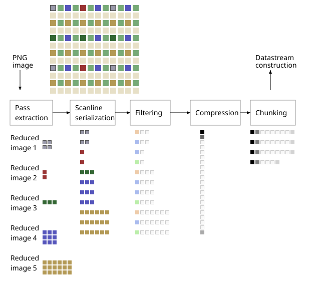
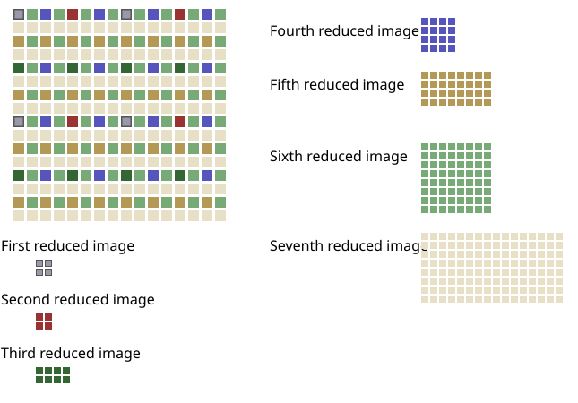
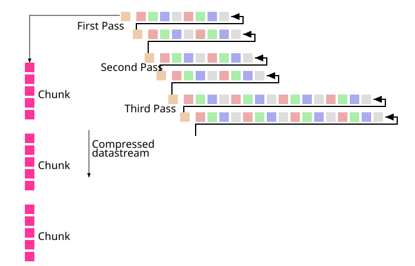

# 4.5 PNG image

Source: [Portable Network Graphics (PNG) Specification](https://www.w3.org/TR/2025/REC-png-3-20250624/) · 3rd edition, W3C Recommendation 2025-06-24.

[Document index](../README.md) · [Topic guide](../../../../README.md) · [Publisher](https://www.w3.org/TR/2025/REC-png-3-20250624/).

HTML normalized to Markdown. Complex tables and mathematical markup retain HTML; illustrations are stored locally.

[Previous](004-4-3-color-spaces.md) · [Next](006-4-7-additional-information.md)

### 4.5 PNG image

The transformation of the reference image results in one of five types of PNG image (see [Figure 6](004-4-3-color-spaces.md#possible-pixel-types "Possible PNG image pixel types")) :

Truecolor with alpha

:   Each [pixel](003-4-concepts.md#3pixel) consists of four [samples](002-2-scope.md#dfn-sample): red, green, blue and [alpha](003-4-concepts.md#3alpha).

Greyscale with alpha

:   Each [pixel](003-4-concepts.md#3pixel) consists of two [samples](002-2-scope.md#dfn-sample): a [grey sample](005-4-5-png-image.md#3greyscale) and an [alpha](003-4-concepts.md#3alpha) sample.

Truecolor

:   Each [pixel](003-4-concepts.md#3pixel) consists of a triplet of [samples](002-2-scope.md#dfn-sample): red, green, blue. An optional alpha channel can be specified
    as a single triplet of red, green, blue [samples](002-2-scope.md#dfn-sample): [pixels](003-4-concepts.md#3pixel) of the image whose red, green, blue [samples](002-2-scope.md#dfn-sample)
    are identical to the red, green, blue [samples](002-2-scope.md#dfn-sample) of the alpha channel are fully transparent; others are fully opaque. If
    the alpha channel is not present, all [pixels](003-4-concepts.md#3pixel) are fully opaque.

Greyscale

:   Each pixel consists of a single grey sample, which represents overall
    [luminance](002-2-scope.md#dfn-luminance) (on a scale from black to white). An optional alpha channel can be specified as a single [grey
    sample](005-4-5-png-image.md#3greyscale): [pixels](003-4-concepts.md#3pixel) of the image whose [grey sample](005-4-5-png-image.md#3greyscale) is identical to the [grey sample](005-4-5-png-image.md#3greyscale) of the alpha channel
    are fully transparent; others are fully opaque. If the alpha channel is not present, all [pixels](003-4-concepts.md#3pixel) are fully
    opaque.

[Indexed-color](004-4-3-color-spaces.md#3indexedColour)
:   Each pixel consists of an index into a palette (and into an associated table of alpha values, if present).

The format of each pixel depends on the PNG image type and the bit depth. For PNG image types other than indexed-color,
the bit depth specifies the number of bits per sample, not the total number of bits per pixel. For [indexed-color](004-4-3-color-spaces.md#3indexedColour) images, the
bit depth specifies the number of bits in each palette index, not the sample depth of the colors in the palette or alpha
table. Within the pixel the samples appear in the following order, depending on the PNG image type.

1. [Truecolor with alpha](005-4-5-png-image.md#dfn-truecolor-with-alpha): red, green, blue, alpha.

2. [Greyscale with alpha](005-4-5-png-image.md#dfn-greyscale-with-alpha): grey, alpha.

3. [Truecolor](005-4-5-png-image.md#3truecolour): red, green, blue.

4. [Greyscale](005-4-5-png-image.md#dfn-greyscale): grey.

5. [Indexed-color](004-4-3-color-spaces.md#3indexedColour): palette index.

### 4.6 Encoding the PNG image

### Introduction

A conceptual model of the process of encoding a PNG image is given in [Figure 7](005-4-5-png-image.md#encoding-png-image "Encoding the PNG image"). The steps
refer to the operations on the array of pixels or indices in the PNG image. The [palette](004-4-3-color-spaces.md#3palette) and [alpha table](004-4-3-color-spaces.md#3alphaTable) are not encoded in
this way.

1. Pass extraction: to allow for progressive display, the PNG image pixels can be rearranged to form several smaller
   images called reduced images or passes.
2. Scanline serialization: the image is serialized a scanline at a time. Pixels are ordered left to right in a scanline
   and scanlines are ordered top to bottom.
3. Filtering: each scanline is transformed into a filtered scanline using one of the defined filter types to prepare the
   scanline for image compression.
4. Compression: occurs on all the filtered scanlines in the image.
5. Chunking: the compressed image is divided into conveniently sized chunks. An error detection code is added to each
   chunk.
6. Datastream construction: the chunks are inserted into the datastream.

#### 4.6.1 Pass extraction

Pass extraction (see [Figure 7](005-4-5-png-image.md#encoding-png-image "Encoding the PNG image")) splits a PNG image into a sequence of reduced images where the
first image defines a coarse view and subsequent images enhance this coarse view until the last image completes the PNG
image. The set of reduced images is also called an interlaced PNG image. Two interlace methods are defined in this
specification. The first method is a null method; pixels are stored sequentially from left to right and scanlines from top
to bottom. The second method makes multiple scans over the image to produce a sequence of seven reduced images. The seven
passes for a sample image are illustrated in [Figure 7](005-4-5-png-image.md#encoding-png-image "Encoding the PNG image"). See [8. Interlacing and pass extraction](012-7-3-filtering.md#8Interlace).

[Figure 7](005-4-5-png-image.md#encoding-png-image) 
Encoding the PNG image

[Figure 8](005-4-5-png-image.md#pass-extraction) 
Pass extraction

#### 4.6.2 Scanline serialization

Each row of pixels, called a scanline, is represented as a sequence of bytes.

#### 4.6.3 Filtering

PNG allows [image data](002-2-scope.md#dfn-image-data) to be filtered before it is compressed. Filtering can improve the compressibility of the
data. The filter operation is deterministic, reversible, and lossless. This allows the decompressed data to be
reverse-filtered in order to obtain the original data. See [7.3 Filtering](012-7-3-filtering.md#7Filtering).

#### 4.6.4 Compression

The sequence of filtered scanlines in the pass or passes of the PNG image is compressed (see [Figure 9](005-4-5-png-image.md#compression "Compression and chunking")) by one of the defined compression methods. The concatenated filtered scanlines form the input to the
compression stage. The output from the compression stage is a single compressed datastream. See [10. Compression](013-9-3-filter-type-3-average.md#10Compression).

#### 4.6.5 Chunking

Chunking provides a convenient breakdown of the compressed datastream into manageable chunks (see [Figure 9](005-4-5-png-image.md#compression "Compression and chunking")). Each chunk has its own redundancy check. See [11. Chunk specifications](014-10-3-other-uses-of-compression.md#11Chunks).

[Figure 9](005-4-5-png-image.md#compression) 
Compression and chunking

