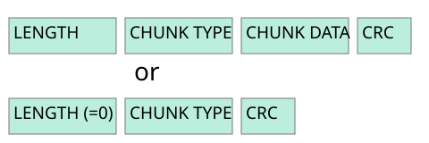

# 4.10 Error handling

Source: [Portable Network Graphics (PNG) Specification](https://www.w3.org/TR/2025/REC-png-3-20250624/) · 3rd edition, W3C Recommendation 2025-06-24.

[Document index](../README.md) · [Topic guide](../../../../README.md) · [Publisher](https://www.w3.org/TR/2025/REC-png-3-20250624/).

HTML normalized to Markdown. Complex tables and mathematical markup retain HTML; illustrations are stored locally.

[Previous](007-4-9-apng-frame-based-animation.md) · [Next](009-5-5-crc-algorithm.md)

<a id="4Concepts.Errors"></a>

<a id="x4-10-error-handling"></a>

### 4.10 Error handling

Errors in a PNG datastream fall into two general classes:

1. transmission errors or damage to a computer file system, which tend to corrupt much or all of the datastream;
2. syntax errors, which appear as invalid values in chunks, or as missing or misplaced chunks. Syntax errors can be caused
   not only by encoding mistakes, but also by the use of registered or private values, if those values are unknown to the
   decoder.

PNG decoders should detect errors as early as possible, recover from errors whenever possible, and fail gracefully
otherwise. The error handling philosophy is described in detail in [13.1 Error handling](025-13-1-error-handling.md#13Decoders.Errors).

<a id="4Concepts.Registration"></a>

<a id="x4-11-extensions"></a>

### 4.11 Extensions

*This section is non-normative.*

The PNG format exposes several extension points:

- [chunk type](010-5-7-defining-chunks.md#sec-defining-new-chunks);
- [text keyword](018-11-3-2-8-clli-content-light-level-information.md#11tEXt); and

<a id="ref-for-dfn-private-field-values-1"></a>

- [private field values](010-5-7-defining-chunks.md#dfn-private-field-values).

Some of these extension points are reserved by W3C, while others are available for private use.

<a id="5DataRep"></a>

<a id="x5-datastream-structure"></a>

## 5. Datastream structure

<a id="5Introduction"></a>

<a id="x5-1-png-datastream"></a>

### 5.1 PNG datastream

<a id="3PNGdatastream"></a>

<a id="ref-for-3PNGimage-2"></a>

The PNG datastream consists of a PNG signature followed by a sequence of chunks. It
is the result of encoding a [PNG image](003-4-concepts.md#3PNGimage).

<a id="issue-container-generatedID-8"></a>

<a id="h-note-8"></a>

Note

The term datastream is used rather than "file" to describe a byte sequence that may be only a portion of a
file. It is also used to emphasize that the sequence of bytes might be generated and consumed "on the fly", never appearing in
a stored file at all.

<a id="5PNG-file-signature"></a>

<a id="3PNGsignature"></a>

### 5.2 PNG signature

The first eight bytes of a PNG datastream always contain the following hexadecimal values:


```

89 50 4E 47 0D 0A 1A 0A
```


This signature indicates that the remainder of the datastream contains a single PNG image, consisting of a series of
chunks beginning with an [IHDR](014-10-3-other-uses-of-compression.md#11IHDR) chunk and ending with an [IEND](014-10-3-other-uses-of-compression.md#11IEND) chunk.

<a id="ref-for-dfn-datastream-1"></a>

This signature differentiates a PNG datastream from other types of [datastream](002-2-scope.md#dfn-datastream) and allows early detection of some
transmission errors.

<a id="5Chunk-layout"></a>

<a id="x5-3-chunk-layout"></a>

### 5.3 Chunk layout

<a id="3chunk"></a>

Each chunk consists of three or four fields (see [Figure 10](008-4-10-error-handling.md#figure411 "Chunk parts")). The meaning of the fields is described in
[Table 5](008-4-10-error-handling.md#table51 "Chunk fields"). The chunk data field may be empty.

<a id="figure411"></a>




[Figure 10](008-4-10-error-handling.md#figure411) 
Chunk parts


<a id="table51"></a>

<a id="ref-for-dfn-png-four-byte-unsigned-integer-1"></a>

<a id="zero-length-data"></a>

<table class="numbered simple" id="table51">
<caption><a class="self-link" href="008-4-10-error-handling.md#table51">Table <bdi class="tableno">5</bdi></a> <span class="table-title">
          Chunk fields
        </span></caption>
<tbody><tr>
<th>Name</th>
<th>Description</th>
</tr>
<tr>
<td>Length</td>
<td>
            A <a class="internalDFN" data-link-type="dfn" href="002-2-scope.md#dfn-png-four-byte-unsigned-integer" id="ref-for-dfn-png-four-byte-unsigned-integer-1">PNG four-byte unsigned integer</a> giving the number of bytes in the chunk's data field. The length counts
            <strong>only</strong> the data field, <strong>not</strong> itself, the chunk type, or the <abbr title="Cyclic Redundancy Code">CRC</abbr>. Zero is a valid
            length. Although encoders and decoders should treat the length as unsigned, its value shall not exceed 2<sup>31</sup>-1
            bytes.
          </td>
</tr>
<tr>
<td>Chunk Type</td>
<td>
            A sequence of four bytes defining the chunk type. Each byte of a chunk type is restricted to the hexadecimal values 41
            to 5A and 61 to 7A. These correspond to the uppercase and lowercase ISO 646 [<cite><a class="bibref" data-link-type="biblio" href="044-g-references.md#bib-iso646" title="Information technology — ISO 7-bit coded character set for information interchange">ISO646</a></cite>] letters
            (<code>A</code>-<code>Z</code> and <code>a</code>-<code>z</code>) respectively for convenience in description and
            examination of PNG datastreams. Encoders and decoders shall treat the chunk types as fixed binary values, not character
            strings. For example, it would not be correct to represent the chunk type <a class="chunk" href="014-10-3-other-uses-of-compression.md#11IDAT">IDAT</a> by
            the equivalents of those letters in the UCS 2 character set. Additional naming conventions for chunk types are
            discussed in <a class="sec-ref" href="008-4-10-error-handling.md#5Chunk-naming-conventions"><bdi class="secno">5.4 </bdi>Chunk naming conventions</a>.
          </td>
</tr>
<tr>
<td>Chunk Data</td>
<td>The data bytes appropriate to the chunk type, if any.
            <span id="zero-length-data">This field can be of zero length.</span></td>
</tr>
<tr>
<td><abbr title="Cyclic Redundancy Code">CRC</abbr></td>
<td>
            A four-byte <abbr title="Cyclic Redundancy Code">CRC</abbr> calculated on the preceding bytes in the chunk, including the chunk type field and chunk data
            fields, but <strong>not</strong> including the length field. The <abbr title="Cyclic Redundancy Code">CRC</abbr> can be used to check for corruption of the
            data. The <abbr title="Cyclic Redundancy Code">CRC</abbr> is always present, even for chunks containing no data. See <a class="sec-ref" href="009-5-5-crc-algorithm.md#5CRC-algorithm"><bdi class="secno">5.5 </bdi><abbr title="Cyclic Redundancy Code">CRC</abbr> algorithm</a>.
          </td>
</tr>
</tbody></table>

The chunk data length may be any number of bytes up to the maximum; therefore, implementors cannot assume that chunks are
aligned on any boundaries larger than bytes.

<a id="5Chunk-naming-conventions"></a>

<a id="x5-4-chunk-naming-conventions"></a>

### 5.4 Chunk naming conventions

Chunk types are chosen to be meaningful names when the bytes of the chunk type are interpreted as ISO 646 letters
[[ISO646](044-g-references.md#bib-iso646 "Information technology — ISO 7-bit coded character set for information interchange")]. Chunk types are assigned so that a decoder can determine some properties of a chunk even when the type is not
recognized. These rules allow safe, flexible extension of the PNG format, by allowing a PNG decoder to decide what to do when
it encounters an unknown chunk.

The naming rules are normally of interest only when the decoder does not recognize the chunk's type, as specified at
[13. PNG decoders and viewers](024-12-6-interlacing.md#13Decoders).

Four bits of the chunk type, the property bits, namely bit 5 (value 32) of each byte, are used to convey chunk properties.
This choice means that a human can read off the assigned properties according to whether the letter corresponding to each
byte of the chunk type is uppercase (bit 5 is 0) or lowercase (bit 5 is 1).

The property bits are an inherent part of the chunk type, and hence are fixed for any chunk type. Thus, CHNK and cHNk would be unrelated chunk types, not the same chunk with different
properties.

The semantics of the property bits are defined in [Table 6](008-4-10-error-handling.md#table52 "Semantics of property bits").

<a id="table52"></a>

<a id="ref-for-dfn-png-editor-2"></a>

<a id="ref-for-dfn-png-editor-3"></a>

[Table 6](008-4-10-error-handling.md#table52) 
Semantics of property bits

| Name & location | Definition | Description |
| --- | --- | --- |
| Ancillary bit: first byte | 0 (uppercase) = critical,  1 (lowercase) = ancillary. | Critical chunks are necessary for successful display of the contents of the datastream, for example the image header chunk ([IHDR](014-10-3-other-uses-of-compression.md#11IHDR)). A decoder trying to extract the image, upon encountering an unknown chunk type in which the ancillary bit is 0, shall indicate to the user that the image contains information it cannot safely interpret.  Ancillary chunks are not strictly necessary in order to meaningfully display the contents of the datastream, for example the time chunk ( [tIME](020-11-3-4-5-exif-exchangeable-image-file-exif-profile.md#11tIME)). A decoder encountering an unknown chunk type in which the ancillary bit is 1 can safely ignore the chunk and proceed to display the image. |
| Private bit: second byte | 0 (uppercase) = public,  1 (lowercase) = private. | Public chunks are reserved for definition by the W3C. The definition of private chunks is specified at [12.10.1 Use of private chunks](024-12-6-interlacing.md#12Use-of-private-chunks). The names of private chunks have a lowercase second letter, while the names of public chunks have uppercase second letters. |
| Reserved bit: third byte | 0 (uppercase) in this version of PNG.  If the reserved bit is 1, the datastream does not conform to this version of PNG. | The significance of the case of the third letter of the chunk name is reserved for possible future extension. In this International Standard, all chunk names shall have uppercase third letters. |
| Safe-to-copy bit: fourth byte | 0 (uppercase) = unsafe to copy,  1 (lowercase) = safe to copy. | This property bit is not of interest to pure decoders, but it is needed by [PNG editors](002-2-scope.md#dfn-png-editor). This bit defines the proper handling of unrecognized chunks in a datastream that is being modified. Rules for [PNG editors](002-2-scope.md#dfn-png-editor) are discussed further in [14.2 Behavior of PNG editors](032-13-17-histogram-and-suggested-palette-usage.md#14Ordering). |

The hypothetical chunk type "cHNk" has the property bits:


```
cHNk  <-- 32 bit chunk type represented in text form
||||
|||+- Safe-to-copy bit is 1 (lower case letter; bit 5 is 1)
||+-- Reserved bit is 0     (upper case letter; bit 5 is 0)
|+--- Private bit is 0      (upper case letter; bit 5 is 0)
+---- Ancillary bit is 1    (lower case letter; bit 5 is 1)
```


Therefore, this name represents an ancillary, public, safe-to-copy chunk.

