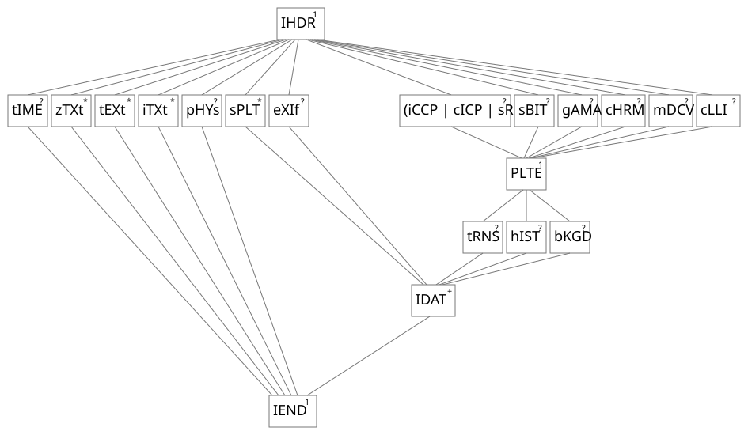
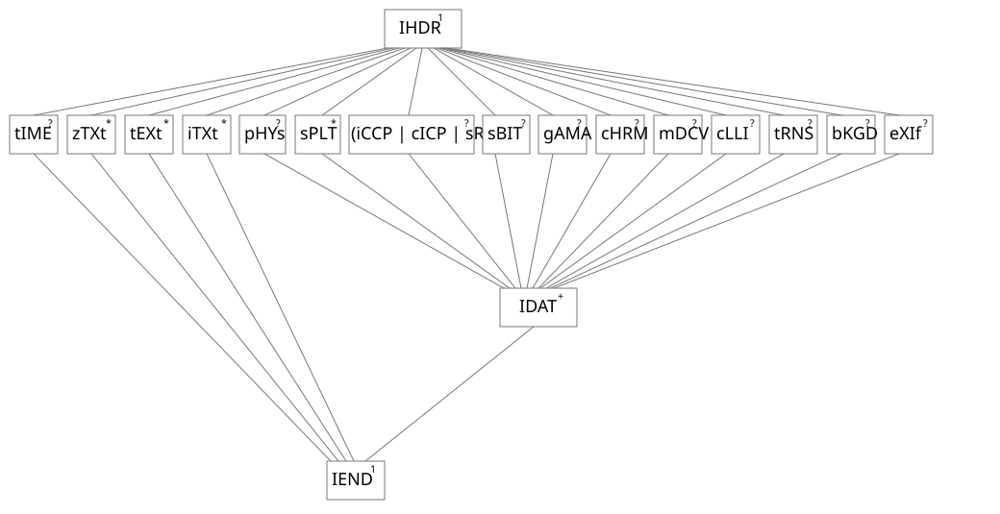
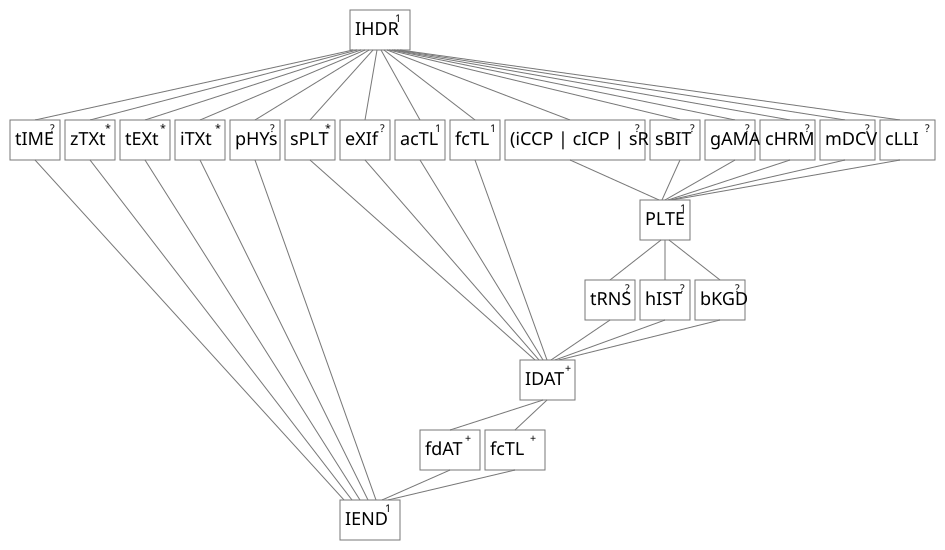
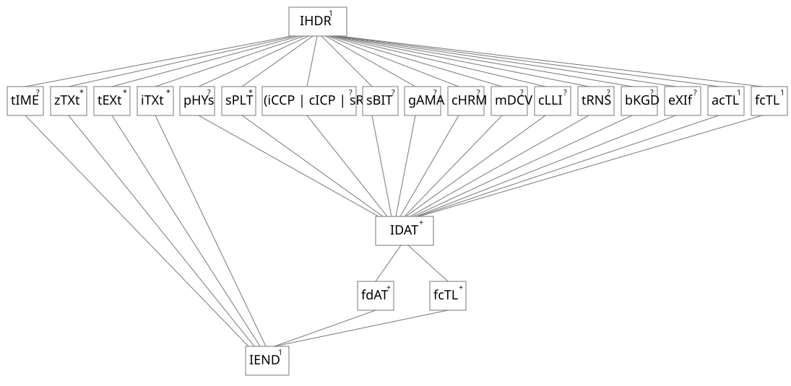
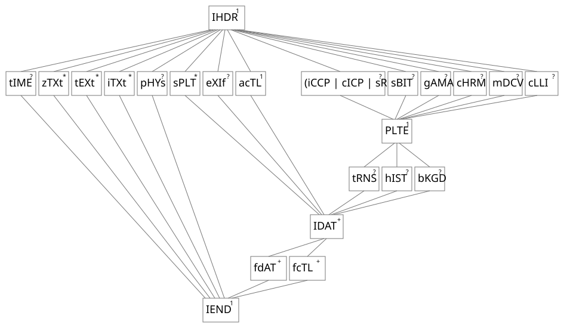

# 5.5 CRC algorithm

Source: [Portable Network Graphics (PNG) Specification](https://www.w3.org/TR/2025/REC-png-3-20250624/) · 3rd edition, W3C Recommendation 2025-06-24.

[Document index](../README.md) · [Topic guide](../../../../README.md) · [Publisher](https://www.w3.org/TR/2025/REC-png-3-20250624/).

HTML normalized to Markdown. Complex tables and mathematical markup retain HTML; illustrations are stored locally.

[Previous](008-4-10-error-handling.md) · [Next](010-5-7-defining-chunks.md)

### 5.5 CRC algorithm

CRC fields are calculated using standardized CRC methods with pre and post conditioning, as defined by [[ISO-3309](044-g-references.md#bib-iso-3309 "ISO/IEC 3309:1993, Information Technology — Telecommunications and information exchange between systems — High-level data link control (HDLC) procedures — Frame structure.")] and [[ITU-T-V.42](044-g-references.md#bib-itu-t-v.42 "ITU-T V.42, SERIES V: DATA COMMUNICATION OVER THE TELEPHONE NETWORK. Error-correcting procedures for DCEs using asynchronous-to-synchronous conversion")]. The CRC polynomial employed— which is identical to that used in the GZIP file format
specification [[RFC1952](044-g-references.md#bib-rfc1952 "GZIP file format specification version 4.3")]— is

x32 + x26 + x23 + x22 + x16 + x12 + x11 +
x10 + x8 + x7 + x5 + x4 + x2 + x + 1

In PNG, the 32-bit CRC is initialized to all 1's, and then the data from each byte is processed from the least
significant bit (1) to the most significant bit (128). After all the data bytes are processed, the CRC is inverted
(its ones complement is taken). This value is transmitted (stored in the datastream) MSB first. For the purpose of separating
into bytes and ordering, the least significant bit of the 32-bit CRC is defined to be the coefficient of the
`x31` term.

Practical calculation of the CRC often employs a precalculated table to accelerate the computation. See [D. Sample CRC implementation](035-c-gamma-and-chromaticity.md#D-CRCAppendix).

### 5.6 Chunk ordering

The constraints on the positioning of the individual chunks are listed in [Table 7](009-5-5-crc-algorithm.md#table53 "Chunk ordering rules") and illustrated
diagrammatically for static images in [Figure 11](009-5-5-crc-algorithm.md#lattice-diagram-with-plte "Lattice diagram: Static PNG images with PLTE") and [Figure 12](009-5-5-crc-algorithm.md#lattice-diagram-without-plte "Lattice diagram: Static PNG images without PLTE"), for animated images where the static image forms the first frame in [Figure 13](009-5-5-crc-algorithm.md#lattice-apng-static-with-plte "Lattice diagram: Animated PNG images with PLTE, static image forms the first frame") and [Figure 14](009-5-5-crc-algorithm.md#lattice-apng-static-without-plte "Lattice diagram: Animated PNG images without PLTE, static image forms the first frame"), and for animated images where the
static image is not part of the animation in [Figure 15](009-5-5-crc-algorithm.md#lattice-apng-nostatic-with-plte "Lattice diagram: Animated PNG images with PLTE, static image not part of animation") and [Figure 16](010-5-7-defining-chunks.md#lattice-apng-nostatic-without-plte "Lattice diagram: Animated PNG images without PLTE, static image not part of animation"). These lattice diagrams represent the constraints on positioning imposed by this
specification. The lines in the diagrams define partial ordering relationships. Chunks higher up shall appear before chunks
lower down. Chunks which are horizontally aligned and appear between two other chunk types (higher and lower than the
horizontally aligned chunks) may appear in any order between the two higher and lower chunk types to which they are
connected. The superscript associated with the chunk type is defined in [Table 8](009-5-5-crc-algorithm.md#table54 "Meaning of symbols used in lattice diagrams"). It indicates whether the
chunk is mandatory, optional, or may appear more than once. A vertical bar between two chunk types indicates
alternatives.

<table class="numbered simple" id="table53">
<caption><a class="self-link" href="009-5-5-crc-algorithm.md#table53">Table <bdi class="tableno">7</bdi></a> 
          Chunk ordering rules
        </caption>
<tbody><tr>
<th colspan="3">Critical chunks 
          (shall appear in this order, except PLTE is optional)</th>
</tr>
<tr>
<th>Chunk name</th>
<th>Multiple allowed</th>
<th>Ordering constraints</th>
</tr>
<tr>
<td>
<a class="chunk" href="014-10-3-other-uses-of-compression.md#11IHDR">IHDR</a>
</td>
<td>No</td>
<td>Shall be first</td>
</tr>
<tr>
<td>
<a class="chunk" href="014-10-3-other-uses-of-compression.md#11PLTE">PLTE</a>
</td>
<td>No</td>
<td>
            Before first <a class="chunk" href="014-10-3-other-uses-of-compression.md#11IDAT">IDAT</a>
</td>
</tr>
<tr>
<td>
<a class="chunk" href="014-10-3-other-uses-of-compression.md#11IDAT">IDAT</a>
</td>
<td>Yes</td>
<td>
            Multiple <a class="chunk" href="014-10-3-other-uses-of-compression.md#11IDAT">IDAT</a> chunks shall be consecutive
          </td>
</tr>
<tr>
<td>
<a class="chunk" href="014-10-3-other-uses-of-compression.md#11IEND">IEND</a>
</td>
<td>No</td>
<td>Shall be last</td>
</tr>
<tr>
<th colspan="3">Ancillary chunks 
          (need not appear in this order)</th>
</tr>
<tr>
<th>Chunk name</th>
<th>Multiple allowed</th>
<th>Ordering constraints</th>
</tr>
<tr>
<td>
<a class="chunk" href="020-11-3-4-5-exif-exchangeable-image-file-exif-profile.md#acTL-chunk">acTL</a>
</td>
<td>No</td>
<td>
            Before <a class="chunk" href="014-10-3-other-uses-of-compression.md#11IDAT">IDAT</a>
</td>
</tr>
<tr>
<td>
<a class="chunk" href="015-11-3-ancillary-chunks.md#11cHRM">cHRM</a>
</td>
<td>No</td>
<td>
            Before <a class="chunk" href="014-10-3-other-uses-of-compression.md#11PLTE">PLTE</a> and <a class="chunk" href="014-10-3-other-uses-of-compression.md#11IDAT">IDAT</a>
</td>
</tr>
<tr>
<td>
<a class="chunk" href="016-11-3-2-5-srgb-standard-rgb-color-space.md#cICP-chunk">cICP</a>
</td>
<td>No</td>
<td>
            Before <a class="chunk" href="014-10-3-other-uses-of-compression.md#11PLTE">PLTE</a> and <a class="chunk" href="014-10-3-other-uses-of-compression.md#11IDAT">IDAT</a>
</td>
</tr>
<tr>
<td>
<a class="chunk" href="015-11-3-ancillary-chunks.md#11gAMA">gAMA</a>
</td>
<td>No</td>
<td>
            Before <a class="chunk" href="014-10-3-other-uses-of-compression.md#11PLTE">PLTE</a> and <a class="chunk" href="014-10-3-other-uses-of-compression.md#11IDAT">IDAT</a>
</td>
</tr>
<tr>
<td>
<a class="chunk" href="015-11-3-ancillary-chunks.md#11iCCP">iCCP</a>
</td>
<td>No</td>
<td>
            Before <a class="chunk" href="014-10-3-other-uses-of-compression.md#11PLTE">PLTE</a> and <a class="chunk" href="014-10-3-other-uses-of-compression.md#11IDAT">IDAT</a>. If the <a class="chunk" href="015-11-3-ancillary-chunks.md#11iCCP">iCCP</a> chunk is present, the <a class="chunk" href="016-11-3-2-5-srgb-standard-rgb-color-space.md#11sRGB">sRGB</a> chunk should not be present.
          </td>
</tr>
<tr>
<td>
<a class="chunk" href="017-11-3-2-7-mdcv-mastering-display-color-volume.md#mDCV-chunk">mDCV</a>
</td>
<td>No</td>
<td>
            Before <a class="chunk" href="014-10-3-other-uses-of-compression.md#11PLTE">PLTE</a> and <a class="chunk" href="014-10-3-other-uses-of-compression.md#11IDAT">IDAT</a>.
          </td>
</tr>
<tr>
<td>
<a class="chunk" href="018-11-3-2-8-clli-content-light-level-information.md#cLLI-chunk">cLLI</a>
</td>
<td>No</td>
<td>
            Before <a class="chunk" href="014-10-3-other-uses-of-compression.md#11PLTE">PLTE</a> and <a class="chunk" href="014-10-3-other-uses-of-compression.md#11IDAT">IDAT</a>.
          </td>
</tr>
<tr>
<td>
<a class="chunk" href="015-11-3-ancillary-chunks.md#11sBIT">sBIT</a>
</td>
<td>No</td>
<td>
            Before <a class="chunk" href="014-10-3-other-uses-of-compression.md#11PLTE">PLTE</a> and <a class="chunk" href="014-10-3-other-uses-of-compression.md#11IDAT">IDAT</a>
</td>
</tr>
<tr>
<td>
<a class="chunk" href="016-11-3-2-5-srgb-standard-rgb-color-space.md#11sRGB">sRGB</a>
</td>
<td>No</td>
<td>
            Before <a class="chunk" href="014-10-3-other-uses-of-compression.md#11PLTE">PLTE</a> and <a class="chunk" href="014-10-3-other-uses-of-compression.md#11IDAT">IDAT</a>. If the <a class="chunk" href="016-11-3-2-5-srgb-standard-rgb-color-space.md#11sRGB">sRGB</a> chunk is present, the <a class="chunk" href="015-11-3-ancillary-chunks.md#11iCCP">iCCP</a> chunk should not be present.
          </td>
</tr>
<tr>
<td>
<a class="chunk" href="019-11-3-3-4-itxt-international-textual-data.md#11bKGD">bKGD</a>
</td>
<td>No</td>
<td>
            After <a class="chunk" href="014-10-3-other-uses-of-compression.md#11PLTE">PLTE</a>; before <a class="chunk" href="014-10-3-other-uses-of-compression.md#11IDAT">IDAT</a>
</td>
</tr>
<tr>
<td>
<a class="chunk" href="019-11-3-3-4-itxt-international-textual-data.md#11hIST">hIST</a>
</td>
<td>No</td>
<td>
            After <a class="chunk" href="014-10-3-other-uses-of-compression.md#11PLTE">PLTE</a>; before <a class="chunk" href="014-10-3-other-uses-of-compression.md#11IDAT">IDAT</a>
</td>
</tr>
<tr>
<td>
<a class="chunk" href="015-11-3-ancillary-chunks.md#11tRNS">tRNS</a>
</td>
<td>No</td>
<td>
            After <a class="chunk" href="014-10-3-other-uses-of-compression.md#11PLTE">PLTE</a>; before <a class="chunk" href="014-10-3-other-uses-of-compression.md#11IDAT">IDAT</a>
</td>
</tr>
<tr>
<td>
<a class="chunk" href="020-11-3-4-5-exif-exchangeable-image-file-exif-profile.md#eXIf">eXIf</a>
</td>
<td>No</td>
<td>
            Before <a class="chunk" href="014-10-3-other-uses-of-compression.md#11IDAT">IDAT</a>
</td>
</tr>
<tr>
<td>
<a class="chunk" href="020-11-3-4-5-exif-exchangeable-image-file-exif-profile.md#fcTL-chunk">fcTL</a>
</td>
<td>Yes</td>
<td>
            One may occur before <a class="chunk" href="014-10-3-other-uses-of-compression.md#11IDAT">IDAT</a>; all others shall be after <a class="chunk" href="014-10-3-other-uses-of-compression.md#11IDAT">IDAT</a>
</td>
</tr>
<tr>
<td>
<a class="chunk" href="019-11-3-3-4-itxt-international-textual-data.md#11pHYs">pHYs</a>
</td>
<td>No</td>
<td>
            Before <a class="chunk" href="014-10-3-other-uses-of-compression.md#11IDAT">IDAT</a>
</td>
</tr>
<tr>
<td>
<a class="chunk" href="019-11-3-3-4-itxt-international-textual-data.md#11sPLT">sPLT</a>
</td>
<td>Yes</td>
<td>
            Before <a class="chunk" href="014-10-3-other-uses-of-compression.md#11IDAT">IDAT</a>
</td>
</tr>
<tr>
<td>
<a class="chunk" href="020-11-3-4-5-exif-exchangeable-image-file-exif-profile.md#fdAT-chunk">fdAT</a>
</td>
<td>Yes</td>
<td>
            After <a class="chunk" href="014-10-3-other-uses-of-compression.md#11IDAT">IDAT</a>
</td>
</tr>
<tr>
<td>
<a class="chunk" href="020-11-3-4-5-exif-exchangeable-image-file-exif-profile.md#11tIME">tIME</a>
</td>
<td>No</td>
<td>None</td>
</tr>
<tr>
<td>
<a class="chunk" href="019-11-3-3-4-itxt-international-textual-data.md#11iTXt">iTXt</a>
</td>
<td>Yes</td>
<td>None</td>
</tr>
<tr>
<td>
<a class="chunk" href="018-11-3-2-8-clli-content-light-level-information.md#11tEXt">tEXt</a>
</td>
<td>Yes</td>
<td>None</td>
</tr>
<tr>
<td>
<a class="chunk" href="018-11-3-2-8-clli-content-light-level-information.md#11zTXt">zTXt</a>
</td>
<td>Yes</td>
<td>None</td>
</tr>
</tbody></table>

[Table 8](009-5-5-crc-algorithm.md#table54) 
Meaning of symbols used in lattice diagrams

| Symbol | Meaning |
| --- | --- |
| + | One or more |
| 1 | Only one |
| ? | Zero or one |
| \* | Zero or more |
| | | Alternative |

[Figure 11](009-5-5-crc-algorithm.md#lattice-diagram-with-plte) 
Lattice diagram: Static PNG images with [PLTE](014-10-3-other-uses-of-compression.md#11PLTE)

[Figure 12](009-5-5-crc-algorithm.md#lattice-diagram-without-plte) 
Lattice diagram: Static PNG images without [PLTE](014-10-3-other-uses-of-compression.md#11PLTE)

[Figure 13](009-5-5-crc-algorithm.md#lattice-apng-static-with-plte) 
Lattice diagram: Animated PNG images with [PLTE](014-10-3-other-uses-of-compression.md#11PLTE), static image forms the first frame

[Figure 14](009-5-5-crc-algorithm.md#lattice-apng-static-without-plte) 
Lattice diagram: Animated PNG images without [PLTE](014-10-3-other-uses-of-compression.md#11PLTE), static image forms the first frame

