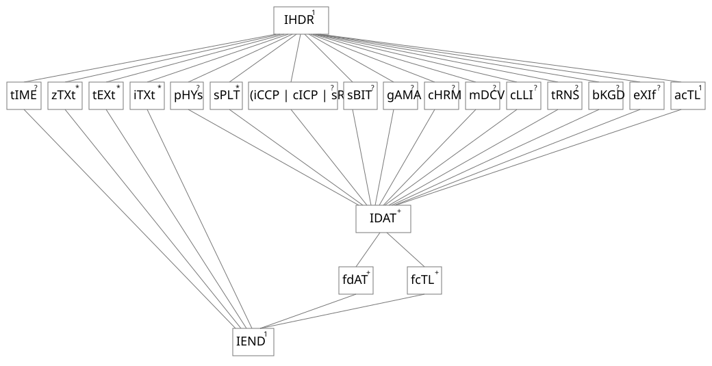

# 5.7 Defining chunks

Source: [Portable Network Graphics (PNG) Specification](https://www.w3.org/TR/2025/REC-png-3-20250624/) · 3rd edition, W3C Recommendation 2025-06-24.

[Document index](../README.md) · [Topic guide](../../../../README.md) · [Publisher](https://www.w3.org/TR/2025/REC-png-3-20250624/).

HTML normalized to Markdown. Complex tables and mathematical markup retain HTML; illustrations are stored locally.

[Previous](009-5-5-crc-algorithm.md) · [Next](011-6-2-alpha-representation.md)

[Figure 15](009-5-5-crc-algorithm.md#lattice-apng-nostatic-with-plte) 
Lattice diagram: Animated PNG images with [PLTE](014-10-3-other-uses-of-compression.md#11PLTE), static image not part of animation

[Figure 16](010-5-7-defining-chunks.md#lattice-apng-nostatic-without-plte) 
Lattice diagram: Animated PNG images without [PLTE](014-10-3-other-uses-of-compression.md#11PLTE), static image not part of animation

### 5.7 Defining chunks

#### 5.7.1 General

All chunks, private and public, *SHOULD* be listed at [[PNG-EXTENSIONS](044-g-references.md#bib-png-extensions "Extensions to the PNG Third Edition Specification, Version 1.6.0")].

#### 5.7.2 Defining public chunks

Public chunks are reserved for definition by the W3C.

Public chunks are intended for broad use consistent with the philosophy of PNG.

Organizations and applications are encouraged to submit any chunk that meet the criteria above for definition as a
public chunk by the [PNG Working Group](https://www.w3.org/groups/wg/png).

The definition as a public chunk is neither automatic nor immediate. A proposed public chunk type *SHALL* not be used in
publicly available software or datastreams until defined as such.

The definition of new critical chunk types is discouraged unless necessary.

#### 5.7.3 Defining private chunks

Organizations and applications *MAY* define private chunks for private and experimental use.

A private chunk *SHOULD NOT* be defined merely to carry textual information of interest to a human user. Instead [iTXt](019-11-3-3-4-itxt-international-textual-data.md#11iTXt) chunk *SHOULD* BE used and corresponding keyword *SHOULD* BE used and a suitable keyword
defined.

Listing private chunks at [[PNG-EXTENSIONS](044-g-references.md#bib-png-extensions "Extensions to the PNG Third Edition Specification, Version 1.6.0")] reduces, but does not eliminate, the chance that the same private chunk is
used for incompatible purposes by different applications. If a private chunk type is used, additional identifying
information *SHOULD* BE be stored at the beginning of the chunk data to further reduce the risk of conflicts.

An ancillary chunk type, not a critical chunk type, *SHOULD* be used for all private chunks that store information that is
not absolutely essential to view the image.

Private critical chunks *SHOULD NOT* be defined because PNG datastreams containing such chunks are not portable, and
*SHOULD NOT* be used in publicly available software or datastreams. If a private critical chunk is essential for an
application, it *SHOULD* appear near the start of the datastream, so that a standard decoder need not read very far before
discovering that it cannot handle the datastream.

See [B. Guidelines for private chunk types](034-a-internet-media-types.md#newchunks) for additional guidelines on defining private chunks.

### 5.8 Private field values

Values greater than or equal to 128 in the following fields are private field values:

- bit depth

- [color type](010-5-7-defining-chunks.md#3colourType)
- [compression method](013-9-3-filter-type-3-average.md#10CompressionCM0)
- [interlace method](012-7-3-filtering.md#8InterlaceMethods)
- [filter method](012-7-3-filtering.md#9FtIntro)

These [private field values](010-5-7-defining-chunks.md#dfn-private-field-values) are neither defined nor reserved by this specification.

[Private field values](010-5-7-defining-chunks.md#dfn-private-field-values) *MAY* be used for experimental or private semantics.

[Private field values](010-5-7-defining-chunks.md#dfn-private-field-values) *SHOULD NOT* appear in publicly available software or datastreams since they can result in
datastreams that are unreadable by PNG decoders as detailed at [13. PNG decoders and viewers](024-12-6-interlacing.md#13Decoders).

## 6. Reference image to PNG image transformation

### 6.1 Color types and values

As explained in [4.5 PNG image](005-4-5-png-image.md#4Concepts.PNGImage) there are five types of PNG
image. Corresponding to each type is a [color type](010-5-7-defining-chunks.md#3colourType), which is the sum of the following values: 1
(palette used), 2 ([truecolor](005-4-5-png-image.md#3truecolour) used) and 4 (alpha used). [greyscale](005-4-5-png-image.md#dfn-greyscale) and [truecolor](005-4-5-png-image.md#3truecolour) images may have an explicit
alpha channel. The PNG image types and corresponding [color types](010-5-7-defining-chunks.md#3colourType) are listed in [Table 9](010-5-7-defining-chunks.md#table6.1 "PNG image types and color types").

[Table 9](010-5-7-defining-chunks.md#table6.1) 
PNG image types and color types

| PNG image type | Color type |
| --- | --- |
| Greyscale | 0 |
| Truecolor | 2 |
| Indexed-color | 3 |
| Greyscale with alpha | 4 |
| Truecolor with alpha | 6 |

The allowed bit depths and sample depths for each PNG image type are listed in [Image header](014-10-3-other-uses-of-compression.md#11IHDR).

Greyscale samples represent luminance if the transfer curve is indicated (by [gAMA](015-11-3-ancillary-chunks.md#11gAMA),
[sRGB](016-11-3-2-5-srgb-standard-rgb-color-space.md#11sRGB), [iCCP](015-11-3-ancillary-chunks.md#11iCCP)) or [cICP](016-11-3-2-5-srgb-standard-rgb-color-space.md#cICP-chunk); or device-dependent greyscale if not.
RGB samples represent calibrated color information if the color space is indicated (by [gAMA](015-11-3-ancillary-chunks.md#11gAMA) and [cHRM](015-11-3-ancillary-chunks.md#11cHRM), [sRGB](016-11-3-2-5-srgb-standard-rgb-color-space.md#11sRGB), [iCCP](015-11-3-ancillary-chunks.md#11iCCP), or [cICP](016-11-3-2-5-srgb-standard-rgb-color-space.md#cICP-chunk); or uncalibrated device-dependent color if not.

Sample values are not necessarily proportional to light intensity; the [gAMA](015-11-3-ancillary-chunks.md#11gAMA) chunk
specifies the relationship between sample values and display output intensity. Viewers are strongly encouraged to compensate
properly. See [4.3 Color spaces](004-4-3-color-spaces.md#4Concepts.ColourSpaces), [13.13 Decoder gamma handling](029-13-13-decoder-gamma-handling.md#13Decoder-gamma-handling) and [C. Gamma and chromaticity](035-c-gamma-and-chromaticity.md#C-GammaAppendix).

