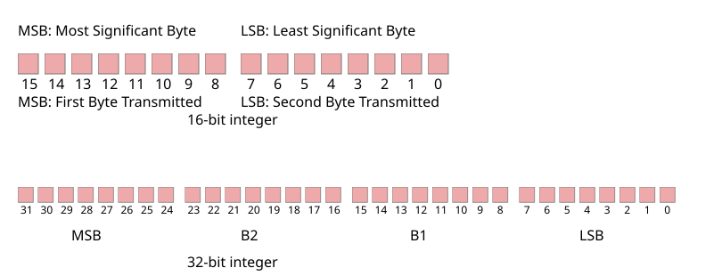

# 6.2 Alpha representation

Source: [Portable Network Graphics (PNG) Specification](https://www.w3.org/TR/2025/REC-png-3-20250624/) · 3rd edition, W3C Recommendation 2025-06-24.

[Document index](../README.md) · [Topic guide](../../../../README.md) · [Publisher](https://www.w3.org/TR/2025/REC-png-3-20250624/).

HTML normalized to Markdown. Complex tables and mathematical markup retain HTML; illustrations are stored locally.

[Previous](010-5-7-defining-chunks.md) · [Next](012-7-3-filtering.md)

### 6.2 Alpha representation

In a PNG datastream transparency may be represented in one of four ways, depending on the PNG image type (see [4.4.1 Alpha separation](004-4-3-color-spaces.md#4Concepts.Implied-alpha) and [4.4.4 Alpha compaction](004-4-3-color-spaces.md#4Concepts.Alpha-indexing)).

1. [Truecolor with alpha](005-4-5-png-image.md#dfn-truecolor-with-alpha), [greyscale with alpha](005-4-5-png-image.md#dfn-greyscale-with-alpha): an alpha channel is part of the image array.

2. [truecolor](005-4-5-png-image.md#3truecolour), [greyscale](005-4-5-png-image.md#dfn-greyscale): A [tRNS](015-11-3-ancillary-chunks.md#11tRNS) chunk contains a single pixel value
   distinguishing the fully transparent pixels from the fully opaque pixels.

3. [Indexed-color](004-4-3-color-spaces.md#3indexedColour): A [tRNS](015-11-3-ancillary-chunks.md#11tRNS) chunk contains the alpha table that associates an alpha
   sample with each palette entry.

4. [truecolor](005-4-5-png-image.md#3truecolour), [greyscale](005-4-5-png-image.md#dfn-greyscale), [indexed-color](004-4-3-color-spaces.md#3indexedColour): there is no [tRNS](015-11-3-ancillary-chunks.md#11tRNS) chunk present and all
   pixels are fully opaque.

An alpha channel included in the image array has 8-bit or 16-bit samples, the same size as the other samples. The alpha
sample for each pixel is stored immediately following the greyscale or RGB samples of the pixel. An alpha value of zero
represents full transparency, and a value of 2sampledepth - 1 represents full opacity. Intermediate values
indicate partially transparent pixels that can be [composited](002-2-scope.md#dfn-composited) against a background image to yield the delivered
image.

The color values in a pixel are not premultiplied by the alpha value assigned to the pixel. This rule is sometimes called
"unassociated" or "non-premultiplied" alpha. (Another common technique is to store sample values premultiplied by the alpha
value; in effect, such an image is already [composited](002-2-scope.md#dfn-composited) against a black background. PNG does **not** use
premultiplied alpha. In consequence an image editor can take a PNG image and easily change its transparency.) See [12.3 Alpha channel creation](023-12-3-alpha-channel-creation.md#12Alpha-channel-creation) and [13.16 Alpha channel processing](031-13-16-alpha-channel-processing.md#13Alpha-channel-processing).

## 7. Encoding the PNG image as a PNG datastream

### 7.1 Integers and byte order

All integers that require more than one byte shall be in [network byte order](002-2-scope.md#dfn-network-byte-order) (as illustrated in [Figure 17](011-6-2-alpha-representation.md#integer-representation-in-png "Integer representation in PNG") ): the most significant byte comes first, then the less significant bytes in descending
order of significance (MSB LSB for two-byte integers, MSB B2 B1 LSB for four-byte integers). The highest bit (value 128) of a
byte is numbered bit 7; the lowest bit (value 1) is numbered bit 0. Values are unsigned unless otherwise noted. Values
explicitly noted as signed are represented in two's complement notation.

[PNG four-byte unsigned integers](002-2-scope.md#dfn-png-four-byte-unsigned-integer) are limited to the range 0 to 231-1 to accommodate languages that have
difficulty with unsigned four-byte values.

[Figure 17](011-6-2-alpha-representation.md#integer-representation-in-png) 
Integer representation in PNG

### 7.2 Scanlines

A PNG image (or pass, see [8. Interlacing and pass extraction](012-7-3-filtering.md#8Interlace)) is a rectangular pixel array, with pixels appearing left-to-right
within each scanline, and scanlines appearing top-to-bottom. The size of each pixel is determined by the number of bits per
pixel.

Pixels within a scanline are always packed into a sequence of bytes with no wasted bits between pixels. Scanlines always
begin on byte boundaries. Permitted bit depths and [color types](010-5-7-defining-chunks.md#3colourType) are restricted so that in all cases the packing is
simple and efficient.

In PNG images of [color type](010-5-7-defining-chunks.md#3colourType) 0 (greyscale) each pixel is a single sample, which may have precision less than a byte
(1, 2, or 4 bits). These samples are packed into bytes with the leftmost sample in the high-order bits of a byte followed by
the other samples for the scanline.

In PNG images of [color type](010-5-7-defining-chunks.md#3colourType) 3 (indexed-color) each pixel is a single palette index. These indices are packed into
bytes in the same way as the samples for [color type](010-5-7-defining-chunks.md#3colourType) 0.

When there are multiple pixels per byte, some low-order bits of the last byte of a scanline may go unused. The contents of
these unused bits are not specified.

PNG images that are not [indexed-color](004-4-3-color-spaces.md#3indexedColour) images may have sample values with a bit depth of 16. Such sample values are in
[network byte order](002-2-scope.md#dfn-network-byte-order) (MSB first, LSB second). PNG permits multi-sample pixels only with 8 and 16-bit samples, so multiple
samples of a single pixel are never packed into one byte.

