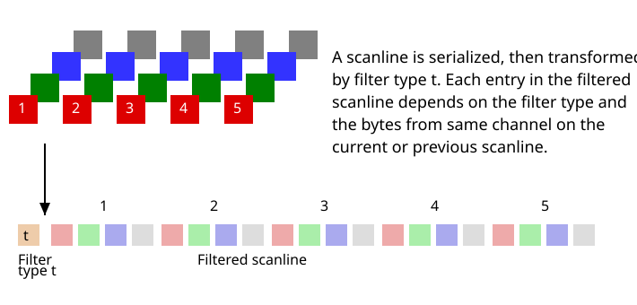
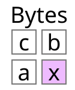

# 7.3 Filtering

Source: [Portable Network Graphics (PNG) Specification](https://www.w3.org/TR/2025/REC-png-3-20250624/) · 3rd edition, W3C Recommendation 2025-06-24.

[Document index](../README.md) · [Topic guide](../../../../README.md) · [Publisher](https://www.w3.org/TR/2025/REC-png-3-20250624/).

HTML normalized to Markdown. Complex tables and mathematical markup retain HTML; illustrations are stored locally.

[Previous](011-6-2-alpha-representation.md) · [Next](013-9-3-filter-type-3-average.md)

<a id="7Filtering"></a>

<a id="x7-3-filtering"></a>

### 7.3 Filtering

<a id="3filter"></a>

<a id="ref-for-dfn-scanline-2"></a>

A filter method is a transformation applied to an array of [scanlines](002-2-scope.md#dfn-scanline) with the aim of
improving their compressibility.

<a id="ref-for-3filter-1"></a>

<a id="ref-for-dfn-image-data-2"></a>

PNG standardizes one [filter method](012-7-3-filtering.md#3filter) and several filter types that may be used to prepare [image data](002-2-scope.md#dfn-image-data) for
compression. It transforms the byte sequence into an equal length sequence of bytes preceded by a filter type byte (see
[Figure 18](012-7-3-filtering.md#serializing-and-filtering-scanline "Serializing and filtering a scanline") for an example).

<a id="ref-for-3filter-2"></a>

The encoder shall use only a single [filter method](012-7-3-filtering.md#3filter) for an interlaced PNG image, but may use different filter types
for each scanline in a reduced image. An intelligent encoder can switch filters from one scanline to the next. The method for
choosing which filter to employ is left to the encoder.

<a id="ref-for-dfn-image-data-3"></a>

The filter type byte is not considered part of the [image data](002-2-scope.md#dfn-image-data), but it is included in the datastream sent to the
compression step. See [9. Filtering](012-7-3-filtering.md#9Filters).

<a id="serializing-and-filtering-scanline"></a>

<a id="figure49"></a>




[Figure 18](012-7-3-filtering.md#serializing-and-filtering-scanline) 
Serializing and filtering a scanline

<a id="8Interlace"></a>

<a id="x8-interlacing-and-pass-extraction"></a>

## 8. Interlacing and pass extraction

<a id="8InterlaceIntro"></a>

<a id="introduction-4"></a>

### Introduction

Pass extraction (see [Figure 4.8](005-4-5-png-image.md#figure48)) splits a PNG image into a sequence of reduced images (the
interlaced PNG image) where the first image defines a coarse view and subsequent images enhance this coarse view until the
last image completes the PNG image. This allows progressive display of the interlaced PNG image by the decoder and allows
images to "fade in" when they are being displayed on-the-fly. On average, interlacing slightly expands the datastream size,
but it can give the user a meaningful display much more rapidly.

<a id="8InterlaceMethods"></a>

<a id="x8-1-interlace-methods"></a>

### 8.1 Interlace methods

Two interlace methods are defined in this International Standard, methods 0 and 1. Other values of interlace method are
reserved for future standardization.

With interlace method 0, the null method, pixels are extracted sequentially from left to right, and scanlines sequentially
from top to bottom. The interlaced PNG image is a single reduced image.

Interlace method 1, known as Adam7, defines seven distinct passes over the image. Each pass transmits a subset of the
pixels in the reference image. The pass in which each pixel is transmitted (numbered from 1 to 7) is defined by replicating
the following 8-by-8 pattern over the entire image, starting at the upper left corner:


```
1 6 4 6 2 6 4 6
7 7 7 7 7 7 7 7
5 6 5 6 5 6 5 6
7 7 7 7 7 7 7 7
3 6 4 6 3 6 4 6
7 7 7 7 7 7 7 7
5 6 5 6 5 6 5 6
7 7 7 7 7 7 7 7
```


[Figure 4.8](005-4-5-png-image.md#figure48) shows the seven passes of interlace method 1. Within each pass, the selected pixels are
transmitted left to right within a scanline, and selected scanlines sequentially from top to bottom. For example, pass 2
contains pixels 4, 12, 20, etc. of scanlines 0, 8, 16, etc. (where scanline 0, pixel 0 is the upper left corner). The last
pass contains all of scanlines 1, 3, 5, etc. The transmission order is defined so that all the scanlines transmitted in a
pass will have the same number of pixels; this is necessary for proper application of some of the filters. The interlaced PNG
image consists of a sequence of seven reduced images. For example, if the PNG image is 16 by 16 pixels, then the third pass
will be a reduced image of two scanlines, each containing four pixels (see [Figure 4.8](005-4-5-png-image.md#figure48)).

Scanlines that do not completely fill an integral number of bytes are padded as defined in [7.2 Scanlines](011-6-2-alpha-representation.md#7Scanline).

<a id="issue-container-generatedID-9"></a>

<a id="h-note-9"></a>

Note

NOTE If the reference image contains fewer than five columns or fewer than five rows, some passes will be
empty.

<a id="9Filters"></a>

<a id="x9-filtering"></a>

## 9. Filtering

<a id="9FtIntro"></a>

<a id="x9-1-filter-methods-and-filter-types"></a>

### 9.1 Filter methods and filter types

Filtering transforms the PNG image with the goal of improving compression. The overall process is depicted in [Figure 7](005-4-5-png-image.md#encoding-png-image "Encoding the PNG image") while the specifics of serializing and filtering a scanline are shown in [Figure 18](012-7-3-filtering.md#serializing-and-filtering-scanline "Serializing and filtering a scanline").

<a id="ref-for-3filter-3"></a>

<a id="ref-for-3filter-4"></a>

<a id="ref-for-3filter-5"></a>

<a id="ref-for-3filter-6"></a>

<a id="ref-for-3filter-7"></a>

PNG allows for a number of [filter methods](012-7-3-filtering.md#3filter). All the reduced images in an interlaced image shall use a single
[filter method](012-7-3-filtering.md#3filter). Only [filter method](012-7-3-filtering.md#3filter) 0 is defined by this specification. Other [filter methods](012-7-3-filtering.md#3filter) are reserved
for future standardization. [Filter method](012-7-3-filtering.md#3filter) 0 provides a set of five filter types, and individual scanlines in each
reduced image may use different filter types.

PNG imposes no additional restriction on which filter types can be applied to an interlaced PNG image. However, the filter
types are not equally effective on all types of data. See [12.7 Filter selection](024-12-6-interlacing.md#12Filter-selection).

Filtering transforms the byte sequence in a scanline to an equal length sequence of bytes preceded by the filter type.
Filter type bytes are associated only with non-empty scanlines. No filter type bytes are present in an empty pass. See
[13.10 Interlacing and progressive display](028-13-10-interlacing-and-progressive-display.md#13Progressive-display).

<a id="9Filter-types"></a>

<a id="x9-2-filter-types-for-filter-method-0"></a>

### 9.2 Filter types for filter method 0

<a id="ref-for-3colourType-8"></a>

<a id="ref-for-dfn-image-data-4"></a>

Filters are applied to **bytes**, not to pixels, regardless of the bit depth or [color type](010-5-7-defining-chunks.md#3colourType) of the
image. The filters operate on the byte sequence formed by a scanline that has been represented as described in [7.2 Scanlines](011-6-2-alpha-representation.md#7Scanline). If the image includes an alpha channel, the alpha data is filtered in the same way as the [image
data](002-2-scope.md#dfn-image-data).

Filters may use the original values of the following bytes to generate the new byte value:

<a id="table-named-filter-bytes"></a>

[Table 10](012-7-3-filtering.md#table-named-filter-bytes) 
Named filter bytes

| Name | Definition |
| --- | --- |
| x | the byte being filtered; |
| a | the byte corresponding to x in the pixel immediately before the pixel containing x (or the byte immediately before x, when the bit depth is less than 8); |
| b | the byte corresponding to x in the previous scanline; |
| c | the byte corresponding to b in the pixel immediately before the pixel containing b (or the byte immediately before b, when the bit depth is less than 8). |

<a id="filter-byte-positions"></a>

<a id="figure72"></a>




[Figure 19](012-7-3-filtering.md#filter-byte-positions) 
Positions of filter bytes a, b and c relative to x

[Figure 19](012-7-3-filtering.md#filter-byte-positions "Positions of filter bytes a, b and c relative to x") shows the relative positions of the bytes x, a, b,
and c.

<a id="ref-for-3filter-8"></a>

[Filter method](012-7-3-filtering.md#3filter) 0 defines five basic filter types as listed in [Table 11](012-7-3-filtering.md#9-table91 "Filter types"). `Orig(y)`
denotes the original (unfiltered) value of byte y. `Filt(y)` denotes the value after a filter type has
been applied. `Recon(y)` denotes the value after the corresponding reconstruction function has been applied. The
Paeth filter type PaethPredictor [[Paeth](044-g-references.md#bib-paeth "Image File Compression Made Easy, in Graphics Gems II, pp. 93-100")] is defined below.

<a id="ref-for-3filter-9"></a>

<a id="ref-for-3filter-10"></a>

[Filter method](012-7-3-filtering.md#3filter) 0 specifies exactly this set of five filter types and this shall not be extended. This ensures that
decoders need not decompress the data to determine whether it contains unsupported filter types: it is sufficient to check
the [filter method](012-7-3-filtering.md#3filter) in [11.2.1 IHDR Image header](014-10-3-other-uses-of-compression.md#11IHDR).

<a id="9-table91"></a>

[Table 11](012-7-3-filtering.md#9-table91) 
Filter types

| Type | Name | Filter Function | Reconstruction Function |
| --- | --- | --- | --- |
| 0 | None | `Filt(x) = Orig(x)` | `Recon(x) = Filt(x)` |
| 1 | Sub | `Filt(x) = Orig(x) - Orig(a)` | `Recon(x) = Filt(x) + Recon(a)` |
| 2 | Up | `Filt(x) = Orig(x) - Orig(b)` | `Recon(x) = Filt(x) + Recon(b)` |
| 3 | Average | `Filt(x) = Orig(x) - floor((Orig(a) + Orig(b)) / 2)` | `Recon(x) = Filt(x) + floor((Recon(a) + Recon(b)) / 2)` |
| 4 | Paeth | `Filt(x) = Orig(x) - PaethPredictor(Orig(a), Orig(b), Orig(c))` | `Recon(x) = Filt(x) + PaethPredictor(Recon(a), Recon(b), Recon(c))` |

For all filters, the bytes "to the left of" the first pixel in a scanline shall be treated as being zero. For filters that
refer to the prior scanline, the entire prior scanline and bytes "to the left of" the first pixel in the prior scanline shall
be treated as being zeroes for the first scanline of a reduced image.

To reverse the effect of a filter requires the decoded values of the prior pixel on the same scanline, the pixel
immediately above the current pixel on the prior scanline, and the pixel just to the left of the pixel above.

Unsigned arithmetic modulo 256 is used, so that both the inputs and outputs fit into bytes. Filters are applied to each
byte regardless of bit depth. The sequence of `Filt` values is transmitted as the filtered scanline.

