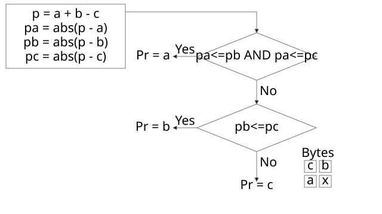

# 9.3 Filter type 3: Average

Source: [Portable Network Graphics (PNG) Specification](https://www.w3.org/TR/2025/REC-png-3-20250624/) · 3rd edition, W3C Recommendation 2025-06-24.

[Document index](../README.md) · [Topic guide](../../../../README.md) · [Publisher](https://www.w3.org/TR/2025/REC-png-3-20250624/).

HTML normalized to Markdown. Complex tables and mathematical markup retain HTML; illustrations are stored locally.

[Previous](012-7-3-filtering.md) · [Next](014-10-3-other-uses-of-compression.md)

<a id="9Filter-type-3-Average"></a>

<a id="x9-3-filter-type-3-average"></a>

### 9.3 Filter type 3: Average

The sum `Orig(a) + Orig(b)` shall be performed without overflow (using at least nine-bit arithmetic).
`floor()` indicates that the result of the division is rounded to the next lower integer if fractional; in other
words, it is an integer division or right shift operation.

<a id="9Filter-type-4-Paeth"></a>

<a id="x9-4-filter-type-4-paeth"></a>

### 9.4 Filter type 4: Paeth

The Paeth filter type computes a simple linear function of the three neighboring pixels (left, above, upper left), then
chooses as predictor the neighboring pixel closest to the computed value. The algorithm used in this specification is an
adaptation of the technique due to Alan W. Paeth [[Paeth](044-g-references.md#bib-paeth "Image File Compression Made Easy, in Graphics Gems II, pp. 93-100")].

The PaethPredictor function is defined in the code below. The logic of the function and the locations of the bytes
a, b, c, and x are shown in [Figure 20](013-9-3-filter-type-3-average.md#paethpredictor-function "The PaethPredictor function").
Pr is the predictor for byte x.


```
p = a + b - c
pa = abs(p - a)
pb = abs(p - b)
pc = abs(p - c)
if pa <= pb and pa <= pc then Pr = a
else if pb <= pc then Pr = b
else Pr = c
return Pr
```


<a id="paethpredictor-function"></a>

<a id="9-figure91"></a>




[Figure 20](013-9-3-filter-type-3-average.md#paethpredictor-function) 
The PaethPredictor function

The calculations within the PaethPredictor function shall be performed exactly, without overflow.

**The order in which the comparisons are performed is critical and shall not be altered.** The function tries
to establish in which of the three directions (vertical, horizontal, or diagonal) the gradient of the image is smallest.

Exactly the same PaethPredictor function is used by both encoder and decoder.

<a id="10Compression"></a>

<a id="x10-compression"></a>

## 10. Compression

<a id="10CompressionCM0"></a>

<a id="x10-1-compression-method-0"></a>

### 10.1 Compression method 0

<a id="ref-for-dfn-deflate-2"></a>

<a id="ref-for-dfn-deflate-3"></a>

<a id="ref-for-dfn-deflate-4"></a>

<a id="ref-for-3LZ77-2"></a>

Only PNG compression method 0 is defined by this International Standard. Other values of compression method are reserved
for future standardization. PNG compression method 0 is [deflate](002-2-scope.md#dfn-deflate) compression with a sliding window (which is an upper
bound on the distances appearing in the [deflate](002-2-scope.md#dfn-deflate) stream) of at most 32768 bytes. [Deflate](002-2-scope.md#dfn-deflate) compression is derived
from [LZ77](002-2-scope.md#3LZ77).

<a id="ref-for-dfn-deflate-5"></a>

<a id="ref-for-dfn-zlib-1"></a>

[Deflate](002-2-scope.md#dfn-deflate)-compressed datastreams within PNG are stored in the [zlib](002-2-scope.md#dfn-zlib) format, which has the structure:

<a id="zlib-structure"></a>

|  |  |
| --- | --- |
| zlib compression method/flags code | 1 byte |
| Additional flags/check bits | 1 byte |
| Compressed data blocks | n bytes |
| Check value | 4 bytes |

<a id="ref-for-dfn-zlib-2"></a>

[zlib](002-2-scope.md#dfn-zlib) is specified at [[rfc1950](044-g-references.md#bib-rfc1950 "ZLIB Compressed Data Format Specification version 3.3")].

<a id="ref-for-dfn-zlib-3"></a>

<a id="ref-for-dfn-deflate-6"></a>

<a id="ref-for-3LZ77-3"></a>

<a id="ref-for-dfn-zlib-4"></a>

For PNG compression method 0, the [zlib](002-2-scope.md#dfn-zlib) compression method/flags code shall specify method code 8 ([deflate](002-2-scope.md#dfn-deflate)
compression) and an [LZ77](002-2-scope.md#3LZ77) window size of not more than 32768 bytes. The [zlib](002-2-scope.md#dfn-zlib) compression method number is not
the same as the PNG compression method number in the [IHDR](014-10-3-other-uses-of-compression.md#11IHDR) chunk. The additional flags
shall not specify a preset dictionary.

If the data to be compressed contain 16384 bytes or fewer, the PNG encoder may set the window size by rounding up to a
power of 2 (256 minimum). This decreases the memory required for both encoding and decoding, without adversely affecting the
compression ratio.

<a id="ref-for-dfn-zlib-5"></a>

<a id="ref-for-3LZ77-4"></a>

<a id="ref-for-3LZ77-5"></a>

<a id="ref-for-dfn-deflate-7"></a>

The compressed data within the [zlib](002-2-scope.md#dfn-zlib) datastream are stored as a series of blocks, each of which can represent raw
(uncompressed) data, [LZ77](002-2-scope.md#3LZ77)-compressed data encoded with fixed Huffman codes, or [LZ77](002-2-scope.md#3LZ77)-compressed data encoded
with custom Huffman codes. A marker bit in the final block identifies it as the last block, allowing the decoder to recognize
the end of the compressed datastream. Further details on the compression algorithm and the encoding are given in the
[deflate](002-2-scope.md#dfn-deflate) specification [[rfc1951](044-g-references.md#bib-rfc1951 "DEFLATE Compressed Data Format Specification version 1.3")].

<a id="ref-for-dfn-zlib-6"></a>

<a id="ref-for-dfn-zlib-7"></a>

<a id="ref-for-dfn-deflate-8"></a>

The check value stored at the end of the [zlib](002-2-scope.md#dfn-zlib) datastream is calculated on the uncompressed data represented by the
datastream. The algorithm used to calculate this is not the same as the CRC calculation used for PNG chunk CRC
field values. The [zlib](002-2-scope.md#dfn-zlib) check value is useful mainly as a cross-check that the [deflate](002-2-scope.md#dfn-deflate) algorithms are
implemented correctly. Verifying the individual PNG chunk CRCs provides confidence that the PNG datastream has been
transmitted undamaged.

<a id="10CompressionFSL"></a>

<a id="x10-2-compression-of-the-sequence-of-filtered-scanlines"></a>

### 10.2 Compression of the sequence of filtered scanlines

<a id="ref-for-dfn-zlib-8"></a>

<a id="ref-for-dfn-image-data-5"></a>

The sequence of filtered scanlines is compressed and the resulting data stream is split into [IDAT](014-10-3-other-uses-of-compression.md#11IDAT) chunks. The concatenation of the contents of all the [IDAT](014-10-3-other-uses-of-compression.md#11IDAT) chunks makes
up a [zlib](002-2-scope.md#dfn-zlib) datastream. This datastream decompresses to filtered [image data](002-2-scope.md#dfn-image-data).

<a id="ref-for-dfn-zlib-9"></a>

<a id="ref-for-dfn-deflate-9"></a>

<a id="ref-for-dfn-zlib-10"></a>

<a id="ref-for-dfn-zlib-11"></a>

It is important to emphasize that the boundaries between [IDAT](014-10-3-other-uses-of-compression.md#11IDAT) chunks are arbitrary and
can fall anywhere in the [zlib](002-2-scope.md#dfn-zlib) datastream. There is not necessarily any correlation between [IDAT](014-10-3-other-uses-of-compression.md#11IDAT) chunk boundaries and [deflate](002-2-scope.md#dfn-deflate) block boundaries or any other feature of the [zlib](002-2-scope.md#dfn-zlib) data. For
example, it is entirely possible for the terminating [zlib](002-2-scope.md#dfn-zlib) check value to be split across [IDAT](014-10-3-other-uses-of-compression.md#11IDAT) chunks.

<a id="ref-for-dfn-image-data-6"></a>

<a id="ref-for-dfn-deflate-10"></a>

<a id="ref-for-dfn-zlib-12"></a>

Similarly, there is no required correlation between the structure of the [image data](002-2-scope.md#dfn-image-data) (i.e., scanline boundaries) and
[deflate](002-2-scope.md#dfn-deflate) block boundaries or [IDAT](014-10-3-other-uses-of-compression.md#11IDAT) chunk boundaries. The complete filtered PNG image
is represented by a single [zlib](002-2-scope.md#dfn-zlib) datastream that is stored in a number of [IDAT](014-10-3-other-uses-of-compression.md#11IDAT)
chunks.

