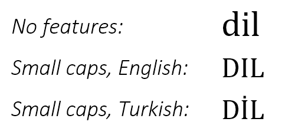
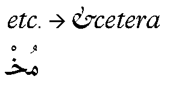
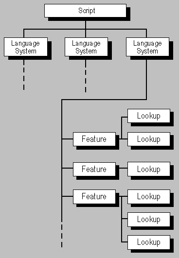

# Overview

Source: [OpenType layout common table formats](https://learn.microsoft.com/en-us/typography/opentype/spec/chapter2) · OpenType 1.9.1 website snapshot.

[Document index](../README.md) · [Topic guide](../../../../../README.md) · [Publisher](https://learn.microsoft.com/en-us/typography/opentype/spec/chapter2).

HTML normalized to Markdown. Complex tables and mathematical markup retain HTML; illustrations are stored locally.

[Next](002-scripts-and-languages.md)

OpenType Layout makes use of five tables: the Glyph Substitution table (GSUB), the Glyph Positioning table (GPOS), the Baseline table (BASE), the Justification table (JSTF), and the Glyph Definition table (GDEF). These tables use some of the same data formats. This chapter defines these common formats and explains conventions used in all OpenType Layout tables. The common formats are also used in the Mathematical Typesetting table (MATH). Separate chapters provide all other details of the [GSUB](../../gsub/README.md), [GPOS](../../gpos/README.md), [BASE](https://learn.microsoft.com/en-us/typography/opentype/spec/base), [JSTF](https://learn.microsoft.com/en-us/typography/opentype/spec/jstf), [GDEF](../../gdef/README.md) and [MATH](../../math/README.md) tables.

Example tables and lists that illustrate the common data formats are supplied at the end of this chapter.

## Overview

The OpenType Layout tables provide typographic information for substituting and positioning glyphs, operations that are required for correct text display of many scripts as well as for high quality typography. OpenType Layout data is organized by *script*, *language system*, *typographic feature*, and *lookup*.

At the top level, data is organized by *script*. A script is a collection of glyphs used to represent one or more languages in written form (see Figure 2a). For instance, a single script, Latin, is used to write English, French, German, and many other languages. In contrast, Japanese is written using three scripts: Hiragana, Katakana, and Kanji. With OpenType Layout, multiple scripts can be supported by a single font.

Figure 2a. Glyphs in the Latin, Kanji, and Arabic scripts

For each script, data is then organized by one or more *language systems*, which allows a font to support different typographic conventions for different language contexts. For example, Turkish has different upper and lower case relationships from most other languages written with Latin script, and that affects the glyph selection that is needed when a small caps feature (['smcp'](https://learn.microsoft.com/en-us/typography/opentype/spec/features_pt#smcp)) is used.

Figure 2b. Differences in the English and Turkish language systems

A language system specifies *features*, which represent typographic effects on glyphs. Some examples of features are a 'vert' feature for substituting vertical glyphs in Japanese, a 'liga' feature for using ligatures in place of separate glyphs, and a 'mark' feature for positioning diacritical marks with respect to base glyphs in Arabic.

Figure 2c. A ligature glyph feature substitutes the <et> ligature for individual glyphs, and a 'mark' feature positions diacritical marks above an Arabic ligature glyph.

In the absence of language-specific rules, a default language system specifies features to be applied for the given script. For instance, a default language system feature for the Arabic script would specify features to substitute initial, medial, and final glyph forms based on a glyph’s position in a word.

An application may use its own criteria to determine when to use a specific language system or the default language system. When doing layout for a run of text, it uses features specified by one or the other, but not both.

Features are implemented with *lookup* data that the text-processing client uses to substitute and position glyphs. Lookups describe the glyphs affected by an operation, the type of operation to be applied to these glyphs, and the resulting glyph output.

A font may also include FeatureVariations data within a GPOS or GSUB table that allows the default lookup data associated with a feature to be substituted by alternate lookup data when particular conditions apply. Currently, this mechanism is used only for variable fonts using OpenType Font Variations.

## OpenType Layout and Font Variations

OpenType Font Variations allow a single font to support many design variations along one or more axes of design variation. For example, a font with weight and width variations might support weights from thin to black, and widths from ultra-condensed to ultra-expanded. For general information on OpenType Font Variations, see the chapter, [OpenType Font Variations Overview](https://learn.microsoft.com/en-us/typography/opentype/spec/otvaroverview).

When different variation instances are selected, the design and metrics of individual glyphs changes. This can impact font-unit values given in GPOS, BASE, JSTF or GDEF tables, such as the X and Y coordinates of an attachment anchor position. The font-unit values given in these tables apply to the default instance of a variable font. If adjustments are needed for different variation instances, this is done using variation data with processes similar to those used for glyph outlines and other font data, as described in the chapter, [OpenType Font Variations Overview](https://learn.microsoft.com/en-us/typography/opentype/spec/otvaroverview). The variation data for GPOS, JSTF or GDEF values is contained in an *ItemVariationStore* table which, in turn, is contained within the GDEF table; variation data for BASE values is contained in an ItemVariationStore table within the BASE table itself. The format of the ItemVariationStore is described in detail in the chapter, [OpenType Font Variations Common Table Formats](https://learn.microsoft.com/en-us/typography/opentype/spec/otvarcommonformats). For font-unit values within the GPOS, BASE, JSTF or GDEF tables that require variation, references to specific variation data within the ItemVariationStore are provided in *VariationIndex tables*, described below.

In some variable fonts, it might be desirable to have different glyph-substitution or glyph-positioning actions used for different regions within the font’s variation space. For example, for narrow or heavy instances in which counters become small, it might be desirable to make certain glyph substitutions to use alternate glyphs with certain strokes removed or outlines simplified to allow for larger counters. Such effects can be achieved using a *FeatureVariations* table within either the GSUB or GPOS table. The FeatureVariations table is described below.

## Table organization

Two OpenType Layout tables, GSUB and GPOS, use the same data formats to describe the scripts and languages they support, and the typographic glyph operations used for each supported script and language: a *ScriptList* table, a *FeatureList* table, a *LookupList* table, and an optional FeatureVariations table. In GSUB, the tables define glyph substitution data. In GPOS, they define glyph positioning data. This section describes the organization and relationship between these formats; the following sections describe the formats in detail.

The ScriptList identifies the scripts in a font, each of which is represented by a Script table. Each Script table has a default language system table plus zero or more tables for specific language systems. Language system tables reference Feature tables defined in the FeatureList. Each Feature table references Lookup tables defined in the LookupList that describes glyph actions that implement the feature.

Figure 2d. The relationship of scripts, language systems, features, and lookups for substitution and positioning tables

> *Note:*
> The data in the BASE and JSTF tables also is organized by script and language system. However, the data formats differ from those in GSUB and GPOS, and they do not include a FeatureList or LookupList. The BASE and JSTF data formats are described in the [BASE](https://learn.microsoft.com/en-us/typography/opentype/spec/base) and [JSTF](https://learn.microsoft.com/en-us/typography/opentype/spec/jstf) chapters.

The information used to substitute and position glyphs is defined in Lookup subtables. Each subtable supplies one type of information, depending upon whether the lookup is part of a GSUB or GPOS table. For instance, a GSUB lookup might specify the glyphs to be substituted and the context in which a substitution occurs, and a GPOS lookup might specify glyph position adjustments for kerning. OpenType Layout has eight types of GSUB lookups (described in the [GSUB](../../gsub/README.md) chapter) and nine types of GPOS lookups (described in the [GPOS](../../gpos/README.md) chapter).

Each subtable (except for an Extension LookupType subtable) includes a Coverage table that lists the “covered” glyphs that will result in a glyph substitution or positioning operation. The [Coverage table](005-coverage-table.md#coverage-table) formats are described in a later section of this chapter.

Some substitution or positioning operations could apply to groups, or classes, of glyphs. GSUB and GPOS Lookup subtables use the Class Definition table to assign glyphs to classes. A description of the [Class Definition table](005-coverage-table.md#class-definition-table) formats is provided later in this chapter.

In non-variable fonts, GPOS Lookup subtables may also contain Device tables to adjust scaled contour glyph coordinates for particular output sizes and resolutions. Device tables can also be used for similar adjustments to baseline metric or caret offset values in the BASE and GDEF tables. Similarly, in variable fonts, GPOS lookup subtables, BaseCoord tables and CaretValue tables may contain VariationIndex tables that reference variation data to adjust font-unit values as needed for different variation instances within a font’s design variation space. [Device and VariationIndex tables](009-device-and-variationindex-tables.md#device-and-variationindex-tables) are described in a later section of this chapter.

As mentioned above, a feature table references a set of lookups in the lookup list. The FeatureVariations table allows the default set of lookups used for a given feature to be substituted by a different set of lookups under particular conditions. This can be used in variable fonts to provide different substitution or positioning actions for different variation instances. For example, for narrow or heavy instances in which counters become small, it may be desirable to make certain glyph substitutions to use alternate glyphs with certain strokes removed or outlines simplified to allow for larger counters.

