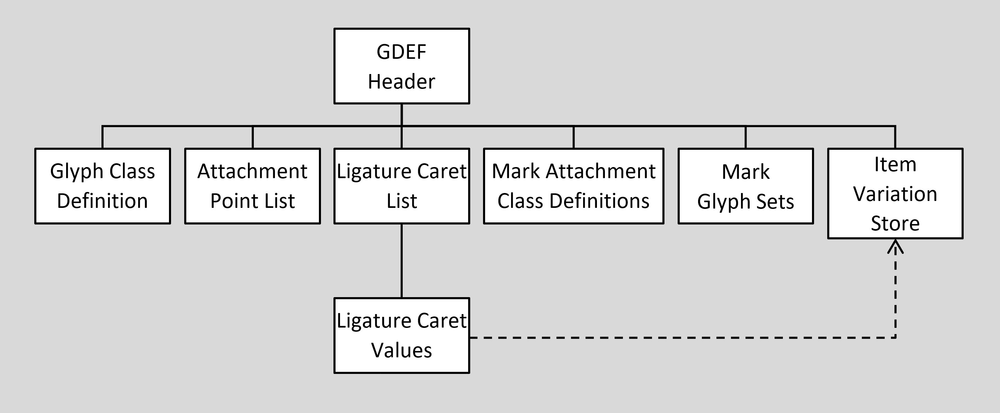
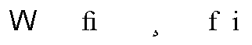
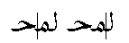

# Overview

Source: [Glyph definition](https://learn.microsoft.com/en-us/typography/opentype/spec/gdef) · OpenType 1.9.1 website snapshot.

[Document index](../README.md) · [Topic guide](../../../../../README.md) · [Publisher](https://learn.microsoft.com/en-us/typography/opentype/spec/gdef).

HTML normalized to Markdown. Complex tables and mathematical markup retain HTML; illustrations are stored locally.

[Next](002-gdef-table-structures.md)

## Overview

The Glyph Definition (GDEF) table provides various glyph properties used in OpenType Layout processing. It contains six types of information in six independent subtables:

- The *glyph class definition* table classifies the different types of glyphs in the font.
- The *attachment list* table identifies all attachment points on the glyphs, which streamlines data access and bitmap caching.
- The *ligature caret list* table contains positioning data for ligature carets, which the text-processing client uses on screen to select and highlight the individual components of a ligature glyph.
- The *mark attachment class definition* table classifies mark glyphs, to help group together marks that are positioned similarly.
- The *mark glyph sets* table allows the enumeration of an arbitrary number of glyph sets that can be used as an extension of the mark attachment class definition to allow lookups to filter mark glyphs by arbitrary sets of marks.
- The *item variation store* table is used in variable fonts to contain variation data used for adjustment of values in the GDEF, GPOS or JSTF tables.

The [GSUB](../../gsub/README.md), [GPOS](../../gpos/README.md) or [JSTF](https://learn.microsoft.com/en-us/typography/opentype/spec/jstf) tables may reference certain GDEF table information used for processing of lookup tables. See, for example, the LookupFlag bit enumeration in [OpenType Layout Common Table Formats](../../chapter2/README.md). In variable fonts, the GDEF, GPOS and JSTF tables may all reference variation data within the item variation store table contained within the GDEF table. See below for further discussion of variable fonts and the item variation store table.

A client may use any one or more of the six GDEF tables during text processing. This overview explains how each of the six tables are organized and used (see Figure 7a). The rest of this chapter describes the individual GDEF tables and the formats that they reference.

Figure 7a. High-level organization of GDEF table

**Glyph class definition table**

The glyph class definition table (GlyphClassDef) identifies four types of glyphs in a font: base glyphs, ligature glyphs, combining mark glyphs, and glyph components (see Figure 7b). GSUB and GPOS lookups define and use these glyph classes to differentiate the types of glyphs in a string. For example, GPOS uses the glyph classes to distinguish between a simple base glyph and the mark glyph that follows it.

Figure 7b. A base glyph, ligature glyph, mark glyph, and glyph components

In addition, a client uses class definitions to apply GSUB and GPOS LookupFlag data correctly. For example, a LookupFlag may specify ignoring ligatures and marks during a glyph operation. If the font does not include a GlyphClassDef table, the client will need to define and maintain this information when processing the GSUB and GPOS tables.

**Attachment point list table**

The attachment point list table (AttachList) identifies all the attachment points defined in the GPOS table and their associated glyphs so a client can quickly access coordinates for each glyph’s attachment points. As a result, the client can cache coordinates for attachment points along with glyph bitmaps and avoid recalculating the attachment points each time it displays a glyph. Without this table, processing speed would be slower because the client would have to decode the GPOS lookups that define attachment points and compile the points in a list.

**Ligature caret list table**

The ligature caret list table (LigCaretList) specifies coordinates for positioning carets within ligatures in a font. The client uses this data to select and highlight ligature components in displayed text (see Figure 7c).

Figure 7c. Proper ligature caret postioning

Each ligature may have more than one caret position, with each position defined as an X or Y value on the baseline according to the writing direction of the script or language system. The font developer can use any of three formats to represent a caret coordinate value. One format represents values in design units only, another fine-tunes a value based on a designated contour point, and the third uses a Device table (in non-variable fonts only) to adjust values at specific font sizes.

In a variable font, the caret positions may need to be adjusted for different variation instances. This is done using data in an item variation store table. See below for more regarding variable fonts and the item variation store table.

Without a ligature caret list table, the client would have to define caret positions without knowing the positions of the ligature components. The resulting highlighting or hit-testing might be ambiguous. For example, suppose a client places a caret at the midpoint position along the width of a hypothetical “wi” ligature. Because the “w” is wider than the “i,” that position would not clearly indicate which component is selected. Instead, for accurate selection, the caret should be moved to the right so that either the “w” or “i” could be clearly highlighted.

**Mark attachment class definition table**

A mark attachment class definition table is used to assign mark glyphs into different classes. These classes can be used in lookup tables within the GSUB or GPOS table to control how mark glyphs within a glyph sequence are treated by lookups. For more information on the use of mark attachment classes, see the description of lookup flags in the “Lookup Table” section of the chapter, [OpenType Layout Common Table Formats](../../chapter2/chunks/004-lookuplist-table.md#lookup-table).

**Mark glyph sets table**

A mark glyph sets table (MarkGlyphSets) is used to define sets of mark glyphs that can be used in lookup tables within the GSUB or GPOS table to control how mark glyphs within a glyph sequence are treated by lookups. For more information on the use of mark glyph sets, see the description of lookup flags in the “Lookup Table” section of the chapter, [OpenType Layout Common Table Formats](../../chapter2/chunks/004-lookuplist-table.md#lookup-table).

**Item variation store**

An item variation store table (ItemVariationStore) is used in variable fonts. For general information on OpenType Font Variations, see the chapter, [OpenType Font Variations Overview](https://learn.microsoft.com/en-us/typography/opentype/spec/otvaroverview). When different variation instances are selected, the shape and metrics of glyphs can change. When the shapes of ligature glyphs change in this way, corresponding changes could also be required for caret X or Y positions.

Variation data for caret positions is stored in the ItemVariationStore table. This same table, within the GDEF table, can also hold variation data used for X or Y values in the GPOS or JSTF tables. The item variation store and constituent formats are described in the chapter, [OpenType Font Variations Common Table Formats](https://learn.microsoft.com/en-us/typography/opentype/spec/otvarcommonformats).

The variation data within an item variation store is comprised of a number of adjustment deltas that get applied to the default values of target items for variation instances within particular regions of the font’s variation space. The item variation store format uses *delta-set indices* to reference variation delta data for particular target, font-data items to which they are applied. Data external to the item variation store identifies the delta-set index to be used for each given target item. Within the GDEF, GPOS or JSTF tables, these indices are specified within [*VariationIndex* tables](../../chapter2/chunks/009-device-and-variationindex-tables.md#device-and-variationindex-tables), with one VariationIndex table referenced for each item that requires variation adjustment.

The VariationIndex table is a variant of a Device table, with a distinct format value. As a result, variable fonts cannot use device tables. A VariationIndex table will be ignored in applications that do not support Font Variations, or if the font is not a variable font.

