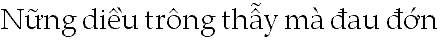
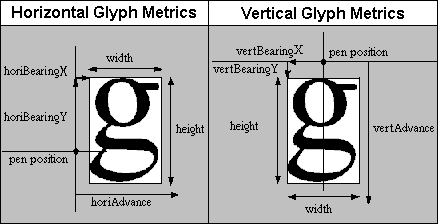
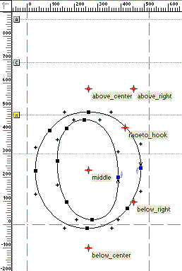

# Overview

Source: [Glyph positioning](https://learn.microsoft.com/en-us/typography/opentype/spec/gpos) · OpenType 1.9.1 website snapshot.

[Document index](../README.md) · [Topic guide](../../../../../README.md) · [Publisher](https://learn.microsoft.com/en-us/typography/opentype/spec/gpos).

HTML normalized to Markdown. Complex tables and mathematical markup retain HTML; illustrations are stored locally.

[Next](002-gpos-table-and-opentype-font-variations.md)

## Overview

The Glyph Positioning table (GPOS) provides precise control over glyph placement for sophisticated text layout and rendering in each script and language system that a font supports.

Complex glyph positioning becomes an issue in many writing systems, such as Vietnamese, that use diacritical and other marks to modify the sound or meaning of characters. These writing systems require controlled placement of all marks in relation to one another for legibility and linguistic accuracy.

Figure 4a. Vietnamese words with marks.

Other writing systems require sophisticated glyph positioning for correct typographic composition. For instance, Urdu glyphs are calligraphic and connect to one another along a descending, diagonal text line that proceeds from right to left. To properly render Urdu, a text-processing client must modify both the horizontal (X) and vertical (Y) positions of each glyph (see Figure 4b).

Figure 4b. Urdu layout requires glyph positioning control, as well as contextual substitution

With the GPOS table, a font developer can define a complete set of positioning adjustment features. GPOS data, organized by script and language system, is easy for a text-processing client to use to position glyphs.

**Basic glyph positioning**

Basic text layout implementations that do not make use of the GPOS table rely on two values to determine a glyph’s position: placement, and advance. If glyphs are positioned with respect to a virtual “pen point” that moves along a line of text, placement describes the glyph’s position with respect to the current pen point, and advance describes where to move the pen point to position the next glyph (see Figure 4c). For horizontal text, placement corresponds to the left side bearing, and advance corresponds to the advance width.

Figure 4c. Basic glyph positioning

Apart from the GPOS tables, other font tables specify placement and advance only in the X direction for horizontal layout and only in the Y direction for vertical layout. For simple layout of some writing systems, these two values could provide for adequate glyph positioning. For more sophisticated layout, however, the values need to cover a richer range. Placement and advance may need adjustment vertically, as well as horizontally.

The only positioning adjustment defined in other font tables is pair kerning, supported by the legacy ['kern'](../../kern/README.md) table, which modifies the horizontal spacing between two glyphs. A typical kerning table lists pairs of glyphs and specifies how much space a text-processing client should add or remove between the glyphs to properly display each pair. It does not provide specific information about how to adjust the glyphs in each pair and cannot adjust contexts of more than two glyphs.

**Advanced glyph positioning**

The GPOS table provides excellent control and flexibility for positioning a single glyph and for positioning multiple glyphs in relation to one another. By using both X and Y values that the GPOS table defines for placement and advance and by using glyph attachment points, a client can more precisely adjust the position of a glyph.

In addition, the GPOS table can reference a Device table to define subtle, device-dependent adjustments to any placement or advance value at any font size and device resolution. For example, a Device table can specify adjustments at 51 pixels per em (ppem) that do not occur at 50 ppem.

X and Y values specified for placement operations are always within the typical Cartesian coordinate system (origin at the baseline of the left side), regardless of the writing direction. Additionally, all values specified are done so in font unit measurements. This is especially convenient for font designers, since glyphs are drawn in the same coordinate system. However, it’s important to note that the meaning of “advance width” changes, depending on the writing direction.

For example, in left-to-right scripts, if the first glyph has an advance width of 100, then the second glyph begins at 100,0. In right-to-left scripts, if the first glyph has an advance width of 100, then the second glyph begins at -100,0. For a top-to-bottom feature, to increase the advance height of a glyph by 100, the YAdvance = 100. For any feature, regardless of writing direction, to lower the dieresis over an “o” by 10 units, set the YPlacement = -10.

Other GPOS features can define attachment points to combine glyphs and position them with respect to one another. A glyph might have multiple attachment points. The point used will depend on the glyph to be attached. For instance, a base glyph could have attachment points for different diacritical marks.

Figure 4d. Base glyph with multiple attachment points.

To reduce the size of the font file, a base glyph may use the same attachment point for all mark glyphs assigned to a particular class. For example, a base glyph could have two attachment points, one above and one below the glyph. Then all marks that attach above glyphs would be attached at the high point, and all marks that attach below glyphs would be attached at the low point. Attachment points are useful in scripts such as Arabic that combine numerous glyphs with vowel marks.

Attachment points also are useful for connecting cursive-style glyphs. Glyphs in cursive fonts can be designed to attach or overlap when rendered. Alternatively, the font developer can use the GPOS table to create a cursive attachment feature and define explicit exit and entry attachment points for each glyph (see Figure 4e).

Figure 4e. Entry and exit points marked on contextual Urdu glyph variants

The GPOS table supports eight types of actions for positioning and attaching glyphs:

- A *single adjustment* positions one glyph, such as a superscript or subscript.
- A *pair adjustment* positions two glyphs with respect to one another. Kerning is an example of pair adjustment.
- A *cursive attachment* describes cursive scripts and other glyphs that are connected with attachment points when rendered.
- A *mark-to-base attachment* positions combining marks with respect to base glyphs, as when positioning vowels, diacritical marks, or tone marks in Arabic, Hebrew, and Vietnamese.
- A *mark-to-ligature attachment* positions combining marks with respect to ligature glyphs. Because ligatures may have multiple points for attaching marks, the font developer needs to associate each mark with one of the ligature glyph’s components.
- A *mark-to-mark attachment* positions one mark relative to another, as when positioning tone marks with respect to vowel diacritical marks in Vietnamese.
- *Contextual positioning* describes how to position one or more glyphs in context, within an identifiable sequence of specific glyphs, glyph classes, or varied sets of glyphs. One or more positioning operations may be performed on “input” context sequences. Figure 4f illustrates a context for positioning adjustments.
- *Chained contexts positioning* describes how to position one or more glyphs in a chained context, within an identifiable sequence of specific glyphs, glyph classes, or varied sets of glyphs. One or more positioning operations may be performed on “input” context sequences.

Figure 4f. Contextual positioning lowered the accent over a vowel glyph that followed an overhanging uppercase glyph

The GPOS data formats used to implement the different types of positioning and attaching actions include a ninth type, *positioning extension*. This provides a format extension mechanism, allowing reference to subtables using 32-bit offsets rather than 16-bit offsets. It does not provide an additional type of positioning action, however.

