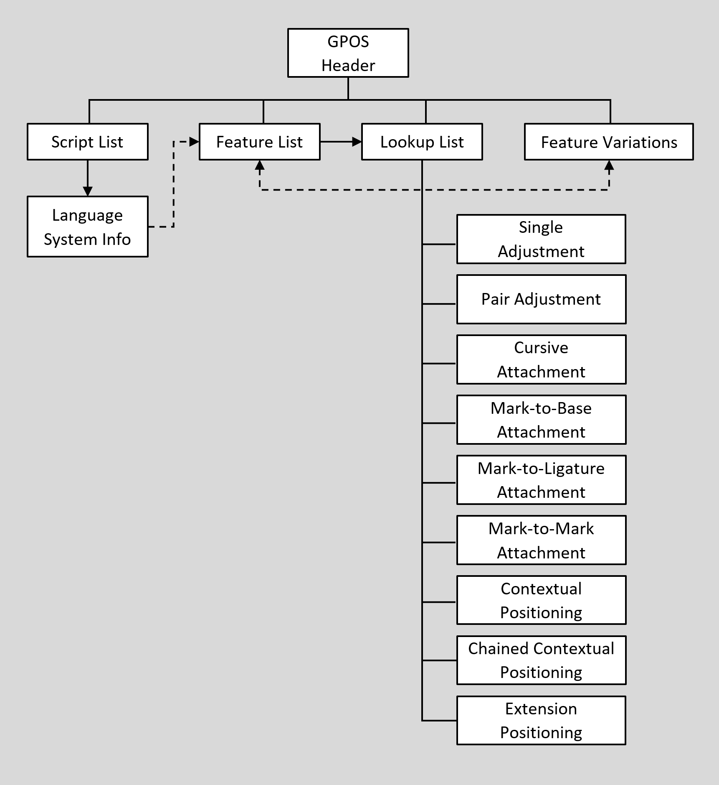

# GPOS table and OpenType Font Variations

Source: [Glyph positioning](https://learn.microsoft.com/en-us/typography/opentype/spec/gpos) · OpenType 1.9.1 website snapshot.

[Document index](../README.md) · [Topic guide](../../../../../README.md) · [Publisher](https://learn.microsoft.com/en-us/typography/opentype/spec/gpos).

HTML normalized to Markdown. Complex tables and mathematical markup retain HTML; illustrations are stored locally.

[Previous](001-overview.md) · [Next](003-gpos-table-structures.md)

## GPOS table and OpenType Font Variations

OpenType Font Variations allow a single font to support many design variations along one or more axes of design variation. For example, a font with weight and width variations might support weights from thin to black, and widths from ultra-condensed to ultra-expanded. For general information on OpenType Font Variations, see the chapter, [OpenType Font Variations Overview.](https://learn.microsoft.com/en-us/typography/opentype/spec/otvaroverview)

When different variation instances are selected, the design of individual glyphs changes. The same contours and points are used, but the position in the design grid of each point can change, as can the default horizontal or vertical advance and side bearings. As a result, corresponding changes may also be required for positioning and advance adjustments in the GPOS table.

Positioning actions in the GPOS table can be expressed directly using explicit X or Y font-unit values. In a variable font, these X and Y values apply to the default instance and may need to be adjusted for the current variation instance. This is done using variation data with processes similar to those used for glyph outlines and other font data, as described in the OpenType Font Variations Overview chapter.

For certain GPOS actions, positions can be expressed indirectly by reference to specific glyph outline points. In a variable font, use of glyph points to specify a positioning action would require invoking the rasterizer to process the glyph-outline variation data in order to obtain the adjusted position of the point before the glyph positioning operation can be completed. This could have a significant, negative impact on performance of text-layout processing. For this reason, in a variable font, positions that require adjustment for different variation instances should always be expressed directly as X and Y values.

Variation data for adjustment of GPOS X or Y values is stored within an *ItemVariationStore* table located within the [GDEF](../../gdef/README.md) table. The same item variation store is also used for adjustment of values in the GDEF and JSTF tables. The item variation store and constituent formats are described in the chapter, [OpenType Font Variations Common Table Formats](https://learn.microsoft.com/en-us/typography/opentype/spec/otvarcommonformats).

The variation data within an item variation store is comprised of a number of adjustment deltas that get applied to the default values of target items for variation instances within particular regions of the font’s variation space. The item variation store format uses *delta-set indices* to reference variation delta data for particular target, font-data items to which they are applied. Data external to the item variation store identifies the delta-set index to be used for each given target item. Within the GPOS table, these indices are specified within *VariationIndex* tables, with one VariationIndex table referenced for each item that requires variation adjustment.

Note that the VariationIndex table is a variant of a Device table, with a distinct format value. (For full details on the [Device and VariationIndex](../../chapter2/chunks/009-device-and-variationindex-tables.md#devVarIdxTbls) table formats, see the chapter, [OpenType Layout Common Table Formats](../../chapter2/README.md).) As a result, variable fonts cannot use device tables. A VariationIndex table will be ignored in applications that do not support Font Variations, or if the font is not a variable font.

## GPOS table organization

The GPOS table begins with a header that defines offsets to a ScriptList, a FeatureList, a LookupList, and an optional FeatureVariations table (see Figure 4g):

- The [ScriptList](../../chapter2/chunks/002-scripts-and-languages.md#slTbl_sRec) identifies all the scripts and language systems in the font that use glyph positioning.
- The [FeatureList](../../chapter2/chunks/003-features-and-lookups.md#flTbl) defines all the glyph positioning features required to render these scripts and language systems.
- The [LookupList](../../chapter2/chunks/004-lookuplist-table.md#lulTbl) contains all the lookup data needed to implement each glyph positioning feature.
- The [FeatureVariations](../../chapter2/chunks/010-feature-variations.md#featVarTbl) table can be used to substitute an alternate set of lookup tables to use for any given feature under specified conditions. This is currently used only in variable fonts.

For a detailed discussion of ScriptLists, FeatureLists, LookupLists, and FeatureVariation tables, see the chapter, [OpenType Layout Common Table Formats](../../chapter2/README.md) .

Figure 4g. High-level organization of GPOS table

The GPOS table is organized so text processing clients can easily locate the features and lookups that apply to a particular script or language system. To access GPOS information, clients should use the following procedure:

1. Locate the current script in the GPOS ScriptList table.
2. If the language system is known, search the script for the correct LangSys table; otherwise, use the script’s default LangSys table.
3. The LangSys table provides index numbers into the GPOS FeatureList table to access a required feature and a number of additional features.
4. Inspect the featureTag of each feature, and select the feature tables to apply to an input glyph string.
5. If a Feature Variation table is present, evaluate conditions in the Feature Variation table to determine if any of the initially-selected feature tables should be substituted by an alternate feature table.
6. Each feature table provides an array of index numbers into the GPOS LookupList table. Assemble all lookups from the set of chosen feature tables, and apply the lookups in the order given in the LookupList table.

For a detailed description of the Feature Variation table and how it is processed, see the chapter, [OpenType Layout Common Table Formats](../../chapter2/README.md).

Lookup data is defined in [Lookup tables](../../chapter2/chunks/004-lookuplist-table.md#lookupTbl), which are defined in the OpenType Layout Common Table Formats chapter. A Lookup table contains one or more subtables that define the specific conditions, type, and results of a positioning action used to implement a feature. Specific Lookup subtable types are used for glyph positioning actions, and are defined in this chapter. All subtables within a Lookup table must be of the same lookup type, as listed in the following table for the GposLookupType enumeration:

*GposLookupType enumeration*

| Value | Type | Description |
| --- | --- | --- |
| 1 | [Single adjustment](003-gpos-table-structures.md#SP) | Adjust position of a single glyph |
| 2 | [Pair adjustment](003-gpos-table-structures.md#PP) | Adjust position of a pair of glyphs |
| 3 | [Cursive attachment](004-lookup-type-3-subtable-cursive-attachment-positioning.md#CAP) | Attach cursive glyphs |
| 4 | [Mark-to-base attachment](005-lookup-type-4-subtable-mark-to-base-attachment-positioning.md#MBP) | Attach a combining mark to a base glyph |
| 5 | [Mark-to-ligature attachment](005-lookup-type-4-subtable-mark-to-base-attachment-positioning.md#MLP) | Attach a combining mark to a ligature |
| 6 | [Mark-to-mark attachment](006-lookup-type-6-subtable-mark-to-mark-attachment-positioning.md#MMP) | Attach a combining mark to another mark |
| 7 | [Contextual positioning](006-lookup-type-6-subtable-mark-to-mark-attachment-positioning.md#CP) | Position one or more glyphs in context |
| 8 | [Chained contexts positioning](007-lookup-type-8-subtable-chained-contexts-positioning.md#CCP) | Position one or more glyphs in chained context |
| 9 | [Positioning extension](007-lookup-type-8-subtable-chained-contexts-positioning.md#EP) | Extension mechanism for other positionings |

Each lookup type has one or more subtable formats. The “best” format depends on the type of positioning operation and the resulting storage efficiency. When glyph information is best presented in more than one format, a single lookup may define more than one subtable, as long as all the subtables are of the same lookup type. For example, within a given lookup, a glyph index array format could best represent one set of target glyphs, whereas a glyph index range format could be better for another set.

Certain structures are used across multiple GPOS lookup subtable types and formats. All lookup subtables use the [Coverage table](../../chapter2/README.md), which is defined in the OpenType Layout Common Table Formats chapter. Single and pair adjustments (lookup types 1 and 2) use a [*ValueRecord*](007-lookup-type-8-subtable-chained-contexts-positioning.md#valueRecord) structure and associated *ValueFormat* enumeration; attachment subtables (lookup types 3, 4, 5 and 6) use [*Anchor*](007-lookup-type-8-subtable-chained-contexts-positioning.md#anchorTables) and [*MarkArray*](008-mark-array-table.md#markArrayTable) tables. These shared formats are defined later in this chapter.

A series of positioning operations on the same glyph or string requires multiple lookups, one for each separate action. Each lookup has a different array index in the LookupList table and is applied in the LookupList order. The positioning adjustment of each lookup is applied to the result of previous lookups. When the adjustments are expressed as absolute placement or advance adjustments in the X or Y direction, these adjustments are accumulated as each lookup is processed. For adjustments expressed using attachment points, however, attachment point positioning can override the effect of preceding lookups.

During text processing, a client applies a lookup to each glyph in the string before moving to the next lookup. A lookup is finished for a glyph after the client locates the target glyph or glyph context and performs a positioning action, if specified. To move to the “next” glyph, the client will skip all the glyphs that participated in the lookup operation: glyphs that were positioned as well as any other glyphs that formed an input sequence context for the operation. Only glyphs in the input sequence are skipped; in the case of chained contexts positioning, the glyphs in the lookahead sequence are not skipped.

There is just one exception: the “next” glyph in a sequence may be one of those that formed a context for the operation just performed. Specifically, in the case of pair positioning operations (i.e., kerning), if the ValueRecord for the second glyph is null, that glyph is treated as the “next” glyph in the sequence.

The next section of this chapter describes the GPOS header and the subtables defined for each GposLookupType. [Examples](008-mark-array-table.md#examples) at the end of this chapter illustrate the GPOS header and seven of the nine lookup types, as well as the ValueRecord and Anchor and MarkArray tables.

