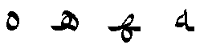
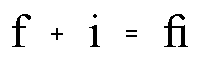
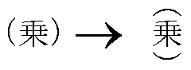
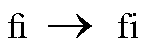
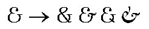
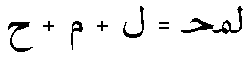

# Overview

Source: [Glyph substitution](https://learn.microsoft.com/en-us/typography/opentype/spec/gsub) · OpenType 1.9.1 website snapshot.

[Document index](../README.md) · [Topic guide](../../../../../README.md) · [Publisher](https://learn.microsoft.com/en-us/typography/opentype/spec/gsub).

HTML normalized to Markdown. Complex tables and mathematical markup retain HTML; illustrations are stored locally.

[Next](002-gsub-table-organization.md)

## Overview

The Glyph Substitution (GSUB) table provides data for substitution of glyphs for appropriate rendering of scripts, such as cursively-connecting forms in Arabic script, or for advanced typographic effects, such as ligatures.

Many language systems require substitution of alternate glyph forms. For example, in the Arabic script, the glyph shape that depicts a particular character varies according to its position in a word or text string (see Figure 1). In other language systems, glyph substitutes are aesthetic options for the user, such as the use of ligature glyphs in the English language (see Figure 2).

Figure 1. Isolated, initial, medial, and final forms of the Arabic character HAH

Figure 2. Two Latin glyphs and their associated ligature

OpenType fonts use character encoding standards, such as the Unicode Standard, that assumes a distinction between characters and glyphs: text is encoded as sequences of characters, and the ['cmap' table](../../cmap/README.md) provides a mapping from that character to a single default glyph. Multiple characters are not directly mapped to a single glyph, as needed for ligatures; and a single character is not mapped directly to multiple glyphs, as may be needed for some complex-script scenarios. The GSUB table provides a way to describe such substitutions, enabling applications to apply such substitutions during text layout and rendering to achieve desired results.

To access substitute glyphs, GSUB maps from the glyph index or indices defined in a 'cmap' subtable to the glyph index or indices of the substitute glyphs. For example, if a font has three alternative forms of an ampersand glyph, the 'cmap' table associates the ampersand’s character code with only one of these glyphs. In GSUB, the indices of the other ampersand glyphs are then referenced from this one default index.

The text-processing client uses the GSUB data to manage glyph substitution actions. GSUB identifies the glyphs that are input to and output from each glyph substitution action, specifies how and where the client uses glyph substitutes, and regulates the order of glyph substitution operations. Any number of substitutions can be defined for each script or language system represented in a font.

The GSUB table supports seven types of glyph substitutions that are widely used in international typography:

- A *single substitution* replaces a single glyph with another single glyph. This is used, for example, to render positional glyph variants in Arabic and vertical text in East Asia (see Figure 3).

    

  Figure 3. Alternative forms of parentheses used when positioning Kanji vertically
- A *multiple substitution* replaces a single glyph with more than one glyph. This is used to specify actions such as ligature decomposition (see Figure 4).

   

  Figure 4. Decomposing a Latin ligature glyph into its individual glyph components
- An *alternate substitution* identifies functionally equivalent but different looking forms of a glyph. These glyphs are often referred to as aesthetic alternatives. For example, a font might have five different glyphs for the ampersand symbol, but one would have a default glyph index in the 'cmap' table. The client could use the default glyph or substitute any of the four alternatives (see Figure 5).

  

  Figure 5. Alternative ampersand glyphs in a font
- A *ligature substitution* replaces several glyph indices with a single glyph index, as when an Arabic ligature glyph replaces a string of separate glyphs (see Figure 6). When a string of glyphs can be replaced with a single ligature glyph, the first glyph is substituted with the ligature. The remaining glyphs in the string are deleted, this *does not* include those glyphs that are skipped as a result of lookup flags.

  

  Figure 6. Three Arabic glyphs and their associated ligature glyph
- *Contextual substitution* is an extension of the above lookup types, describing glyph substitutions in context — that is, a substitution of one or more glyphs within a certain pattern of glyphs. Each substitution describes one or more input glyph sequences and one or more substitutions to be performed on that sequence. Contextual substitutions can be applied to specific glyph sequences, glyph classes, or sets of glyphs.
- *Chained contexts substitution* extends the capabilities of contextual substitution. As with contextual substitution, actions can be performed on one or more glyphs within a pattern of glyphs—the *input sequence*. But the actions can be constrained by chained glyph sequence contexts: a *backtrack* sequence that precedes the input sequence, and a *lookahead* sequence that follows the input sequence. Three formats allow the backtrack, input and lookahead sequence patterns to be described using specific glyphs, glyph classes, or glyph sets.
- *Reverse Chaining contextual single substitution* allows one glyph to be substituted with another by chaining input glyph to a backtrack and/or lookahead sequence. The difference between this and other lookup types is that processing of input glyph sequence goes from end to start.

The GSUB data formats used to implement the different types of substitution include an eighth type, *substitution extension*. This provides a format extension mechanism, allowing reference to subtables using 32-bit offsets rather than 16-bit offsets. It does not provide an additional type of substitution action, however.

## GSUB table and OpenType Font Variations

OpenType Font Variations allow a single font to support many design variations along one or more axes of design variation. For example, a font with weight and width variations might support weights from thin to black, and widths from ultra-condensed to ultra-expanded. For general information on OpenType Font Variations, see the chapter, [OpenType Font Variations Overview](https://learn.microsoft.com/en-us/typography/opentype/spec/otvaroverview).

In a variable font, it may be desirable to have different glyph-substitution actions used for different regions within the font’s variation space. For example, for narrow or heavy instances in which counters become small, it may be desirable to make certain glyph substitutions to use alternate glyphs with certain strokes removed or outlines simplified to allow for larger counters. Such effects can be achieved using a FeatureVariations table within the GSUB table. The FeatureVariations table is described in the chapter, [OpenType Layout Common Table Formats](../../chapter2/README.md). See also the [Required Variation Alternates ('rvrn')](https://learn.microsoft.com/en-us/typography/opentype/spec/features_pt#rvrn) feature in the OpenType Layout tag registry.

