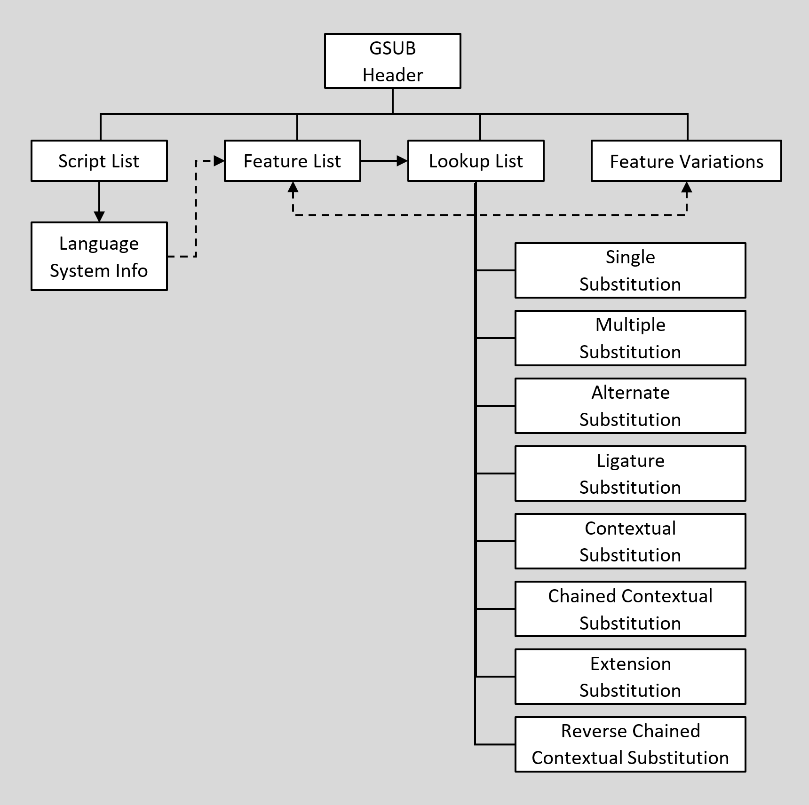

# GSUB table organization

Source: [Glyph substitution](https://learn.microsoft.com/en-us/typography/opentype/spec/gsub) · OpenType 1.9.1 website snapshot.

[Document index](../README.md) · [Topic guide](../../../../../README.md) · [Publisher](https://learn.microsoft.com/en-us/typography/opentype/spec/gsub).

HTML normalized to Markdown. Complex tables and mathematical markup retain HTML; illustrations are stored locally.

[Previous](001-overview.md) · [Next](003-gsub-table-structures.md)

## GSUB table organization

The GSUB table begins with a header that defines offsets to a ScriptList, a FeatureList, a LookupList, and an optional FeatureVariations table (see Figure 7):

- The [ScriptList](../../chapter2/chunks/002-scripts-and-languages.md#slTbl_sRec) identifies all the scripts and language systems in the font that use glyph substitutes.
- The [FeatureList](../../chapter2/chunks/003-features-and-lookups.md#flTbl) defines all the glyph substitution features required to render these scripts and language systems.
- The [LookupList](../../chapter2/chunks/004-lookuplist-table.md#lulTbl) contains all the lookup data needed to implement each glyph substitution feature.
- The [FeatureVariations](../../chapter2/chunks/010-feature-variations.md#featVarTbl) table can be used to substitute alternate sets of lookup tables to use for any given feature under specified conditions. This is currently used only in variable fonts.

For a detailed discussion of ScriptLists, FeatureLists, LookupLists, and FeatureVariation tables, see the chapter, [OpenType Layout Common Table Formats.](../../chapter2/README.md)

Figure 7. High-level organization of GSUB table

This organization helps text-processing clients to easily locate the features and lookups that apply to a particular script or language system. To access GSUB information, clients should use the following procedure:

1. Locate the current script in the GSUB ScriptList table.
2. If the language system is known, search the script for the correct LangSys table; otherwise, use the script’s default LangSys table.
3. The LangSys table provides index numbers into the GSUB FeatureList table to access a required feature and a number of additional features.
4. Inspect the featureTag of each feature, and select the feature tables to apply to an input glyph string.
5. If a Feature Variations table is present, evaluate conditions in the Feature Variation table to determine if any of the initially-selected feature tables should be substituted by an alternate feature table.
6. Each feature table provides an array of index numbers into the GSUB LookupList table. Assemble all lookups from the set of chosen features, and apply the lookups in the order given in the LookupList table.

For a detailed description of the Feature Variations table and how it is processed, see the [FeatureVariations table](../../chapter2/chunks/010-feature-variations.md#featVarTbl) section in the OpenType Layout Common Table Formats chapter.

Lookup data is defined in [Lookup tables](../../chapter2/chunks/004-lookuplist-table.md#lookupTbl), which are defined in the OpenType Layout Common Table Formats chapter. A Lookup table contains one or more Lookup subtables that define the specific conditions, type, and results of a substitution action used to implement a feature. Specific Lookup subtable types are used for glyph substitution actions, and are defined in this chapter. All subtables within a Lookup table must be of the same lookup type, as listed in the following table for the GsubLookupType enumeration:

*GsubLookupType enumeration*

| Value | Type | Description |
| --- | --- | --- |
| 1 | [Single](003-gsub-table-structures.md#SS) | Replace one glyph with one glyph |
| 2 | [Multiple](003-gsub-table-structures.md#MS) | Replace one glyph with more than one glyph |
| 3 | [Alternate](004-lookup-type-3-subtable-alternate-substitution.md#AS) | Replace one glyph with one of many glyphs |
| 4 | [Ligature](004-lookup-type-3-subtable-alternate-substitution.md#LS) | Replace multiple glyphs with one glyph |
| 5 | [Contextual substitution](004-lookup-type-3-subtable-alternate-substitution.md#CS) | Replace one or more glyphs in context |
| 6 | [Chained contexts substitution](005-lookup-type-6-subtable-chained-contexts-substitution.md#CC) | Replace one or more glyphs in chained context |
| 7 | [Substitution extension](005-lookup-type-6-subtable-chained-contexts-substitution.md#ES) | Extension mechanism for other substitution types |
| 8 | [Reverse chaining context single](005-lookup-type-6-subtable-chained-contexts-substitution.md#RCCS) | Applied in reverse order, replace single glyph in chained contexts |

Each lookup type has one or more subtable formats. The “best” format depends on the type of substitution and the resulting storage efficiency. When glyph information is best presented in more than one format, a single lookup may define more than one subtable, as long as all the subtables are for the same lookup type. For example, within a given lookup, a glyph index array format could best represent one set of target glyphs, whereas a glyph index range format could be better for another set.

A series of substitution operations on the same glyph or string requires multiple lookups, one for each separate action. Each lookup has a different array index in the LookupList table and is applied in the LookupList order. The substitution action of each lookup is applied to the results of previous lookups. Some substitution lookups could “feed” later lookups by producing a glyph sequence that matches the input sequence pattern of a later lookup that would not have matched the original glyph sequence. The opposite is also possible: one substitution lookup produces a glyph sequence that does *not* match the pattern of a later lookup that *would* have matched the original glyph sequence. Thus, the ordering of lookups in the LookupList can be very significant.

During text processing, a client applies a lookup to each glyph in the string before moving to the next lookup. A lookup is finished for a glyph after the client locates the target glyph or glyph context and performs a substitution, if specified. To move to the “next” glyph, the client will skip all the glyphs that participated in the lookup operation: glyphs that were substituted as well as any other glyphs that formed an input sequence context for the operation. Only glyphs in the input sequence are skipped; in the case of chained contexts substitution, the glyphs in the lookahead sequence are not skipped.

The next section of this chapter describes the GSUB header and the subtables defined for each GsubLookupType. [Examples](006-gsub-structure-examples.md#examples) at the end of this chapter illustrate the GSUB header and six of the eight LookupTypes, including the three formats available for contextual substitutions (LookupType 5).

