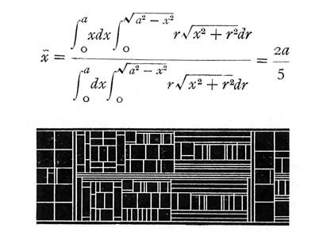

# Overview

Source: [Mathematical typesetting table](https://learn.microsoft.com/en-us/typography/opentype/spec/math) · OpenType 1.9.1 website snapshot.

[Document index](../README.md) · [Topic guide](../../../../../README.md) · [Publisher](https://learn.microsoft.com/en-us/typography/opentype/spec/math).

HTML normalized to Markdown. Complex tables and mathematical markup retain HTML; illustrations are stored locally.

[Next](002-math-header.md)

## Overview

Mathematical formulas are complex text objects in which multiple elements with various metric, style or positioning attributes are combined. In order for a math layout engine to support layout of mathematical formulas, several types of font-specific information particular to the layout of formulas are required. The MATH table provides this font-specific information necessary for math formula layout.

Note that this is not a complete specification of math layout. The MATH table provides font data required for math layout, but detailed algorithms for use of the data are not specified. Different math layout engine implementations can use this data to produce different layout results in accordance with different purposes or goals.

Layout of math formulas is quite different from regular text layout that is done using tables such as GSUB and GPOS. Regular text layout mainly deals with a line of text, often formatted with a single font. In this situation, actions such as contextual substitution or kerning can be done with access to the complete context of the line of text, and the rules can be expressed in terms of known glyph sequences. Math layout is quite different from this.

The general structure of math formulas is hierarchical, with formulas composed of smaller sub-formula expressions, where each expression may be composed of even simpler expressions, and so on down to individual strings — operator symbols, variable names and numbers.

Figure MATH.1. A complex math formula and a diagram showing the pieces of metal type and spacing materials used in a traditional printing application

Likewise, the process of math formula layout is also recursive. Child components are formatted first and then arranged to form their parent’s layout with this process repeated on every level starting from simplest blocks up to the whole formula. Each sub-formula has its own component structure and rules for how to perform layout. For example, a fraction expression consists of numerator and denominator sub-expressions, which will be placed on top one another with a fraction rule separating them. An integral expression contains an integral sign, optional upper-limit and lower-limit expressions, and a following sub-expression.

The simplest blocks within a formula typically contain strings. In isolation, each could be laid out by regular text-layout processing using other tables such as GSUB and GPOS. Math layout goes beyond this. It deals mainly with layout processing involved in composing these simple blocks together into a complex, hierarchical formula. The data provided in the MATH table allows math layout processing to be typographically aware, so that presentation with high typographic quality can be achieved.

A math layout engine works with boxes representing individual formula components as units of layout. During the layout process, individual boxes can be arranged relative to each other; they can be stretched, depending on the sizes of other boxes they interact with; or they can use different glyph variants, based on the box size or position in the formula. The MATH table provides data that informs how these operations are done. Each box has an associated font that supplies information comprising typographic requirements for that box. These may be requirements for that box alone, based on the results of layout operations internal to the box; or they may be requirements on how other boxes interact with that box in layout.

By providing information about a font generally or about specific glyphs in the font, the MATH table can enable math-layout engines to produce layout that is appropriate for the font design, and that realizes the font’s full typographic potential by using stylistic and stretching glyph variants provided by the font.

## MATH table structures

### Shared formats: MathValueRecord, Coverage table

#### MathValueRecord

MATH subtables use math value records to describe values that place or adjust elements of math formulas. These values are expressed in font design units.

A MathValueRecord may also specify an offset to a device table which provides corrections to a given value at particular display resolutions. The device table format is described in the [OpenType Layout Common Table Formats](../../chapter2/chunks/009-device-and-variationindex-tables.md#devVarIdxTbls) chapter. The device table can provide multiple correction values to be used for several different PPEM sizes. Different formats for representing the correction values are provided to allow for efficient representation, according to the size requirements of the correction values. When used in MathValueRecords, format 1 is recommended.

When designing a MATH table, device tables can be specified for many values used for positioning elements of a formula. This creates the potential that many device corrections could accumulate in a given layout. However, such accumulation would result in metrics for formula elements that are significantly different from scale-adjusted dimensions of the same elements rendered on a high-resolution device. It would produce inconsistencies between screen and print renditions, and could also lead to clipping. For these reasons, accumulation of many corrections is undesirable.

While a font may specify device corrections, use of these corrections is under the control of a given layout engine implementation. To maintain consistency across devices with different resolutions, an engine may limit the number of device corrections that are accumulated, or may ignore them altogether. A layout engine may also supply its own corrections where none are indicated in the font. Since the accumulated size of corrections should be kept to a minimum, it is recommended that device tables referenced by a MathValueRecord use format 1 for representation of correction values. This format allows corrections of at most -2 to +1 pixels. The recommended values to use in MathValueRecords are -1, 0, or 1.

*MathValueRecord*

| Type | Name | Description |
| --- | --- | --- |
| FWORD | value | The X or Y value in design units. |
| Offset16 | deviceOffset | Offset to the device table, from the beginning of parent table. May be NULL. Suggested format for device table is 1. |

#### Coverage table

MATH subtables make use of [Coverage tables](../../chapter2/chunks/005-coverage-table.md#coverageTbl), defined in the OpenType Layout Common Table Formats chapter, to specify sets of glyphs. All Coverage table formats may be used in the MATH table.

