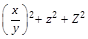
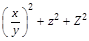
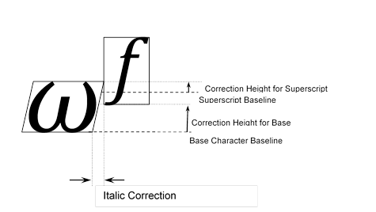

# MathGlyphInfo table

Source: [Mathematical typesetting table](https://learn.microsoft.com/en-us/typography/opentype/spec/math) · OpenType 1.9.1 website snapshot.

[Document index](../README.md) · [Topic guide](../../../../../README.md) · [Publisher](https://learn.microsoft.com/en-us/typography/opentype/spec/math).

HTML normalized to Markdown. Complex tables and mathematical markup retain HTML; illustrations are stored locally.

[Previous](003-continuation-3.md) · [Next](005-math-variants.md)

### MathGlyphInfo table

The MathGlyphInfo table contains positioning information that is defined on per-glyph basis. The table consists of the following parts:

- A MathItalicsCorrectionInfo table that contains information on italics correction values.
- A MathTopAccentAttachment table that contains horizontal positions for attaching mathematical accents.
- An Extended Shape coverage table. The glyphs covered by this table are to be considered extended shapes.
- A MathKernInfo table that provides per-glyph information for mathematical kerning.

*MathGlyphInfo table*

| Type | Name | Description |
| --- | --- | --- |
| Offset16 | mathItalicsCorrectionInfoOffset | Offset to MathItalicsCorrectionInfo table, from the beginning of the MathGlyphInfo table. |
| Offset16 | mathTopAccentAttachmentOffset | Offset to MathTopAccentAttachment table, from the beginning of the MathGlyphInfo table. |
| Offset16 | extendedShapeCoverageOffset | Offset to ExtendedShapes coverage table, from the beginning of the MathGlyphInfo table. When the glyph to the left or right of a box is an extended shape variant, the (ink) box should be used for vertical positioning purposes, not the default position defined by values in MathConstants table. May be NULL. |
| Offset16 | mathKernInfoOffset | Offset to MathKernInfo table, from the beginning of the MathGlyphInfo table. |

### MathItalicsCorrectionInfo table

The MathItalicsCorrectionInfo table contains italics correction values for slanted glyphs used in math layout. The top portion of slanted glyphs may protrude beyond the glyph’s advance width. This can result in collision with other interacting elements, or an appearance in the placement of other interacting elements that is unpleasing unless some accommodation is made for the protrusion. The MathItalicsCorrectionInfo table provides correction values to accommodate for such protrusion.

The table consists of the following parts:

- Coverage of glyphs for which the italics correction values are provided. Italics correction is assumed to be zero for all other glyphs.
- Count of covered glyphs.
- Array of italic correction values for each covered glyph, in order of coverage. The italics correction value can be used as an adjustment for positioning of interacting elements to make allowance for protrusion to the right of the top part of the glyph. For example, taller letters tend to have larger italics correction, and a *V* will probably have larger italics correction than an *L*.

Italics correction can be used in the following situations:

- When a run of slanted characters is followed by a straight character (such as an operator or a delimiter), the italics correction of the last glyph is added to its advance width.
- When positioning limits on an N-ary operator (e.g., integral sign), the horizontal position of the upper limit is moved to the right by ½ of the italics correction, while the position of the lower limit is moved to the left by the same distance.
- When positioning superscripts and subscripts, their default horizontal positions are also different by the amount of the italics correction of the preceding glyph.

*MathItalicsCorrectionInfo table*

| Type | Name | Description |
| --- | --- | --- |
| Offset16 | italicsCorrectionCoverageOffset | Offset to Coverage table, from the beginning of MathItalicsCorrectionInfo table. |
| uint16 | italicsCorrectionCount | Number of italics correction values. Should coincide with the number of covered glyphs. |
| MathValueRecord | italicsCorrection[italicsCorrectionCount] | Array of MathValueRecords defining italics correction values for each covered glyph. |

### MathTopAccentAttachment table

The MathTopAccentAttachment table contains information on horizontal positioning of top math accents. The table consists of the following parts:

- Coverage of glyphs for which information on horizontal positioning of math accents is provided. To position accents over any other glyph, its geometrical center (with respect to advance width) can be used.
- Count of covered glyphs.
- Array of top accent attachment points for each covered glyph, in order of coverage. These attachment points are to be used for finding horizontal positions of accents over characters. It is done by aligning the attachment point of the base glyph with the attachment point of the accent. Note that this is very similar to mark-to-base attachment, but here alignment only happens in the horizontal direction, and the vertical positions of accents are determined by different means.

*MathTopAccentAttachment table*

| Type | Name | Description |
| --- | --- | --- |
| Offset16 | topAccentCoverageOffset | Offset to Coverage table, from the beginning of the MathTopAccentAttachment table. |
| uint16 | topAccentAttachmentCount | Number of top accent attachment point values. Must be the same as the number of glyph IDs referenced in the Coverage table. |
| MathValueRecord | topAccentAttachment[topAccentAttachmentCount] | Array of MathValueRecords defining top accent attachment points for each covered glyph. |

### ExtendedShapeCoverage table

The glyphs covered by this table are to be considered extended shapes. These glyphs are variants extended in the vertical direction, e.g., to match the height of another part of the formula. Because their dimensions may be very large in comparison with normal glyphs in the glyph set, the standard positioning algorithms will not produce the best results when applied to them. In the vertical direction, other formula elements will be positioned not relative to those glyphs, but instead to the ink box of the subexpression containing them.

For example, consider a fraction enclosed in parentheses with a superscript. Notice how the superscripts on ‘*z*’ and ‘*Z*’ are aligned vertically, although they have different heights. If the right parenthesis was not considered an extended shape, the superscript would be put in position aligned with any other superscript on the line, like this:

Because this is undesirable, the right parenthesis in this case should be considered an extended shape, resulting in superscript positioned relative to the whole subexpression:

### MathKernInfo table

The MathKernInfo table provides mathematical kerning values used for kerning of subscript and superscript glyphs relative to a base glyph. Its purpose is to improve spacing in situations such as 𝜔𝑓 or 𝑉𝐴.

Mathematical kerning is height dependent; that is, different kerning amounts can be specified for different heights within a glyph’s vertical extent. For any given glyph, different values can be specified for four corner positions — top-right, to-left, etc. — allowing for different kerning adjustments according to whether the glyph occurs as a subscript, a superscript, a base being kerned with a subscript, or a base being kerned with a superscript.

The kerning algorithm for subscripts and superscripts is as follows:

- Calculate the vertical positions of subscripts and superscripts using the MathConstants table.
- Set the default horizontal position for a subscript immediately after the base glyph.
- Set the default horizontal position for a superscript after the base, applying a shift for italics correction if indicated for the base glyph in the MathItalicsCorrectionInfo table.
- Calculate a superscript kerning value as follows:
  - Evaluate two correction heights (illustrated in the figure below):
    - At the bottom of the superscript-glyph bounding box. (The corresponding height for the base glyph is the distance from the base-glyph baseline to the bottom of the superscript bounding box.)
    - At the top of the base-glyph bounding box. (The corresponding height for the superscript glyph is the distance from the superscript baseline to the top of the base-glyph bounding box.)
  - For each correction height, add the top-right kerning value for the base glyph to the bottom-left kerning value for the superscript glyph.
  - Take the minimum of these two sums: kern the base and superscript by that amount.
- Calculate a subscript kerning value as follows:
  - Evaluate two correction heights:
    - At the top of the subscript-glyph bounding box. (The corresponding height for the base glyph is the distance from the base-glyph baseline to the top of the subscript bounding box.)
    - At the bottom of the base-glyph bounding box. (The corresponding height for the subscript glyph is the distance from the subscript baseline to the bottom of the base-glyph bounding box.)
  - For each correction height, add the bottom-right kerning value for the base glyph to the top-left kerning value for the subscript glyph.
  - Take the minimum of these two sums: kern the base and subscript by that amount.

If a base expression, subscript expression or superscript expression is a box, a math-layout engine may use kerning values of zero for each corner of the box, or may calculate height-dependent kerning amounts by some means.

The following figure illustrates the correction heights for a base and superscript:

Figure MATH.2. Example of horizontal and vertical kerning adjustments for superscript positioning

The MathKernInfo table consists of the following fields:

- A Coverage table of glyphs for which mathematical kerning information is provided. Mathematical kerning amounts are assumed to be zero for all other glyphs.
- Count of MathKernInfoRecords.
- Array of MathKernInfoRecords for each covered glyph, following the order of glyphs in the Coverage table.

*MathKernInfo table*

| Type | Name | Description |
| --- | --- | --- |
| Offset16 | mathKernCoverageOffset | Offset to Coverage table, from the beginning of the MathKernInfo table. |
| uint16 | mathKernCount | Number of MathKernInfoRecords. Must be the same as the number of glyph IDs referenced in the Coverage table. |
| MathKernInfoRecord | mathKernInfoRecords[mathKernCount] | Array of MathKernInfoRecords, one for each covered glyph. |

**MathKernInfoRecord**

Each MathKernInfoRecord points to up to four kern tables for each of the corners around the glyph. If no kern table is provided for a corner, a kerning amount of zero is assumed.

*MathKernInfoRecord*

| Type | Name | Description |
| --- | --- | --- |
| Offset16 | topRightMathKernOffset | Offset to MathKern table for top right corner, from the beginning of the MathKernInfo table. May be NULL. |
| Offset16 | topLeftMathKernOffset | Offset to MathKern table for the top left corner, from the beginning of the MathKernInfo table. May be NULL. |
| Offset16 | bottomRightMathKernOffset | Offset to MathKern table for bottom right corner, from the beginning of the MathKernInfo table. May be NULL. |
| Offset16 | bottomLeftMathKernOffset | Offset to MathKern table for bottom left corner, from the beginning of the MathKernInfo table. May be NULL. |

**MathKern table**

The MathKern table provides kerning amounts for different heights in a glyph’s vertical extent. An array of kerning values is provided, each of which applies to a height range. A corresponding array of heights indicate the transition points between consecutive ranges.

Correction heights for each glyph are relative to the glyph baseline, with positive height values above the baseline, and negative height values below the baseline. The correctionHeights array is sorted in increasing order, from lowest to highest.

The kerning value corresponding to a particular height is determined by finding two consecutive entries in the correctionHeight array such that the given height is greater than or equal to the first entry and less than the second entry. The index of the second entry is used to look up a kerning value in the kernValues array. If the given height is less than the first entry in the correctionHeights array, the first kerning value (index 0) is used. For a height that is greater than or equal to the last entry in the correctionHeights array, the last entry is used.

*MathKern table*

| Type | Name | Description |
| --- | --- | --- |
| uint16 | heightCount | Number of heights at which the kern value changes. |
| MathValueRecord | correctionHeight[heightCount] | Array of correction heights, in design units, sorted from lowest to highest. |
| MathValueRecord | kernValues[heightCount + 1] | Array of kerning values for different height ranges. Negative values are used to move glyphs closer to each other. |

