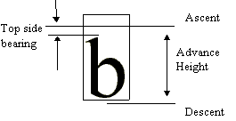

# Overview

Source: [Vertical metrics](https://learn.microsoft.com/en-us/typography/opentype/spec/vmtx) · OpenType 1.9.1 website snapshot.

[Document index](../README.md) · [Topic guide](../../../../../README.md) · [Publisher](https://learn.microsoft.com/en-us/typography/opentype/spec/vmtx).

HTML normalized to Markdown. Complex tables and mathematical markup retain HTML; illustrations are stored locally.

## Overview

The vertical metrics table allows you to specify the vertical spacing for each glyph in a vertical font. This table consists of either one or two arrays that contain metric information (the advance heights and top sidebearings) for the vertical layout of each of the glyphs in the font. The vertical metrics coordinate system is shown below.

OpenType™ vertical fonts require both a vertical header table (['vhea'](../../vhea/README.md)) and the vertical metrics table. The vertical header table contains information that is general to the font as a whole. The vertical metrics table contains information that pertains to specific glyphs. The formats of these tables are similar to those for horizontal metrics, ['hhea'](../../hhea/README.md) and ['hmtx'](../../hmtx/README.md).

See the section [OpenType CJK Font Guidelines](https://learn.microsoft.com/en-us/typography/opentype/spec/recom#cjk) for more information about constructing CJK (Chinese, Japanese, and Korean) fonts.

**Vertical origin and advance height**

The *y coordinate of a glyph’s vertical origin* is specified as the sum of the glyph’s top side bearing (recorded in the 'vmtx' table) and the top (i.e. maximum y) of the glyph’s bounding box.

OpenType fonts that use TrueType outlines contain glyph bounding box information in the Glyph Data ('glyf') table. Fonts that use CFF outlines do not contain glyph bounding box information, and so for these fonts the top of the glyph’s bounding box can only be calculated from the CharString data in the 'CFF ' or CFF2 table. The optional [Vertical Origin (VORG) table](https://learn.microsoft.com/en-us/typography/opentype/spec/vorg) can be used in fonts that use CFF glyph data to record the y coordinate of glyphs’ vertical origins directly, thus obviating the need to calculate bounding boxes as an intermediate step. This improves accuracy and efficiency for applications.

The *x coordinate of a glyph’s vertical origin* is not specified in the 'vmtx' table. Vertical writing implementations may make use of the baseline values in the Baseline (BASE) table, if present, in order to align the glyphs in the x direction as appropriate to the desired vertical baseline.

The *advance height of a glyph* starts from the y coordinate of the glyph’s vertical origin and advances downwards. Its endpoint is at the y coordinate of the vertical origin of the next glyph in the run, by default. Metric-adjustment OpenType layout features such as Vertical Kerning ('vkrn') could modify the vertical advances in a manner similar to kerning in horizontal mode.

## Table formats

The overall structure of the vertical metrics table consists of two arrays shown below: the vMetrics array followed by an array of top side bearings. The top side bearing is measured relative to the top of the origin of glyphs, for vertical composition of ideographic glyphs.

This table does not have a header, but does require that the number of glyphs included in the two arrays equals the total number of glyphs in the font.

The number of entries in the vMetrics array is determined by the value of the numOfLongVerMetrics field of the vertical header table.

The vMetrics array contains two values for each entry. These are the advance height and the top sidebearing for each glyph included in the array.

In monospaced fonts, such as Courier or Kanji, all glyphs have the same advance height. If the font is monospaced, only one entry need be in the first array, but that one entry is required.

The format of an entry in the vertical metrics array is given below.

| Type | Name | Description |
| --- | --- | --- |
| UFWORD | advanceHeight | The advance height of the glyph, in font design units. |
| FWORD | topSideBearing | The top sidebearing of the glyph, in font design units. |

The second array is optional and generally is used for a run of monospaced glyphs in the font. Only one such run is allowed per font, and it must be located at the end of the font. This array contains the top sidebearings of glyphs not represented in the first array, and all the glyphs in this array must have the same advance height as the last entry in the vMetrics array. All entries in this array are therefore monospaced.

The number of entries in this array is calculated by subtracting the value of numOfLongVerMetrics from the number of glyphs in the font. The sum of glyphs represented in the first array plus the glyphs represented in the second array therefore equals the number of glyphs in the font. The format of the top sidebearing array is given below.

| Type | Name | Description |
| --- | --- | --- |
| FWORD | topSideBearing[] | The top sidebearing of the glyph, in font design units. |
