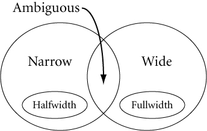
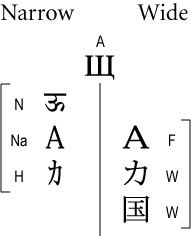

# 2 Scope

Source: [UAX #11: East Asian Width](https://www.unicode.org/reports/tr11/tr11-44.html) · Unicode 17.0.0, revision 44.

[Document index](../README.md) · [Topic guide](../../../../../README.md) · [Publisher](https://www.unicode.org/versions/Unicode17.0.0/).

HTML normalized to Markdown. Complex tables and mathematical markup retain HTML; illustrations are stored locally.

[Previous](001-unicode-standard-annex-11.md) · [Next](003-4-1-relation-to-the-terms-fullwidth-and-halfwidth.md)

<a id="Scope"></a>

## 2  [Scope](002-2-scope.md#Scope)

East\_Asian\_Width is a normative property and provides a useful concept for implementations that

- Have to interwork with East Asian legacy character encodings
- Support both East Asian and Western typography and line layout
- Need to associate fonts with unmarked text runs containing East Asian characters

This annex gives general guidelines how to use this property. It does not provide rules or specifications of how this property might be used in font design or line layout, because, while a useful property for this purpose, it is only one of several character properties that would need to be considered. While the specific assignments of property values for given characters may change over time, it is generally not intended to reflect evolving practice for existing characters. In particular some alphabetic and symbol characters are treated as wide in certain East Asian legacy character set implementations, and as narrow in all other cases. Instead, the guidelines on use of this property should be considered recommendations based on a particular legacy practice that may be overridden by implementations as necessary.

> **Note:** The East\_Asian\_Width property is not intended for use by modern terminal emulators without appropriate tailoring on a case-by-case basis. Such terminal emulators need a way to resolve the halfwidth/fullwidth dichotomy that is necessary for such environments, but the East\_Asian\_Width property does not provide an off-the-shelf solution for all situations. The growing repertoire of the Unicode Standard has long exceeded the bounds of East Asian legacy character encodings, and terminal emulations often need to be customized to support edge cases and for changes in typographical behavior over time.

<a id="Description"></a>

## 3  [Description](002-2-scope.md#Description)

By convention, 1/2 Em wide characters of East Asian legacy encodings are called “halfwidth” (or *hankaku* characters in Japanese); the others are called correspondingly “fullwidth” (or *zenkaku*) characters. Legacy encodings often use a single byte for the halfwidth characters and two bytes for the fullwidth characters. In the Unicode Standard, no such distinction is made, but understanding the distinction is often necessary when interchanging data with legacy systems, especially when fixed-size buffers are involved.

Some character blocks in the compatibility zone contain characters that are explicitly marked “halfwidth” and “fullwidth” in their character name, but for all other characters the width property must be implicitly derived. Some characters behave differently in an East Asian context than in a non–East Asian context. Their default width property is considered ambiguous and needs to be resolved into an actual width property based on context.

The Unicode Character Database [[UCD](https://www.unicode.org/reports/tr41/tr41-36.html#UCD)] assigns to each Unicode character as its default width property one of six values: *Ambiguous, Fullwidth, Halfwidth, Narrow, Wide*, or *Neutral* (*= Not East Asian*). For any given operation, these six default property values resolve into only two property values, *narrow* and *wide,* depending on context.

<a id="Definitions"></a>

## 4  [Definitions](002-2-scope.md#Definitions)

*All terms not defined here shall be as defined elsewhere in the Unicode Standard.*

<a id="ED1"></a>

***[ED1](002-2-scope.md#ED1).** East\_Asian\_Width*: In the context of interoperating with East Asian legacy character encodings and implementing East Asian typography, East\_Asian\_Width is a categorization of character. It can take on two abstract values, *narrow* and *wide*.

In legacy implementations, there is often a corresponding difference in encoding length (one or two bytes) as well as a difference in displayed width. However, the *actual* display width of a glyph is given by the font and may be further adjusted by layout. An important class of fixed-width legacy fonts contains glyphs of just two widths, with the wider glyphs twice as wide as the narrower glyphs.

> **Note:** For convenience, the classification further distinguishes between explicitly and implicitly wide and narrow characters.

<a id="ED2"></a>

***[ED2](002-2-scope.md#ED2).** East Asian Fullwidth (F)*: All characters that are defined as Fullwidth in the Unicode Standard [[Unicode](https://www.unicode.org/reports/tr41/tr41-36.html#Unicode)] by having a compatibility decomposition of type <wide> to characters elsewhere in the Unicode Standard that are implicitly narrow but unmarked.

> **Note:** The Unicode property value aliases drop the common prefix East Asian for this and the following property values.

<a id="ED3"></a>

***[ED3](002-2-scope.md#ED3).** East Asian Halfwidth (H)*: All characters that are explicitly defined as Halfwidth in the Unicode Standard by having a compatibility decomposition of type <narrow> to characters elsewhere in the Unicode Standard that are implicitly wide but unmarked, plus U+20A9 ₩ WON SIGN.

> **Note:** Unlike U+00A5 ¥ YEN SIGN, U+20A9 ₩ WON SIGN has an explicit East\_Asian\_Width property value of *East Asian Halfwidth* (H). What makes U+00A5 different is that this character was included in a very common—and non–East Asian—character set standard, specifically ISO/IEC 8859-1, and encoded at 0xA5. Almost all legacy Latin fonts supported ISO/IEC 8859-1 in its entirety, using variable-width glyphs. By contrast, most legacy font implementations used an explicit half-width glyph for the won sign, whose source is the standard KS X 1003, and encoded at 0x5C. The assignment of the *East Asian Halfwidth* (H) property value does not preclude font developers from using a variable-width glyph for U+20A9, and doing so has become a common practice.

<a id="ED4"></a>

***[ED4](002-2-scope.md#ED4).** East Asian Wide (W)*: All other characters that are *always* wide. These characters occur only in the context of East Asian typography where they are wide characters (such as the Unified Han Ideographs or Squared Katakana Symbols). This category includes characters that have explicit halfwidth counterparts, along with characters that have the [[UTS51](https://www.unicode.org/reports/tr41/tr41-36.html#UTS51)] property *Emoji\_Presentation*, with the exception of characters that have the [[UCD](https://www.unicode.org/reports/tr41/tr41-36.html#UCD)] property *Regional\_Indicator*

<a id="ED5"></a>

***[ED5](002-2-scope.md#ED5).** East Asian Narrow (Na)*: All other characters that are *always* narrow and have explicit fullwidth or wide counterparts. These characters are implicitly narrow in East Asian typography and legacy character sets because they have explicit fullwidth or wide counterparts. All of ASCII is an example of East Asian Narrow characters.

> It is useful to distinguish characters explicitly defined as halfwidth from other narrow characters. In particular, halfwidth punctuation behaves in some important ways like ideographic punctuation, and knowing a character is a halfwidth character can aid in font selection when binding a font to unstyled text.

<a id="ED6"></a>

***[ED6](002-2-scope.md#ED6).** East Asian Ambiguous (A)*: All characters that can be sometimes wide and sometimes narrow. Ambiguous characters require additional information not contained in the character code to further resolve their width. See Section 4.2, [*Ambiguous Characters*](003-4-1-relation-to-the-terms-fullwidth-and-halfwidth.md#Ambiguous), for more details.

> Ambiguous characters occur in East Asian legacy character sets as *wide* characters, but as *narrow* (i.e., normal-width) characters in non–East Asian usage. (Examples are the basic Greek and Cyrillic alphabet found in East Asian character sets, but also some of the mathematical symbols.) Private-use characters are considered ambiguous by default, because additional information is required to know whether they should be treated as wide or narrow.

<a id="Set_Relations"></a>

Figure 1. [Venn Diagram Showing the Set Relations for Five of the Six Categories](002-2-scope.md#Set_Relations)



> When they are treated as *wide* characters, ambiguous characters would typically be rendered upright in vertical text runs.
>
> Because East Asian legacy character sets do not always include complete case pairs of Latin characters, two members of a case pair may have different East\_Asian\_Width properties:


```
Ambiguous: 	01D4    LATIN SMALL LETTER U WITH CARON
Neutral:	01D3    LATIN CAPITAL LETTER U WITH CARON
```


>
> Canonical equivalents of ambiguous characters may not be ambiguous themselves. For example, U+212B Å ANGSTROM SIGN is Ambiguous, while its decomposition, U+00C5 Å LATIN CAPITAL LETTER A WITH RING ABOVE, is Neutral.

<a id="ED7"></a>

***[ED7](002-2-scope.md#ED7).** Neutral (Not East Asian)*: All other characters. Neutral characters do not occur in legacy East Asian character sets. By extension, they also do not tend to occur in East Asian typography. For example, there is no traditional Japanese way of typesetting Devanagari. Canonical equivalents of narrow and neutral characters may not themselves be narrow or neutral respectively. For example, U+00C5 Å LATIN CAPITAL LETTER A WITH RING ABOVE is Neutral, but its decomposition starts with a Narrow character.

> Strictly speaking, it makes no sense to talk of narrow and wide for neutral characters, but because for all practical purposes they behave like Na, they are treated as narrow characters (the same as Na) under the recommendations below.

> In a broad sense, *wide characters* include W, F, and A (when in East Asian context), and *narrow characters* include N, Na, H, and A (when not in East Asian context).
>
> <a id="Examples"></a>
>
> Figure 2. [Examples for Each Character Class and Their Resolved Widths](002-2-scope.md#Examples)



