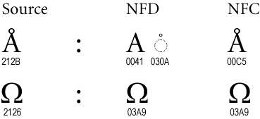
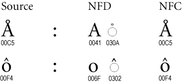
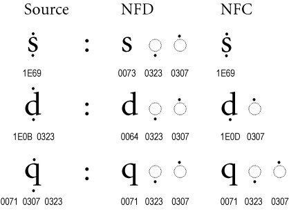
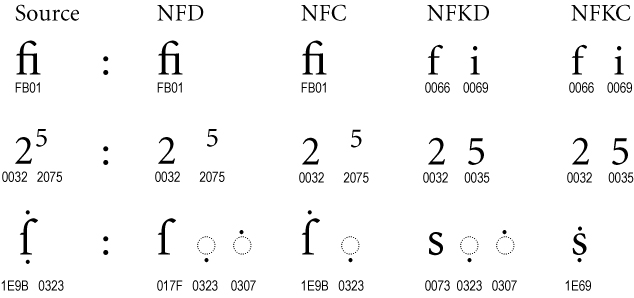

# 1.2 Normalization Forms

Source: [UAX #15: Unicode Normalization Forms](https://www.unicode.org/reports/tr15/tr15-57.html) · Unicode 17.0.0, revision 57.

[Document index](../README.md) · [Topic guide](../../../../../README.md) · [Publisher](https://www.unicode.org/versions/Unicode17.0.0/).

HTML normalized to Markdown. Complex tables and mathematical markup retain HTML; illustrations are stored locally.

[Previous](002-1-1-canonical-and-compatibility-equivalence.md) · [Next](004-1-3-description-of-the-normalization-process.md)

### 1.2  [Normalization Forms](003-1-2-normalization-forms.md#Norm_Forms)

Unicode Normalization Forms are formally defined normalizations
of Unicode strings which make it possible to determine whether any two Unicode strings are
equivalent to each other. Depending on the particular Unicode Normalization Form, that
equivalence can either be a canonical equivalence or a compatibility equivalence.

Essentially, the Unicode Normalization Algorithm puts all
combining marks in a specified order, and uses rules for decomposition and composition to
transform each string into one of the Unicode Normalization Forms. A binary comparison of
the transformed strings will then determine equivalence.

The four
Unicode Normalization Forms are summarized in *Table 1.*

Table 1. [Normalization Forms](003-1-2-normalization-forms.md#Normalization_Forms_Table)

| Form | Description |
| --- | --- |
| Normalization Form D (NFD) | Canonical Decomposition |
| Normalization Form C (NFC) | Canonical Decomposition,  followed by Canonical Composition |
| Normalization Form KD (NFKD) | Compatibility Decomposition |
| Normalization Form KC (NFKC) | Compatibility Decomposition,  followed by Canonical Composition |

There are two forms of normalization that convert to
composite characters: *Normalization Form C* and *Normalization Form KC*. The difference between
these depends on whether the resulting text is to be a *canonical* equivalent to the original
unnormalized text or a *compatibility* equivalent to the original unnormalized
text. (In *NFKC* and *NFKD,* a *K* is used to stand for *compatibility* to
avoid confusion with the *C* standing for *composition*.) Both types of normalization
can be useful in different circumstances.

*Figures 3* through *6* illustrate different ways in which source text can be normalized. In the first three figures, the NFKD form is always the same as the NFD form, and the NFKC form is always
the same as the NFC form, so for simplicity those columns are omitted. Examples like these can
be found in many scripts.

Figure 3. [Singletons](003-1-2-normalization-forms.md#Singletons_Figure)

Certain characters are known as singletons. They never remain in the text after normalization. Examples
include the *angstrom* and *ohm* symbols, which map to their normal letter
counterparts *a-with-ring* and *omega*, respectively.

Figure 4. [Canonical Composites](003-1-2-normalization-forms.md#Canonical_Composites_Figure)

Many characters are known as canonical
composites, or precomposed characters. In the D forms, they are decomposed; in the C forms, they are *usually*
precomposed. (For exceptions, see
*Section 5, [Composition Exclusion Table](006-5-composition-exclusion.md#Primary_Exclusion_List_Table)*.)

Normalization provides a unique order
for combining marks, with a uniform order for all D and C forms. Even when there is no precomposed character, as with
the “q” with accents in *Figure 5*, the ordering may be modified by
normalization.

Figure 5. [Multiple Combining Marks](003-1-2-normalization-forms.md#Multiple_Mark_Figure)

The
example of the letter “d” with accents shows a situation where a precomposed character
plus another accent changes in NF(K)C to
a *different* precomposed character plus a different accent.

Figure 6. [Compatibility Composites](003-1-2-normalization-forms.md#Compatibility_Composite_Figure)

In the NFKC and NFKD forms, many
formatting distinctions are removed, as shown in *Figure 6*. The “fi”
ligature changes into its components “f” and “i”, the superscript formatting
is removed from the “5”, and the long “s” is changed into a normal “s”.

Normalization Form KC does *not* attempt to map character sequences to
compatibility composites. For example, a compatibility composition of “office” does *not*
produce “o\uFB03ce”, even though “\uFB03” is a character that is the
compatibility equivalent of the sequence of three characters “ffi”. In other
words, the composition phase of NFC and NFKC are the same—only their
decomposition phase differs, with NFKC applying compatibility
decompositions.

Normalization Form C uses canonical composite characters where possible, and maintains the
distinction between characters that are compatibility equivalents. Typical strings of composite
accented Unicode characters are already in Normalization Form C. Implementations of Unicode
that
restrict themselves to a repertoire containing no combining marks are already typically
using Normalization Form C. (Implementations need to be aware of
versioning issues—see *Section 3, [Versioning and Stability](005-3-versioning-and-stability.md#Versioning)*.)

The *W3C Character Model for the World Wide Web 1.0: Normalization*
[[CharNorm](https://www.unicode.org/reports/tr41/tr41-36.html#CharNorm)] and other W3C Specifications
(such as XML 1.0 5th Edition) recommend using
Normalization Form C for all content, because this form
avoids potential interoperability problems arising from the use of canonically
equivalent, yet different, character sequences in document formats on the Web.
See the *W3C Character Model for the Word Wide Web: String Matching and
Searching* [[CharMatch](https://www.unicode.org/reports/tr41/tr41-36.html#CharMatch)] for more background.

Normalization Form KC additionally folds the differences between compatibility-equivalent
characters that are inappropriately distinguished in many circumstances. For example, the
halfwidth and fullwidth *katakana* characters will normalize to the same strings, as will
Roman numerals and their letter equivalents. More complete examples are provided in
*Section 6,
[Examples and Charts](007-5-2-composition-exclusion-data-files.md#Examples)*.

Normalization Forms KC and KD must *not* be blindly applied to arbitrary text. Because
they erase many formatting distinctions, they will prevent round-trip conversion to and from many
legacy character sets, and unless supplanted by formatting markup, they may remove distinctions that
are important to the semantics of the text. It is best to think of these
Normalization Forms as
being like uppercase or lowercase mappings: useful in certain contexts for identifying core
meanings, but also performing modifications to the text that may not always be appropriate. They
can be applied more freely to domains with restricted character sets.
(See Unicode Standard Annex #31, "Unicode Identifiers and Syntax"
[[UAX31](https://www.unicode.org/reports/tr41/tr41-36.html#UAX31)] for examples.)

To summarize the treatment of compatibility composites that were in the source text:

- Both NFD and NFC maintain compatibility composites.
- Neither NFKD nor NFKC maintains compatibility composites.
- None of the forms *generate* compatibility composites that were not in the source text.

For a list of all characters that may change in any of the Normalization
Forms (aside from
reordering), see the Normalization Charts [[Charts15](https://www.unicode.org/reports/tr41/tr41-36.html#Charts15)].

