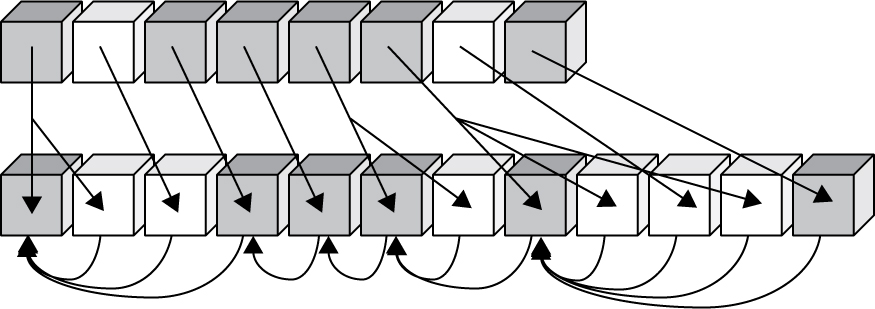

# 1.3 Description of the Normalization Process

Source: [UAX #15: Unicode Normalization Forms](https://www.unicode.org/reports/tr15/tr15-57.html) · Unicode 17.0.0, revision 57.

[Document index](../README.md) · [Topic guide](../../../../../README.md) · [Publisher](https://www.unicode.org/versions/Unicode17.0.0/).

HTML normalized to Markdown. Complex tables and mathematical markup retain HTML; illustrations are stored locally.

[Previous](003-1-2-normalization-forms.md) · [Next](005-3-versioning-and-stability.md)

### 1.3  [Description of the Normalization Process](004-1-3-description-of-the-normalization-process.md#Description_Norm)

This section provides a short summary of
how the Unicode Normalization Algorithm works.

To transform a Unicode string into a given Unicode Normalization Form,
the first step is to fully decompose the string. The decomposition process makes use of the Decomposition\_Mapping
property values defined in UnicodeData.txt. There are also special rules to fully decompose
Hangul syllables. Full decomposition involves recursive application of the Decomposition\_Mapping
values, because in some cases a complex composite character may have a Decomposition\_Mapping into
a sequence of characters, one of which may also have its own non-trivial Decomposition\_Mapping value.

The type of full decomposition chosen depends on which Unicode Normalization
Form is involved. For NFC or NFD, one does a full *canonical* decomposition, which makes use
of only canonical Decomposition\_Mapping values. For NFKC or NFKD, one does a full *compatibility*
decomposition, which makes use of canonical *and* compatibility Decomposition\_Mapping values.

Once a string has been fully decomposed, any sequences of combining marks
that it contains are put into a well-defined order. This rearrangement of combining marks is done
according to a subpart of the Unicode Normalization Algorithm known as the Canonical Ordering
Algorithm. That algorithm sorts sequences of combining marks based on the value of their
Canonical\_Combining\_Class (ccc) property, whose values are also defined in UnicodeData.txt.
Most characters (including all non-combining marks) have a Canonical\_Combining\_Class value of
zero, and are unaffected by the Canonical Ordering Algorithm. Such characters are referred to by a
special term, *starter*. Only the subset of combining
marks which have non-zero Canonical\_Combining\_Class property values are subject to potential
reordering by the Canonical Ordering Algorithm. Those characters are called *non-starters*.

At this point, if one is transforming a Unicode string to NFD or NFKD,
the process is complete. However, one additional step is needed to transform the string to NFC or NFKC:
recomposition. The fully decomposed and canonically ordered string is processed by another
subpart of the Unicode Normalization Algorithm known as the Canonical Composition Algorithm.
That process logically starts at the front of the string and systematically checks it for
pairs of characters which meet certain criteria and for which there is a canonically equivalent
composite character in the standard. Each appropriate pair of characters which meet the
criteria is replaced by the composite character, until the string contains no further such
pairs. This transforms the fully decomposed string into its most
fully *composed* but still canonically equivalent sequence.

*Figure 7* shows a sample of
how the composition process works. The gray cubes represent starters, and the
white cubes represent
non-starters. In the first step, the string is fully decomposed and canonically reordered.
This is represented by the downwards arrows. In the second
step, each character is checked against the last non-starter and starter, and
combined if all the appropriate conditions are met. This is represented by the
curved arrows pointing to the starters. Note that in each case, all of the successive white
boxes (non-starters) are examined *plus* one additional gray box (starter). *Examples* are provided in *Section
6, [Examples and Charts](007-5-2-composition-exclusion-data-files.md#Examples)*.

Figure 7. [Composition Process](004-1-3-description-of-the-normalization-process.md#Composition_Process_Figure)

Taken step-by-step, the Unicode Normalization Algorithm is
fairly complex. However, it is designed in such a way that it enables very efficient,
highly-optimized implementations. For example, checking whether a Unicode string is in
NFC is a very quick process, and since much text is already in NFC, an implementation that
normalizes strings to NFC mostly consists of quick verification checks, with only
very occasional modifications of any pieces which are not already in NFC. See *Section 9,
[Detecting Normalization Forms](008-7-design-goals.md#Detecting_Normalization_Forms)*.

> Note:
> Text exclusively containing ASCII characters (U+0000..U+007F) is left unaffected by all of the Normalization Forms. This is
> particularly important for programming languages. (See Unicode Standard Annex #31, "Unicode Identifiers and Syntax"
> [[UAX31](https://www.unicode.org/reports/tr41/tr41-36.html#UAX31)].)
> Text exclusively containing
> Latin-1 characters (U+0000..U+00FF) is left unaffected by NFC. This is effectively
> the same as saying that all Latin-1 text is *already* normalized to NFC.

The complete formal specification of the Unicode Normalization
Algorithm and of the Unicode Normalization Forms can be found in *Section 3.11, Normalization Forms* in
[[Unicode](https://www.unicode.org/reports/tr41/tr41-36.html#Unicode)]. See that section for all of the
formal definitions and for the details of the exact formulation of each step in the
algorithm.

### 1.4  [Concatenation of Normalized Strings](004-1-3-description-of-the-normalization-process.md#Concatenation)

In using normalization functions, it is important to realize that *none* of
the Normalization Forms are closed under string concatenation. That is, even if two strings
X and Y are normalized, their string concatenation X+Y is *not* guaranteed to be normalized.
This even happens in NFD, because accents are canonically ordered, and may rearrange around the
point where the strings are joined. Consider the string concatenation examples shown in *Table 2*.

Table 2. [String Concatenation](004-1-3-description-of-the-normalization-process.md#Concatenation_Table)

| Form | String1 | String2 | Concatenation | Correct Normalization |
| --- | --- | --- | --- | --- |
| NFD | a ◌̂ | ◌̣ | a ◌̂ ◌̣ | a ◌̣ ◌̂ |
| NFC | a | ◌̂ | a ◌̂ | â |
| NFC | ᄀ | ᅡ ᆨ | ᄀ ᅡ ᆨ | 각 |

However, it is possible to produce an optimized function that concatenates two normalized
strings and *does* guarantee that the result is normalized. Internally,
it only needs to normalize characters around the boundary of where the
original strings were joined, within stable code points. For more
information, see *Section 9.1, [Stable Code
Points](009-9-1-stable-code-points.md#Stable_Code_Points).*

In contrast to their behavior under
string concatenation, all of the Normalization Forms *are* closed under substringing. For
example, given a substring of a normalized string X, from offsets 5 to 10,
the resulting string will still be normalized.

## 2  [Notation](004-1-3-description-of-the-normalization-process.md#Notation)

*Table 3* lists examples of the notational conventions used in this
annex.

Table 3. [Notational Conventions](004-1-3-description-of-the-normalization-process.md#Notation_Example_Table)

<table class="subtle">
<tr>
<th>Example Notation</th>
<th>Description</th>
</tr>
<tr>
<td>"...\uXXXX..."</td>
<td>The Unicode character U+XXXX embedded within a string</td>
</tr>
<tr>
<td>ki, am, and kf</td>
<td>Conjoining jamo types (initial, medial, final) represented by subscripts</td>
</tr>
<tr>
<td>NFx</td>
<td>Any Unicode Normalization Form: NFD, NFKD, NFC, 
		or NFKC</td>
</tr>
<tr>
<td><i>toNFx(s)</i> </td>
<td>A function that produces the the normalized form of a string s 
        according to the definition of Unicode 
        Normalization Form X</td>
</tr>
<tr>
<td><i>isNFx(s)</i></td>
<td>A binary property of a string s, 
		whereby: 
<blockquote>
		isNFx(s) is true if and only if toNFX(s) is identical to s. 
</blockquote>
		See also <i>Section 9,  
		<a href="008-7-design-goals.md#Detecting_Normalization_Forms">Detecting Normalization Forms</a></i>.</td>
</tr>
<tr>
<td>X ≈ Y</td>
<td>X is canonically equivalent to Y</td>
</tr>
<tr>
<td>X[<i>i</i>, <i>j</i>]</td>
<td>The substring of X that includes all code units after offset <i>i</i> 
        and before offset <i>j</i>; 
		for 
      example, if X is “abc”, then X[1,2] is “b”</td>
</tr>
</table>

Additional conventions used in this annex:

1. A sequence of characters may be represented by using plus signs between the character names
   or by using string notation.
2. An *offset into a Unicode string* is a number from 0 to *n*, where *n* is the
   length of the string and indicates a position that is logically between Unicode code units (or
   at the very front or end in the case of 0 or *n*, respectively).
3. Unicode names may be shortened, as shown in *Table 4.*

Table 4. [Character Abbreviation](004-1-3-description-of-the-normalization-process.md#Abbreviation_Table)

| Abbreviation | Full Unicode Name |
| --- | --- |
| *E-grave* | LATIN CAPITAL LETTER E WITH GRAVE |
| *ka* | KATAKANA LETTER KA |
| *hw\_ka* | HALFWIDTH KATAKANA LETTER KA |
| *ten* | COMBINING KATAKANA-HIRAGANA VOICED SOUND MARK |
| *hw\_ten* | HALFWIDTH KATAKANA VOICED SOUND MARK |

