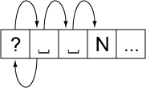

# 6 Implementation Notes

Source: [UAX #29: Unicode Text Segmentation](https://www.unicode.org/reports/tr29/tr29-47.html) · Unicode 17.0.0, revision 47.

[Document index](../README.md) · [Topic guide](../../../../../README.md) · [Publisher](https://www.unicode.org/versions/Unicode17.0.0/).

HTML normalized to Markdown. Complex tables and mathematical markup retain HTML; illustrations are stored locally.

[Previous](010-continuation-10.md) · [Next](012-6-5-tailoring.md)

## 6  [Implementation Notes](011-6-implementation-notes.md#Implementation_Notes)

### 6.1  [Normalization](011-6-implementation-notes.md#Normalization)

The boundary specifications are stated in terms of text normalized
according to Normalization Form NFD (see Unicode Standard Annex #15,
“Unicode Normalization Forms” [[UAX15](https://www.unicode.org/reports/tr41/tr41-36.html#UAX15)]). In practice,
normalization of the input is not required. To ensure that the same
results are returned for canonically equivalent text (that is, the
same boundary positions will be found, although those may be
represented by different offsets), the grapheme cluster boundary
specification has the following features:

- There is never a break within a sequence of nonspacing
  marks.
- There is never a break between a base character and
  subsequent nonspacing marks.

The specification also avoids certain problems by explicitly
assigning the Extend property value to certain characters, such as
U+09BE ( া ) BENGALI VOWEL SIGN AA, to deal with particular
compositions.

The other default boundary specifications never break within
grapheme clusters, and they always use a consistent property value
for each grapheme cluster as a whole.

### 6.2  [Replacing Ignore Rules](011-6-implementation-notes.md#Grapheme_Cluster_and_Format_Rules)

An important rule for the default word and sentence
specifications ignores Extend and Format characters. The main purpose
of this rule is to always treat a grapheme cluster as a single
character—that is, to not break a single grapheme cluster across two higher-level segments. For
example, both word and sentence specifications do not distinguish
between L, V, T, LV, and LVT: thus it does not matter whether there
is a sequence of these or a single one. Format
characters are also ignored by default, because these characters are
normally irrelevant to such boundaries.

The “Ignore” rule is then equivalent to making the following
changes in the rules:

<table class="simple">
<tr>
<td class="lightgray" colspan="3"><i>Replace the “Ignore”
						rule by the following, to disallow breaks within sequences (except
						after CRLF and related characters):</i></td>
</tr>
<tr>
<th style="text-align: right">Original</th>
<th style="text-align: center"> </th>
<th>Modified</th>
</tr>
<tr>
<td style="text-align: right">X (Extend | Format)*→X</td>
<td style="text-align: center">⇒</td>
<td>(¬Sep) × <u>(Extend | Format)</u></td>
</tr>
<tr>
<td class="lightgray" colspan="3"><i>In all subsequent
						rules, insert (Extend | Format)* after every boundary property
						value, except in negations (such as ¬(OLetter | Upper ...). (It is
						not necessary to do this after the final property, on the right
						side of the break symbol.) For example:</i></td>
</tr>
<tr>
<th style="text-align: right">Original</th>
<th style="text-align: center"> </th>
<th>Modified</th>
</tr>
<tr>
<td style="text-align: right">X Y × Z W</td>
<td style="text-align: center">⇒</td>
<td>X <u>(Extend | Format)*</u> Y <u>(Extend | Format)*</u> × Z
					<u>(Extend | Format)*</u> W
				</td>
</tr>
<tr>
<td style="text-align: right">X Y ×</td>
<td style="text-align: center">⇒</td>
<td>X <u>(Extend | Format)*</u> Y <u>(Extend | Format)*</u> ×
				</td>
</tr>
<tr>
<td class="lightgray" colspan="3"><i>An alternate
						expression that resolves to a single character is treated as a
						whole. For example:</i></td>
</tr>
<tr>
<th style="text-align: right">Original</th>
<th style="text-align: center"> </th>
<th>Modified</th>
</tr>
<tr>
<td style="text-align: right">(STerm | ATerm)</td>
<td style="text-align: center">⇒</td>
<td>(STerm | ATerm) <u>(Extend | Format)*</u></td>
</tr>
<tr>
<td class="lightgray" colspan="3"><i>This is <b>not</b>
						interpreted as:
				</i></td>
</tr>
<tr>
<td style="text-align: right"> </td>
<td style="text-align: center">⇏</td>
<td>(STerm <u>(Extend | Format)*</u> | ATerm <u>(Extend |
						Format)*</u>)
				</td>
</tr>
</table>

> **Note:** Where the “Ignore” rule uses
> a different set, such as (Extend | Format | ZWJ) instead of
> (Extend | Format), the corresponding changes would be made in
> the above replacements.

The “Ignore” rules should not be overridden by tailorings, with
the possible exception of remapping some of the Format characters to
other classes.

### 6.3  [State Machines](011-6-implementation-notes.md#State_Machines)

The rules for grapheme clusters can be easily converted into a regular
expression, as in *Table
1b, [Combining Character Sequences and Grapheme Clusters](004-3-1-default-grapheme-cluster-boundary-specification.md#Table_Combining_Char_Sequences_and_Grapheme_Clusters)*. It must be evaluated starting at a known boundary
(such as the start of the text), and it will determine the next
boundary position. The resulting regular expression can also be used to generate
fast, deterministic finite-state machines that will recognize all the
same boundaries that the rules do.

The conversion into a regular expression is very straightforward for
grapheme cluster boundaries. It is not as easy to convert the word
and sentence boundaries, nor the more complex line boundaries [[UAX14](https://www.unicode.org/reports/tr41/tr41-36.html#UAX14)].
However, it is possible to also convert their rules into fast,
deterministic finite-state machines that will recognize all the same
boundaries that the rules do. The implementation of text segmentation in the ICU library follows that strategy.

For more information on Unicode Regular Expressions, see Unicode
Technical Standard #18, “Unicode Regular Expressions” [[UTS18](https://www.unicode.org/reports/tr41/tr41-36.html#UTS18)].

### 6.4  [Random Access](011-6-implementation-notes.md#Random_Access)

Random access introduces a further complication. When iterating
through a string from beginning to end, a regular expression or state
machine works well. From each boundary to find the next boundary is
very fast. By constructing a state table for the reverse direction
from the same specification of the rules, reverse iteration is
possible.

However, suppose that the user wants to iterate starting at a
random point in the text, or detect whether a random point in the
text is a boundary. If the starting point does not provide enough
context to allow the correct set of rules to be applied, then one
could fail to find a valid boundary point. For example, suppose a
user clicked after the first space after the question mark in
“Are␣you␣there?␣ ␣No,␣I’m␣not”. On a forward iteration
searching for a sentence boundary, one would fail to find the
boundary before the “N”, because the “?” had not been seen yet.

A second set of rules to determine a “safe” starting point
provides a solution. Iterate backward with this second set of rules
until a safe starting point is located, then iterate forward from
there. Iterate forward to find boundaries that were located between
the safe point and the starting point; discard these. The desired
boundary is the first one that is not less than the starting point.
The safe rules must be designed so that they function correctly no
matter what the starting point is, so they have to be conservative in
terms of finding boundaries, and only find those boundaries that can
be determined by a small context (a few neighboring characters).

Figure 5. [Random
Access](011-6-implementation-notes.md#Figure_Random_Access)

This process would represent a significant performance cost if
it had to be performed on every search. However, this functionality
can be wrapped up in an iterator object, which preserves the
information regarding whether it currently is at a valid boundary
point. Only if it is reset to an arbitrary location in the text is
this extra backup processing performed. The iterator may even cache
local values that it has already traversed.

