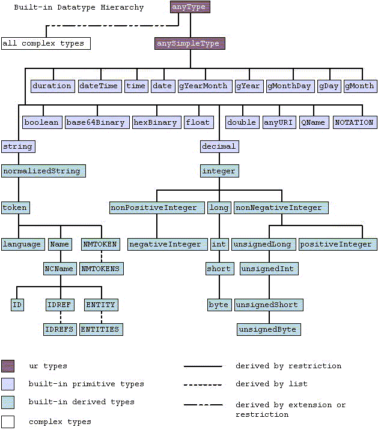

# 2.5.2.3 Derived by union

Source: [XML Schema Part 2: Datatypes](https://www.w3.org/TR/2004/REC-xmlschema-2-20041028/) · 2nd edition, 2004-10-28.

[Document index](../README.md) · [Topic guide](../../../../README.md) · [Publisher](https://www.w3.org/TR/2004/REC-xmlschema-2-20041028/).

HTML normalized to Markdown. Complex tables and mathematical markup retain HTML; illustrations are stored locally.

[Previous](005-2-5-1-3-union-datatypes.md) · [Next](007-3-2-3-1-lexical-representation.md)

A [·list·](004-2-3-lexical-space.md#dt-list) datatype can be [·derived·](005-2-5-1-3-union-datatypes.md#dt-derived)
from another datatype (its [·itemType·](004-2-3-lexical-space.md#dt-itemType)) by creating
a [·value space·](003-1-4-terminology.md#dt-value-space) that consists of a finite-length sequence
of values of its [·itemType·](004-2-3-lexical-space.md#dt-itemType).

##### 2.5.2.3 Derived by union

One datatype can be [·derived·](005-2-5-1-3-union-datatypes.md#dt-derived) from one or more
datatypes by [·union·](004-2-3-lexical-space.md#dt-union)ing their [·value space·](003-1-4-terminology.md#dt-value-space)s
and, consequently, their [·lexical space·](004-2-3-lexical-space.md#dt-lexical-space)s.

#### 2.5.3 Built-in vs. user-derived datatypes

- [Definition:]**Built-in**
  datatypes are those which are defined in this specification,
  and can be either [·primitive·](005-2-5-1-3-union-datatypes.md#dt-primitive) or
  [·derived·](005-2-5-1-3-union-datatypes.md#dt-derived);

- [Definition:]
  **User-derived** datatypes are those [·derived·](005-2-5-1-3-union-datatypes.md#dt-derived)
  datatypes that are defined by individual schema designers.

Conceptually there is no difference between the
[·built-in·](006-2-5-2-3-derived-by-union.md#dt-built-in) [·derived·](005-2-5-1-3-union-datatypes.md#dt-derived) datatypes
included in this specification and the [·user-derived·](006-2-5-2-3-derived-by-union.md#dt-user-derived)
datatypes which will be created by individual schema designers.
The [·built-in·](006-2-5-2-3-derived-by-union.md#dt-built-in) [·derived·](005-2-5-1-3-union-datatypes.md#dt-derived) datatypes
are those which are believed to be so common that if they were not
defined in this specification many schema designers would end up
"reinventing" them. Furthermore, including these
[·derived·](005-2-5-1-3-union-datatypes.md#dt-derived) datatypes in this specification serves to
demonstrate the mechanics and utility of the datatype generation
facilities of this specification.

**Note:**
A datatype which is [·built-in·](006-2-5-2-3-derived-by-union.md#dt-built-in) in this specification
need not be a "built-in" datatype in any programming language used
to implement this specification. Likewise, a datatype which is
[·user-derived·](006-2-5-2-3-derived-by-union.md#dt-user-derived) in this specification need not
be a "user-derived" datatype in any programming language used to
implement this specification.

## 3 Built-in datatypes

Each built-in datatype in this specification (both
[·primitive·](005-2-5-1-3-union-datatypes.md#dt-primitive) and
[·derived·](005-2-5-1-3-union-datatypes.md#dt-derived)) can be uniquely addressed via a
URI Reference constructed as follows:

1. the base URI is the URI of the XML Schema namespace
2. the fragment identifier is the name of the datatype

For example, to address the [int](016-3-3-16-long.md#int) datatype, the URI is:

- `http://www.w3.org/2001/XMLSchema#int`

Additionally, each facet definition element can be uniquely
addressed via a URI constructed as follows:

1. the base URI is the URI of the XML Schema namespace
2. the fragment identifier is the name of the facet

For example, to address the maxInclusive facet, the URI is:

- `http://www.w3.org/2001/XMLSchema#maxInclusive`

Additionally, each facet usage in a built-in datatype definition
can be uniquely addressed via a URI constructed as follows:

1. the base URI is the URI of the XML Schema namespace
2. the fragment identifier is the name of the datatype, followed
   by a period (".") followed by the name of the facet

For example, to address the usage of the maxInclusive facet in
the definition of int, the URI is:

- `http://www.w3.org/2001/XMLSchema#int.maxInclusive`

### 3.1 Namespace considerations

The [·built-in·](006-2-5-2-3-derived-by-union.md#dt-built-in) datatypes defined by this specification
are designed to be used with the XML Schema definition language as well as other
XML specifications.
To facilitate usage within the XML Schema definition language, the [·built-in·](006-2-5-2-3-derived-by-union.md#dt-built-in)
datatypes in this specification have the namespace name:

- http://www.w3.org/2001/XMLSchema

To facilitate usage in specifications other than the XML Schema definition language,
such as those that do not want to know anything about aspects of the
XML Schema definition language other than the datatypes, each [·built-in·](006-2-5-2-3-derived-by-union.md#dt-built-in)
datatype is also defined in the namespace whose URI is:

- http://www.w3.org/2001/XMLSchema-datatypes

This applies to both
[·built-in·](006-2-5-2-3-derived-by-union.md#dt-built-in) [·primitive·](005-2-5-1-3-union-datatypes.md#dt-primitive) and
[·built-in·](006-2-5-2-3-derived-by-union.md#dt-built-in) [·derived·](005-2-5-1-3-union-datatypes.md#dt-derived) datatypes.

Each [·user-derived·](006-2-5-2-3-derived-by-union.md#dt-user-derived) datatype is also associated with a
unique namespace. However, [·user-derived·](006-2-5-2-3-derived-by-union.md#dt-user-derived) datatypes
do not come from the namespace defined by this specification; rather,
they come from the namespace of the schema in which they are defined
(see [XML Representation of
Schemas](https://www.w3.org/TR/2004/REC-xmlschema-1-20041028/structures.html#declare-schema) in [[XML Schema Part 1: Structures]](044-h-references.md#structural-schemas)).

### 3.2 Primitive datatypes

3.2.1 [string](006-2-5-2-3-derived-by-union.md#string)  
        3.2.2 [boolean](006-2-5-2-3-derived-by-union.md#boolean)  
        3.2.3 [decimal](006-2-5-2-3-derived-by-union.md#decimal)  
        3.2.4 [float](007-3-2-3-1-lexical-representation.md#float)  
        3.2.5 [double](007-3-2-3-1-lexical-representation.md#double)  
        3.2.6 [duration](008-3-2-5-1-lexical-representation.md#duration)  
        3.2.7 [dateTime](009-3-2-6-3-facet-comparison-for-durations.md#dateTime)  
        3.2.8 [time](010-3-2-7-5-totally-ordered-datetimes.md#time)  
        3.2.9 [date](010-3-2-7-5-totally-ordered-datetimes.md#date)  
        3.2.10 [gYearMonth](010-3-2-7-5-totally-ordered-datetimes.md#gYearMonth)  
        3.2.11 [gYear](011-3-2-10-1-lexical-representation.md#gYear)  
        3.2.12 [gMonthDay](011-3-2-10-1-lexical-representation.md#gMonthDay)  
        3.2.13 [gDay](011-3-2-10-1-lexical-representation.md#gDay)  
        3.2.14 [gMonth](011-3-2-10-1-lexical-representation.md#gMonth)  
        3.2.15 [hexBinary](012-3-2-15-hexbinary.md#hexBinary)  
        3.2.16 [base64Binary](012-3-2-15-hexbinary.md#base64Binary)  
        3.2.17 [anyURI](012-3-2-15-hexbinary.md#anyURI)  
        3.2.18 [QName](012-3-2-15-hexbinary.md#QName)  
        3.2.19 [NOTATION](013-3-2-19-notation.md#NOTATION)

The [·primitive·](005-2-5-1-3-union-datatypes.md#dt-primitive) datatypes defined by this specification
are described below. For each datatype, the
[·value space·](003-1-4-terminology.md#dt-value-space) and [·lexical space·](004-2-3-lexical-space.md#dt-lexical-space)
are defined, [·constraining facet·](004-2-3-lexical-space.md#dt-constraining-facet)s which apply
to the datatype are listed and any datatypes [·derived·](005-2-5-1-3-union-datatypes.md#dt-derived)
from this datatype are specified.

[·primitive·](005-2-5-1-3-union-datatypes.md#dt-primitive) datatypes can only be added by revisions
to this specification.

#### 3.2.1 string

[Definition:]The **string** datatype
represents character strings in XML. The [·value space·](003-1-4-terminology.md#dt-value-space)
of **string** is the set of finite-length sequences of
[character](https://www.w3.org/TR/2000/WD-xml-2e-20000814#dt-character)s (as defined in
[[XML 1.0 (Second Edition)]](044-h-references.md#XML)) that [·match·](003-1-4-terminology.md#dt-match) the
[Char](https://www.w3.org/TR/2000/WD-xml-2e-20000814#NT-Char) production from [[XML 1.0 (Second Edition)]](044-h-references.md#XML).
A [character](https://www.w3.org/TR/2000/WD-xml-2e-20000814#dt-character) is an atomic unit of
communication; it is not further specified except to note that every
[character](https://www.w3.org/TR/2000/WD-xml-2e-20000814#dt-character) has a corresponding
Universal Character Set code point, which is an integer.

**Note:**
Many human languages have writing systems that require
child elements for control of aspects such as bidirectional formating or
ruby annotation (see [[Ruby]](044-h-references.md#ruby) and Section 8.2.4
[Overriding the
bidirectional algorithm: the BDO element](https://www.w3.org/TR/1999/REC-html401-19991224/struct/dirlang.html#h-8.2.4) of [[HTML 4.01]](044-h-references.md#html4)).
Thus, **string**, as a simple type that can contain only
characters but not child elements, is often not suitable for representing text.
In such situations, a complex type that allows mixed content should be considered.
For more information, see Section 5.5
[Any Element, Any Attribute](https://www.w3.org/TR/2001/REC-xmlschema-0-20010502/#textType)
of [[XML Schema Language: Part 0 Primer]](044-h-references.md#schema-primer).

**Note:**
As noted in [ordered](022-4-1-6-simple-type-definition-for-anysimpletype.md#dc-ordered), the fact that this specification does
not specify an [·order-relation·](022-4-1-6-simple-type-definition-for-anysimpletype.md#dt-order-relation) for [·string·](006-2-5-2-3-derived-by-union.md#dt-string)
does not preclude other applications from treating strings as being ordered.

##### 3.2.1.1 Constraining facets

**string** has the
following [·constraining facets·](004-2-3-lexical-space.md#dt-constraining-facet):

- [length](024-4-2-5-numeric.md#rf-length)
- [minLength](025-4-3-1-4-constraints-on-length-schema-components.md#rf-minLength)
- [maxLength](026-4-3-3-maxlength.md#rf-maxLength)
- [pattern](026-4-3-3-maxlength.md#rf-pattern)
- [enumeration](027-4-3-4-3-constraints-on-xml-representation-of-pattern.md#rf-enumeration)
- [whiteSpace](027-4-3-4-3-constraints-on-xml-representation-of-pattern.md#rf-whiteSpace)

##### 3.2.1.2 Derived datatypes

The following [·built-in·](006-2-5-2-3-derived-by-union.md#dt-built-in)
datatypes are [·derived·](005-2-5-1-3-union-datatypes.md#dt-derived) from
**string**:

- [normalizedString](013-3-2-19-notation.md#normalizedString)

#### 3.2.2 boolean

[Definition:]**boolean** has the
[·value space·](003-1-4-terminology.md#dt-value-space) required to support the mathematical
concept of binary-valued logic: {true, false}.

##### 3.2.2.1 Lexical representation

An instance of a datatype that is defined as [·boolean·](006-2-5-2-3-derived-by-union.md#dt-boolean)
can have the following legal literals {true, false, 1, 0}.

##### 3.2.2.2 Canonical representation

The canonical representation for **boolean** is the set of
literals {true, false}.

##### 3.2.2.3 Constraining facets

**boolean** has the
following [·constraining facets·](004-2-3-lexical-space.md#dt-constraining-facet):

- [pattern](026-4-3-3-maxlength.md#rf-pattern)
- [whiteSpace](027-4-3-4-3-constraints-on-xml-representation-of-pattern.md#rf-whiteSpace)

#### 3.2.3 decimal

