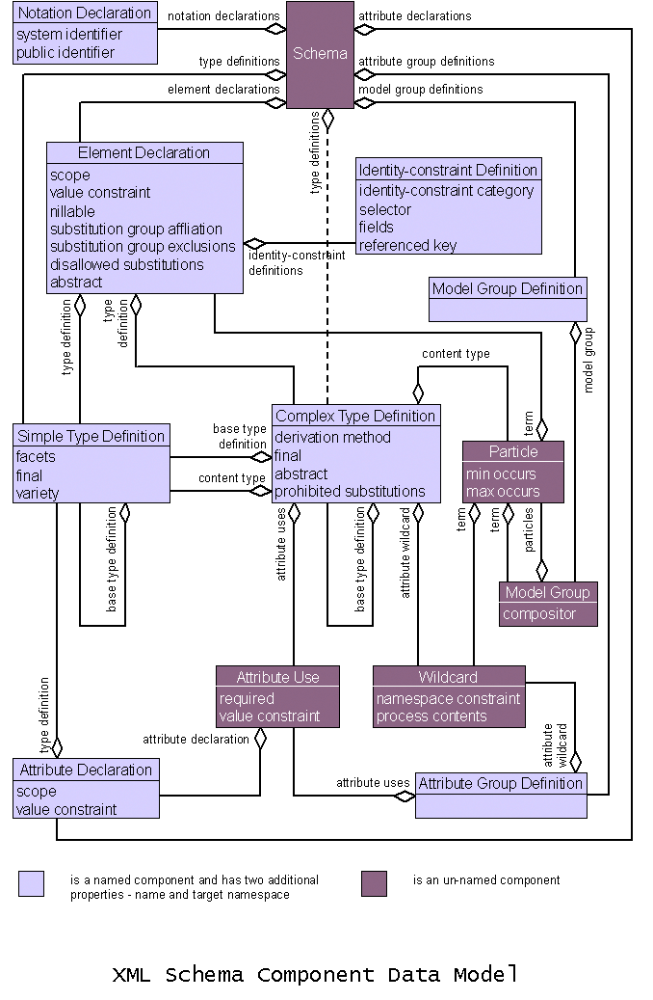

# D Required Information Set Items and Properties (normative)

Source: [XML Schema Part 1: Structures](https://www.w3.org/TR/2004/REC-xmlschema-1-20041028/) · 2nd edition, 2004-10-28.

[Document index](../README.md) · [Topic guide](../../../../README.md) · [Publisher](https://www.w3.org/TR/2004/REC-xmlschema-1-20041028/).

HTML normalized to Markdown. Complex tables and mathematical markup retain HTML; illustrations are stored locally.

[Previous](062-c-4-schema-component-constraints.md) · [Next](064-continuation-64.md)

## D Required Information Set Items and Properties (normative)

This specification requires as a precondition for [·assessment·](004-2-1-overview-of-xml-schema.md#key-va) an information set as defined in [[XML-Infoset]](060-b-references-normative.md#ref-xmlinfo) which supports at least the following information items and properties:

Attribute Information Item
:   [[local name]](https://www.w3.org/TR/xml-infoset/#infoitem.attribute), [[namespace name]](https://www.w3.org/TR/xml-infoset/#infoitem.attribute),
    [[normalized value]](https://www.w3.org/TR/xml-infoset/#infoitem.attribute)

Character Information Item
:   [[character code]](https://www.w3.org/TR/xml-infoset/#infoitem.character)

Element Information Item
:   [[local name]](https://www.w3.org/TR/xml-infoset/#infoitem.element), [[namespace name]](https://www.w3.org/TR/xml-infoset/#infoitem.element),
    [[children]](https://www.w3.org/TR/xml-infoset/#infoitem.element), [[attributes]](https://www.w3.org/TR/xml-infoset/#infoitem.element), [[in-scope namespaces]](https://www.w3.org/TR/xml-infoset/#infoitem.element) or
    [[namespace attributes]](https://www.w3.org/TR/xml-infoset/#infoitem.element)

Namespace Information Item
:   [[prefix]](https://www.w3.org/TR/xml-infoset/#infoitem.namespace), [[namespace name]](https://www.w3.org/TR/xml-infoset/#infoitem.namespace)

In addition, infosets should support the [[unparsedEntities]](https://www.w3.org/TR/xml-infoset/#infoitem.document) property of the Document Information Item. Failure to do so will mean all items of type [ENTITY](https://www.w3.org/TR/2004/REC-xmlschema-2-20041028/datatypes.html#ENTITY) or [ENTITIES](https://www.w3.org/TR/2004/REC-xmlschema-2-20041028/datatypes.html#ENTITIES) will fail to [·validate·](004-2-1-overview-of-xml-schema.md#key-vn).

This specification does not require any destructive alterations to the input
information set: all the information set contributions specified herein are additive.

This appendix is intended to satisfy the requirements for [Conformance](https://www.w3.org/TR/2001/WD-xml-infoset-20010316/#conformance) to the [[XML-Infoset]](060-b-references-normative.md#ref-xmlinfo) specification.

## E Schema Components Diagram (non-normative)

## F Glossary (non-normative)

The listing below is for the benefit of readers of a printed version of this
document: it collects together all the definitions which appear in the
document above.

[absent](008-3-schema-component-details.md#key-null)
:   Throughout this specification, the
    term **absent** is used as a distinguished property value denoting absence

[actual value](008-3-schema-component-details.md#key-vv)
:   The
    phrase **actual value** is used to refer to the member of the value space of the
    simple type definition associated with an attribute information item which corresponds to
    its [·normalized value·](008-3-schema-component-details.md#key-nv)

[assessment](004-2-1-overview-of-xml-schema.md#key-va)
:   the word **assessment** is used to refer
    to the overall process of
    local validation, schema-validity assessment and infoset augmentation

[base type definition](004-2-1-overview-of-xml-schema.md#key-baseTypeDefinition)
:   A type definition used as the
    basis for an [·extension·](004-2-1-overview-of-xml-schema.md#key-typeExtension) or
    [·restriction·](004-2-1-overview-of-xml-schema.md#key-typeRestriction) is known as
    the **base type definition** of that definition

[component name](004-2-1-overview-of-xml-schema.md#key-compName)
:   Declarations and
    definitions may have and be identified by **name**s, which are NCNames as defined by [[XML-Namespaces]](060-b-references-normative.md#ref-xml-namespaces)

[conformance to the XML Representation of Schemas](006-2-3-constraints-and-validation-rules.md#key-interchange)
:   [·Minimally conforming·](006-2-3-constraints-and-validation-rules.md#key-minimallyConforming) processors which accept
    schemas represented in the form of XML documents as described in [Layer 2: Schema Documents, Namespaces and Composition (§4.2)](052-4-schemas-and-namespaces-access-and-composition.md#layer2) are
    additionally said to provide **conformance to the XML Representation of Schemas**.

[content model](005-2-2-1-3-complex-type-definition.md#key-contentModel)
:   A particle can
    be used in a complex type definition to constrain the [·validation·](004-2-1-overview-of-xml-schema.md#key-vn)
    of the [[children]](https://www.w3.org/TR/xml-infoset/#infoitem.element) of an element information item; such a particle is called
    a **content model**

[context-determined declaration](011-3-2-4-attribute-declaration-validation-rules.md#key-dd)
:   During [·validation·](004-2-1-overview-of-xml-schema.md#key-vn), associations
    between element and attribute information items among the [[children]](https://www.w3.org/TR/xml-infoset/#infoitem.element)
    and [[attributes]](https://www.w3.org/TR/xml-infoset/#infoitem.element) on the one hand, and element and attribute
    declarations on the other, are established as a side-effect. Such
    declarations are called the **context-determined declarations**

[declaration](004-2-1-overview-of-xml-schema.md#key-declaration)
:   **declaration** components are associated by
    (qualified) name to information items being [·validated·](004-2-1-overview-of-xml-schema.md#key-vn)

[declared entity name](047-3-14-3-constraints-on-xml-representations-of-simple-type-definitions.md#key-vde)
:   A string is a **declared entity name** if it is equal to the [[name]](https://www.w3.org/TR/xml-infoset/#infoitem.entity.unparsed) of some unparsed entity
    information item in the value of the
    [[unparsedEntities]](https://www.w3.org/TR/xml-infoset/#infoitem.document) property of the document information item
    at the root of the infoset containing the element or attribute information item
    whose [·normalized value·](008-3-schema-component-details.md#key-nv) the string is.

[definition](004-2-1-overview-of-xml-schema.md#key-definition)
:   **definition** components define
    internal schema components that can be used in other schema components

[element substitution group](005-2-2-1-3-complex-type-definition.md#key-equivalenceClass)
:   Through
    the new mechanism of **element substitution groups**, XML Schemas provides a more powerful model supporting substitution of one named element for another

[extension](004-2-1-overview-of-xml-schema.md#key-typeExtension)
:   A complex type definition
    which allows element or attribute content in addition to that allowed by
    another specified type
    definition is said to be an **extension**

[final](020-3-4-complex-type-definitions.md#key-ct-final)
:   the complex type is said to be
    **final**, because no
    further derivations are possible

[fully conforming](006-2-3-constraints-and-validation-rules.md#key-fullyConforming)
:   **Fully conforming**
    processors are network-enabled processors which are not only both [·minimally conforming·](006-2-3-constraints-and-validation-rules.md#key-minimallyConforming) and [·in conformance to the XML Representation of Schemas·](006-2-3-constraints-and-validation-rules.md#key-interchange), but which additionally must be capable of accessing
    schema documents from the World Wide Web according to [Representation of Schemas on the World Wide Web (§2.7)](007-2-5-names-and-symbol-spaces.md#web-representation) and [How schema definitions are located on the Web (§4.3.2)](056-4-3-layer-3-schema-document-access-and-web-interoperability.md#schema-loc).

[implicitly contains](034-3-8-5-model-group-information-set-contributions.md#key-impl-cont)
:   A list
    of particles **implicitly contains** an element declaration if a
    member of the list contains that
    element declaration in its [·substitution group·](019-continuation-19.md#key-eq)

[initial value](008-3-schema-component-details.md#key-iv)
:   the
    **initial value** of some
    attribute information item is the value of the
    [[normalized
    value]](https://www.w3.org/TR/xml-infoset/#infoitem.attribute) property of that item. Similarly, the **initial value** of an element information item is the string composed of, in order, the
    [[character code]](https://www.w3.org/TR/xml-infoset/#infoitem.character) of each character information item in the [[children]](https://www.w3.org/TR/xml-infoset/#infoitem.element) of that
    element information item

[item isomorphic to a component](051-3-15-5-schema-information-set-contributions.md#key-iso)
:   by an **item isomorphic** to a component is meant an information item whose type is equivalent to the component's, with one property per property of the component, with the same name, and value either the same atomic value, or an information item corresponding in the same way to its component value, recursively, as necessary

[laxly assessed](017-3-3-5-element-declaration-information-set-contributions.md#key-lva)
:   an element information item's
    schema validity may be **laxly assessed** if its [·context-determined declaration·](011-3-2-4-attribute-declaration-validation-rules.md#key-dd) is not *skip* by [·validating·](004-2-1-overview-of-xml-schema.md#key-vn) with respect to the [·ur-type definition·](029-3-4-7-built-in-complex-type-definition.md#ur-type-itself) as per [Element Locally Valid (Type) (§3.3.4)](016-3-3-3-constraints-on-xml-representations-of-element-declarations.md#cvc-type)

[minimally conforming](006-2-3-constraints-and-validation-rules.md#key-minimallyConforming)
:   **Minimally conforming** processors must completely and
    correctly implement the [·Schema Component
    Constraints·](006-2-3-constraints-and-validation-rules.md#gloss-cos), [·Validation Rules·](006-2-3-constraints-and-validation-rules.md#gloss-cvc),
    and [·Schema Information
    Set Contributions·](006-2-3-constraints-and-validation-rules.md#gloss-sic) contained in this specification

[NCName](050-3-15-2-1-references-to-schema-components.md#gloss-NCName)
:   An **NCName** is a name
    with no colon, as defined in [[XML-Namespaces]](060-b-references-normative.md#ref-xml-namespaces). When used in connection with the XML
    representation of schema components in this specification, this refers to the
    simple type [NCName](https://www.w3.org/TR/2004/REC-xmlschema-2-20041028/datatypes.html#NCName) as defined in [[XML Schemas: Datatypes]](060-b-references-normative.md#ref-xsp2)

[normalized value](008-3-schema-component-details.md#key-nv)
:   The
    **normalized value** of an element or
    attribute information item is an [·initial value·](008-3-schema-component-details.md#key-iv) whose white space, if any, has been
    normalized according to the value of the [whiteSpace facet](https://www.w3.org/TR/2004/REC-xmlschema-2-20041028/datatypes.html#rf-whiteSpace) of the
    simple type definition used in its [·validation·](004-2-1-overview-of-xml-schema.md#key-vn):

[partition](034-3-8-5-model-group-information-set-contributions.md#key-partition)
:   Define a
    **partition** of a sequence as a sequence of sub-sequences, some or
    all of which may be empty, such that concatenating all the sub-sequences yields
    the original sequence

[post-schema-validation infoset](004-2-1-overview-of-xml-schema.md#key-psvi)
:   We refer to the augmented infoset which results from conformant processing as defined in this specification as the **post-schema-validation infoset**, or PSVI

[QName](050-3-15-2-1-references-to-schema-components.md#gloss-QName)
:   A **QName** is a name
    with an optional namespace qualification, as defined in [[XML-Namespaces]](060-b-references-normative.md#ref-xml-namespaces). When used in connection with the XML
    representation of schema components or references to them, this refers to the
    simple type [QName](https://www.w3.org/TR/2004/REC-xmlschema-2-20041028/datatypes.html#QName) as defined in [[XML Schemas: Datatypes]](060-b-references-normative.md#ref-xsp2)

[resolve](050-3-15-2-1-references-to-schema-components.md#key-resolve)
:   Whenever the word **resolve** in any form is used in this
    chapter in connection with a [·QName·](050-3-15-2-1-references-to-schema-components.md#gloss-QName) in a
    schema document, the
    following definition [QName resolution (Schema Document) (§3.15.3)](050-3-15-2-1-references-to-schema-components.md#src-resolve) should be understood

[restriction](004-2-1-overview-of-xml-schema.md#key-typeRestriction)
:   A type
    definition whose
    declarations or facets are in a one-to-one relation with those of another
    specified type
    definition, with each in turn restricting the possibilities of the one it
    corresponds to, is said to be a **restriction**

[schema component](004-2-1-overview-of-xml-schema.md#key-component)
:   **Schema component** is the generic term for the building blocks that comprise the abstract data model of the schema.

